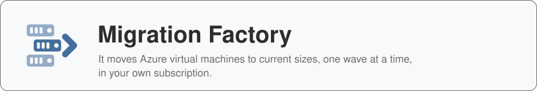
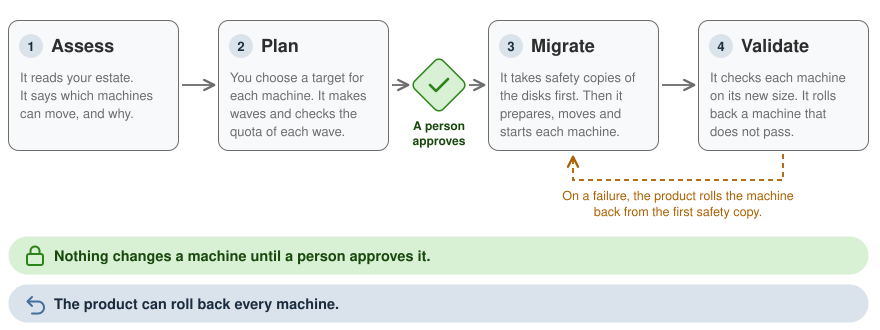

<p align="center">
<picture>
  <source media="(prefers-color-scheme: dark)" srcset="docs/images/readme/banner-dark.svg">
  
</picture>
</p>

Microsoft retires older Azure virtual machine sizes on dates that it announces, and the v6 and
v7 sizes run on its newest hardware. Each machine that moves to a newer size must be assessed,
given a target size and quota, stopped, moved, and checked again. A move to v6 or v7 also
changes the disk controller from SCSI to NVMe, and the operating system must be ready for that
first.

Migration Factory does this work as a production line, inside your own Azure subscription:

<picture>
  <source media="(prefers-color-scheme: dark)" srcset="docs/images/readme/phases-dark.svg">
  
</picture>

## Support matrix (summary)

<picture>
  <source media="(prefers-color-scheme: dark)" srcset="docs/images/readme/routes-dark.svg">
  
</picture>

You choose the target for each machine in the **Choose each target** step. The product shows
only the targets that machine can take. A move to v6 or v7 changes the disk controller from SCSI to NVMe.
A move to v5, or to Bsv2 for a B v1 machine, is a resize on SCSI. A machine keeps its processor maker.

| Machine generation | v5 (and Bsv2 for a B v1 machine) | v6 and v7 |
|---|---|---|
| Generation 2 | Supported | Supported |
| Generation 1 | Supported | Not supported |

| Operating system | v5 (and Bsv2 for a B v1 machine) | v6 and v7 |
|---|---|---|
| Windows Server 2019 and later | Supported | Supported |
| Windows Server 2016 | Supported | Not supported |
| Windows Server older than 2016 | Not supported | Not supported |
| Windows client (Windows 10 and Windows 11) | Not supported | Not supported |
| Linux | A distribution that Microsoft publishes or endorses | The same, on a release that Microsoft lists for NVMe, from an image that supports NVMe |

On Linux, a release that Microsoft does not list for MANA gets no v6, v7, Bsv2 or Intel v5 size.

**[The full support matrix](docs/manual/reference/support-matrix.md)** lists every source size,
target series, Windows version and Linux image. Each row gives the reason and the Microsoft page.

---

## Where to go

Start here, then go to the manual. **[The manual](docs/manual/README.md) is the product's
documentation** — 48 pages, written for an operator rather than a developer. The app serves
the same files.

| You want to | Start at |
|---|---|
| Understand whether this fits your estate | [Support matrix (summary)](#support-matrix-summary) above, then [What this product does](docs/manual/understand/what-it-does.md), the [full support matrix](docs/manual/reference/support-matrix.md) and [Limits](docs/manual/reference/limits.md) |
| Install it | [Install](#install) below — what you need and what it costs, then the manual's step-by-step |
| Run a migration | [The whole journey](docs/manual/journey/the-whole-journey.md) — one migration from nothing to finished |
| Fix something that stopped | [When a machine stops](docs/manual/use/when-a-machine-stops.md) and [Why a machine stopped](docs/manual/reference/stop-reasons.md) |
| Work on the product itself | [CONTRIBUTING.md](CONTRIBUTING.md): how to report a problem, and the checks |

---

## Scope

The product moves standalone IaaS virtual machines that run a server operating system. The
sizes, generations and operating systems it supports are in the
[support matrix](#support-matrix-summary).

<picture>
  <source media="(prefers-color-scheme: dark)" srcset="docs/images/readme/scope-dark.svg">
  
</picture>

[Machines the product does not move](docs/manual/reference/support-matrix.md#machines-the-product-does-not-move)
gives the reason and what to do for each one.

**Some checks stay with you.** Some come before the move and one comes after it, and Azure
makes some decisions. [What stays yours](docs/manual/reference/before-a-machine-moves.md#what-stays-yours)
lists each one with what to do.

---

## Install

<picture>
  <source media="(prefers-color-scheme: dark)" srcset="docs/images/readme/install-dark.svg">
  
</picture>

About 20 minutes. Everything goes into one new resource group in your subscription.

### What you need

**An account** with the **Owner** role on the subscription. The install creates the resource
group and two custom roles in the subscription, and it gives roles, which is why it needs Owner. The account must also be able to create
application registrations in your Entra directory.

**A region** that offers Azure Container Apps with workload profiles. The install checks
before it creates anything.

**Four tools.** Docker is not one of them — the product's image is built in your own
registry, in the cloud.

| Tool | Where |
|---|---|
| Azure CLI 2.61 or later | https://aka.ms/installazurecli |
| Azure Developer CLI | https://aka.ms/azd-install |
| PowerShell 7 | https://aka.ms/powershell |
| Git | https://git-scm.com/downloads |

The install adds the `containerapp` extension of the Azure CLI if it is not installed.

### What it creates, and what it costs

In the resource group:

- a storage account, which is the run store
- a container registry, and a Container Apps environment with two jobs
- a function app for the service, and a web app for the dashboard
- Log Analytics and Application Insights
- three managed identities. The product gets permission over machines only from your answer
  to the install's question, or from the Admin page
- a network security perimeter around the run store

Outside it: two Entra application registrations, and two custom roles. The roles hold
exactly the operations the product performs. A removal of the product keeps the two roles.

It creates no virtual machine, and it touches none of yours.

Azure bills the registry, the storage and the logs while the platform is idle. The job that
does the work bills only while it runs. See [Costs](docs/manual/reference/costs.md).

### The commands

```console
az login
az account set --subscription "<your subscription>"
azd auth login
git clone https://github.com/chrislittle/Migration-Factory.git
cd Migration-Factory
azd up
```

`azd up` asks two questions: the hosting plan for the dashboard and the service, and what the
product may do with the machines in your subscription. If you hold no role that can give admin
consent, it also asks if you stop or continue. [The choices you make first](docs/manual/install/choices.md)
explains each one, and each answer can be changed later. A person runs every update: get a newer copy
of the source, then run `azd up` again.

Read [Before you install](docs/manual/install/before-you-install.md) first, and follow
[Install step by step](docs/manual/install/step-by-step.md) for every command with what you
see at each one.

### Then

The install leaves a product that holds the permission over machines that you chose, and
nobody but you can sign in. [After the install](docs/manual/install/after-install.md) gives the
next two steps, both on the Admin page.

To update it: [Update the product](docs/manual/install/update.md). To remove it:
[Remove the product](docs/manual/install/remove.md).

---

## The manual, two ways to read it

One set of markdown files. There is no second copy that can disagree with it.

| Where | How |
|---|---|
| **On GitHub** | Browse [`docs/manual/`](docs/manual/README.md) — the contents list links every chapter |
| **In the app** | Open the dashboard, select **Get help**, then **Read the manual** |

The contents list is generated from the app's navigation by
[`tools/Update-VmfManualToc.ps1`](tools/Update-VmfManualToc.ps1). A test fails when the two
disagree, so one cannot go out of step with the other.

---

## Documentation map

| Document | What it covers |
|---|---|
| [The manual](docs/manual/README.md) | The product, for operators: install, use, reference, and a worked migration |
| [Architecture](docs/manual/technical/architecture.md) | How the parts fit together |
| [Security](docs/manual/technical/security.md) | Identities, what holds which permission, and why there are no secrets |
| [The run store](docs/manual/technical/run-store.md) | The one piece of shared state, and who may read it |
| [The install, inside](docs/manual/technical/install-internals.md) | What each install step actually does |
| [What the product may do in Azure](docs/manual/reference/permissions.md) | Generated from the product's own permission map |
| [Security policy](SECURITY.md) | How to report a security problem privately |

---

## Working on the product

[CONTRIBUTING.md](CONTRIBUTING.md) tells you how to report a problem and how a change gets
into the product. Run every check with `./tools/Invoke-VmfTests.ps1` before you call a change
done.

To report a problem or to ask for a change, open an issue. This repository does not accept
pull requests from outside contributors yet.

---
## Version

Version **0.9.1**. See [Releases](https://github.com/chrislittle/Migration-Factory/releases)
for what each one changed.

---

## Licence

[Apache License 2.0](LICENSE). Copyright 2026 Chris Little.

You may use, change and share this product, including inside a business. Keep the licence
and the copyright notice with it, and say what you changed if you share a changed version.

**It comes with no warranty.** This product stops and resizes virtual machines.
Read [What this product does](docs/manual/understand/what-it-does.md) and
[Checks before a machine moves](docs/manual/reference/before-a-machine-moves.md), and prove
it on a small wave first.
