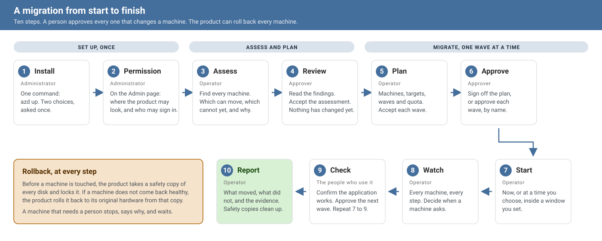

# Migration Factory manual

Migration Factory moves Azure virtual machines from older sizes to current sizes, in waves, with a safety copy of each machine.

## What the product moves

| | Size series |
|---|---|
| From | The A v2, B v1, D, Dl, E and F families, v1 to v5, Intel and AMD, Generation 1 and Generation 2. |
| To | D, Dl and E on v5, v6 and v7. Bsv2 for a B v1 machine. A machine keeps its processor maker. A machine on an F, Fs or Fsv2 size gets an Intel D, Dl or E size. |
| Outside the scope of this tool | Machines that a platform manages (AKS, AVD and scale set members), machines on an Azure Dedicated Host or with hibernation enabled, confidential VMs, Arm, GPU, HPC, FPGA, storage optimized, G and GS sizes, and machines with more than 32 data disks. |

## Why the v6 and v7 sizes

Azure sells virtual machines in size series, such as v4, v5 and v6. The v6 and v7 series run on the newest hardware Microsoft offers. The v6 sizes run on Intel Emerald Rapids and AMD Genoa processors. The v7 sizes run on Intel Xeon 6 and AMD Turin processors. All of them carry Azure Boost, which moves storage and network work off the machine's own processors onto dedicated hardware.

What changes for a machine that moves to v6 or v7:

- **Disks.** Disks connect over NVMe instead of SCSI.
- **Network.** Accelerated networking can use the Microsoft Azure Network Adapter (MANA) in place of the Mellanox adapter.
- **Lifecycle.** Microsoft puts v6 and v7 in its Current lifecycle stage. It retires older size series on dates that it announces.

The product also moves machines to v5. A move to v5 is a resize that keeps the SCSI disk controller, so it changes the least. v5 takes Generation 1 machines and Windows Server 2016, which v6 and v7 do not. See **When to choose v5** in [What this product does](understand/what-it-does.md).

## Why a resize is not enough

Microsoft's own guidance is to treat a move to v6 or v7 as a planned upgrade, not as a blind resize from an older family. Four things change at the platform level. Each one needs a preparation step inside or around the machine:

| What changes | What it needs |
|---|---|
| Disks connect over NVMe | The operating system must have its NVMe driver ready before the move. A machine without it starts and cannot find its own disks. |
| The temporary disk is different | On the v6 and v7 sizes it arrives empty at every start, or is not there at all. Anything that depends on it must be moved or prepared. |
| A Windows machine on a size with a SCSI temporary disk cannot be resized to v6 or v7 without a preview feature | Azure refuses the request unless the subscription has the preview feature VMTempDiskResizePreview registered. With it, the product upgrades the machine in place, as the same machine. |
| v6 and v7 need Generation 2 | A Generation 1 machine can move to v5, or to Bsv2 from B v1. Both take Generation 1 with a resize. When no such size fits it, the machine is outside the scope of this tool. |

A move to v5 is a resize on SCSI, so the NVMe row does not apply to it. For a machine with a temporary disk, the product looks first for a v5 size that has one too.

## What the Migration Factory is

The Migration Factory does that work for you, at the scale of an estate. It follows the four phases Microsoft recommends, and adds what an operations team needs around them:

- **Assess.** It finds every machine you allow it to see. It says which can move, which need preparation, and which cannot move yet. Each answer comes with the reason and the fix.
- **Plan.** You choose the size series for each machine, and the product chooses the size in that series. It groups machines into waves you control, verifies the quota, and names any size the region restricts.
- **Migrate.** It moves one wave at a time: safety copy, preparation, shutdown, move, start, checks. Several machines at once. Every step recorded.
- **Validate.** It verifies every machine on its new size, and rolls back any machine that does not pass.

Two rules shape everything. **Nothing changes a machine until a person approves it.** **The product can roll back every machine**, from a safety copy taken before anything was touched.

It runs inside your own Azure subscription, from a web page called the dashboard. The product sends no record outside your subscription. See [Where it runs](understand/what-it-does.md#where-it-runs).

## The journey in one picture

## Where to get help

Every page of the dashboard has a **Get help** menu. It explains the page you are on, opens this manual, and lets you report a problem with the details already filled in.

## Contents

<!-- contents:start - written by tools/Update-VmfManualToc.ps1 -->

### Understand

- [What this product does](understand/what-it-does.md)
- [Disclaimer](understand/disclaimer.md)
- [How a machine moves](understand/how-a-machine-moves.md)
- [Safety copies and rollback](understand/safety-copies.md)
- [Who does what](understand/roles.md)
- [Words used in this manual](understand/words.md)

### Install

- [Before you install](install/before-you-install.md)
- [The choices you make first](install/choices.md)
- [Install step by step](install/step-by-step.md)
- [After the install](install/after-install.md)
- [Update the product](install/update.md)
- [Remove the product](install/remove.md)
- [If the install fails](install/if-it-fails.md)

### Use the dashboard

- [Sign in and find your way](use/sign-in.md)
- [The Overview page](use/overview.md)
- [Projects](use/projects.md)
- [Assess an estate](use/assess.md)
- [Read an assessment](use/read-an-assessment.md)
- [Plan a migration](use/plan.md)
- [Arrange the waves](use/waves.md)
- [Choose how a wave runs](use/wave-settings.md)
- [Capacity and quota](use/capacity.md)
- [Start a migration](use/start.md)
- [The Migrations page](use/migrations.md)
- [Watch a migration](use/watch.md)
- [When a machine stops](use/when-a-machine-stops.md)
- [Restore a machine](use/put-back.md)
- [Finish a migration](use/finish.md)
- [Reports](use/reports.md)
- [The Admin page](use/admin.md)
- [Get help](use/get-help.md)

### A migration from start to finish

- [The whole journey](journey/the-whole-journey.md)

### Reference

- [Support matrix](reference/support-matrix.md)
- [What an assessment can find](reference/assessment-findings.md)
- [Checks before a machine moves](reference/before-a-machine-moves.md)
- [Why a machine stopped](reference/stop-reasons.md)
- [Wave settings](reference/wave-settings.md)
- [Limits](reference/limits.md)
- [What the product may do in Azure](reference/permissions.md)
- [Costs](reference/costs.md)

### Technical

- [Architecture](technical/architecture.md)
- [How a machine moves, in detail](technical/machine-state-machine.md)
- [The run store](technical/run-store.md)
- [The perimeter around the run store](technical/the-perimeter.md)
- [Security](technical/security.md)
- [Security and permissions questions](technical/security-faq.md)
- [Scale](technical/scale.md)
- [The install, inside](technical/install-internals.md)

<!-- contents:end -->

<!-- next:begin -->

---

**Next:** [What this product does](understand/what-it-does.md)

<!-- next:end -->
