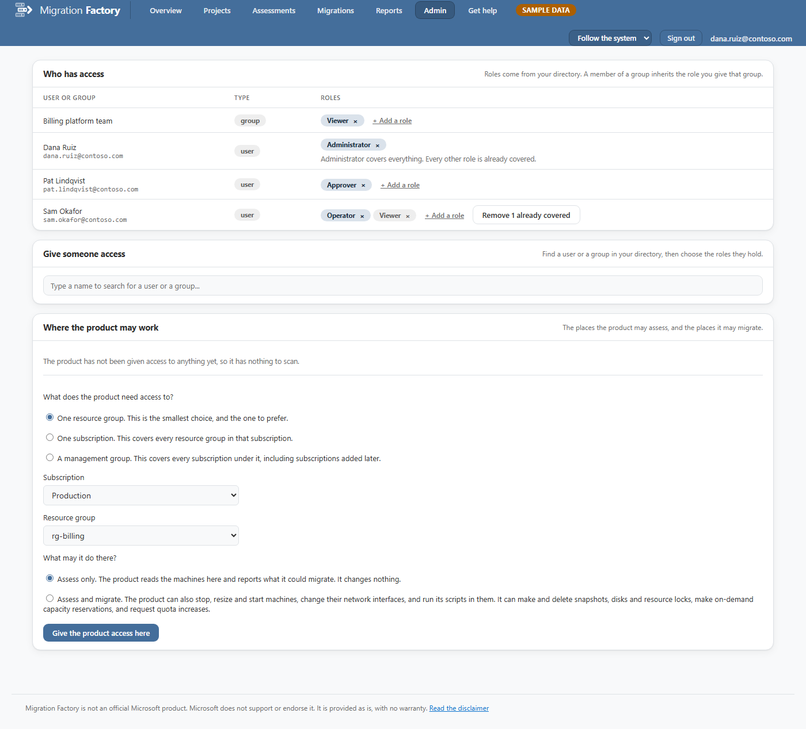

# After the install

The install ends with a dashboard you can sign in to. The product has the permission over machines that you chose in the install, and no other. Two things are yours to do, both on the Admin page, both as yourself.

**Step 1 needs nothing from your directory.** It gives the product access to more of your machines in Azure, and your own rights on the subscription are enough. Step 2 gives people roles, and that reads your directory, so a directory administrator must approve the product once. If yours has not, the Admin page says so and step 1 still works.

## What the install did to your account

- It gave your account the administrator role. That role can do everything the product does, so it is the only role the install gives. If an application identity runs the install, nobody gets the administrator role.
- It set the sign-in rule: from that moment a person needs a role to sign in at all, and nobody but you has one.

Nothing else in your directory changed.

## What the install did to your computer

- It read the Azure Developer CLI's setting for deployment-stack mode. If that mode is on, the install stops before it creates anything, and gives you the command to turn it off. **It does not change the setting.** That setting belongs to your computer and applies to your other projects.

Nothing else on your computer changed.

## Step 1: give the product permission to see your machines

The product has its own identity in Azure. The install asked **What may the product do with the machines in this subscription?** With the default answer, **Scan them, and migrate a machine after you approve a migration.**, the Admin page lists the subscription with **Assess and migrate**. If you answered **Nothing now**, or the install did not ask, the product may not look at any machine yet, and an assessment finds nothing. Give it access to each place that you want assessed.

1. Open the dashboard and sign in.
2. Select **Admin** in the top bar. The page looks like this:

   

   The picture shows the page with people already given a role. Your own page lists one account, yours, holding Administrator.

3. Find the card **Where the product may work**. It lists the places where the product may work.

   If there are none, it says **The product has not been given access to anything yet, so it has nothing to scan.**

4. Select **Connect to Azure** if the card asks for it. The dashboard needs your permission to act in Azure for you. That permission is separate from its permission for the directory. The browser goes to the Microsoft sign-in page and asks for your consent. Accept it to return to the Admin page.
5. Choose the level: a resource group, a subscription, or a management group. A resource group is the smallest choice and the one to prefer for the first time.
6. Choose the place from the list.
7. Under **What may it do there?**, choose **Assess only**. The product will read the machines there and report what could move. It changes nothing.
8. Select **Give the product access here**.

The card lists the place with the level and what the product may do there. The grant was made with your own rights, and the Azure activity log records that you made it.

Repeat for every place you want assessed. Later, when you are ready to migrate machines in a place, open this page again and give **Assess and migrate** there. Give it as narrowly as your estate allows.

If the page says your account cannot grant access in that subscription, you need the Owner or User Access Administrator role there. No identity of the product can assign roles.

### If your company does not let you approve the dashboard

Some directories let only an administrator approve a new application. In one of those, **Connect to Azure** answers **"Need admin approval"**, and you cannot go further on this page, whatever rights you hold in Azure.

**This is not about your rights on the subscription.** You can own it and still meet this. Your directory is answering a different question: may this application act for you at all?

Two ways forward.

**Ask an administrator to approve the product once.** If you hold a role that can give admin consent, the install asks to give it for you. Until your organization has admin consent, the install ends with a link for it. After that this page works for you and for everyone else, and nobody meets this again.

**Or let the install give the permission.** The install's question **What may the product do with the machines in this subscription?** gives it for the subscription that you install into, with no admin consent. To change your answer, see [Change one of the two choices](update.md#change-one-of-the-two-choices).

## Step 2: give other people access

Nobody but you can sign in yet.

1. On the Admin page, find the card **Give someone access**.
2. Type a name. The page searches your directory for people and groups.
3. Choose the person or the group.
4. Choose the roles. A viewer reads. An approver accepts assessments and approves waves. An operator accepts the settings of each wave, and starts and stops migrations. An administrator does all of that and manages access. See [Who does what](../understand/roles.md).
5. Select **Give access**.

The change takes effect the next time they sign in. The role is all they need. The service reads the migration records for them, so they see migrations and not an empty page.

Giving a role to a group gives it to every member, now and later.

## Step 3: assess an estate

Now the product can see machines and people can sign in. Continue with [Assess an estate](../use/assess.md), or follow [The whole journey](../journey/the-whole-journey.md) for a complete first migration.

<!-- next:begin -->

---

**Next:** [Update the product](update.md)

<!-- next:end -->
