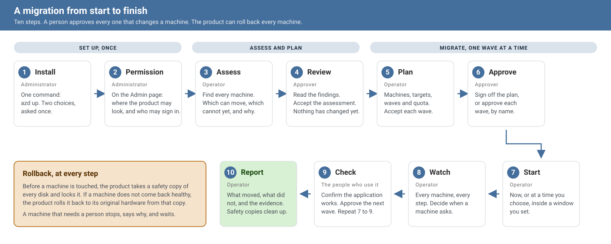

# The whole journey

This page follows one migration from start to finish. Follow it the first time you migrate real machines. Each step links to the page that explains it in full.

The example: a company named Contoso leaves an old datacentre. Its machines are in the subscription `Production`, in a resource group named `rg-billing`. Six machines: four Linux web servers, one Windows database server, one Windows report server. Three people take part. Dana is the administrator. Sam is the operator. Pat approves changes.

The steps below happen in this order. How long they take is up to you. The only waits that are not yours are named where they occur.

## Step 1: install

Dana installs the product. She reads [Before you install](../install/before-you-install.md) and [The choices you make first](../install/choices.md). She chooses the Free plan. For the machines, she chooses **Nothing now**, because she gives permission on the Admin page. She follows [Install step by step](../install/step-by-step.md). The install runs for about fifteen minutes. Then she opens the dashboard address and signs in.

## Step 2: give the product permission, and give people access

Dana opens the Admin page. Under **Where the product may work** she gives the product **Assess only** on the subscription `Production`. Under **Give someone access** she gives Sam the operator role. She gives Pat the approver role. See [After the install](../install/after-install.md).

## Step 3: assess

Sam signs in. The Overview page shows **Start here**. He creates the project **Contoso datacentre exit**. He selects **New assessment** on it, chooses **Resource groups**, the subscription `Production` and the group `rg-billing`, names it `billing-first-look`, and selects **Start looking**. The assessment runs for about two minutes. Then the wizard shows six machines. See [Assess an estate](../use/assess.md).

## Step 4: read and accept

Pat opens the Assessments page and the report. Four machines can migrate now. One, the report server, has a system-assigned identity with a role on a key vault. Its move is the in-place upgrade (Preview), which keeps that identity. One, the old database server, was made from a Windows Server 2016 image. The report counts it under **Some targets only**: v6 and v7 need Windows Server 2019, and v5 takes Windows Server 2016. Pat writes a note, **database server to v5**, and selects **I have reviewed this**. See [Read an assessment](../use/read-an-assessment.md).

## Step 5: plan

Sam selects **Plan a migration** on the accepted assessment. In **Choose the machines**, he selects **Add the 6 machines shown**, then **Continue**. He keeps the default lifecycle stage, Current. Five machines start on v6. The database server starts on v5, the only series it can take. Sam saves the targets. He groups by resource group and sets the largest wave to 3. The wizard builds two waves and opens the wave editor, its step **Arrange the waves**. He renames the waves `web-pilot` and `web-report-db`, and moves the report server and the database server into the second wave. See [Plan a migration](../use/plan.md) and [Arrange the waves](../use/waves.md).

Still in the wave editor, Sam selects **Check the quota** on the card **Request a quota increase**. One check covers both waves. On `web-pilot`, the quota line ends with **The quota is enough for all waves.** On `web-report-db`, it ends with **Azure does not list the limit of this quota.** That is a known reporting gap for some v6 sizes, and the first machine of each size confirms the quota. Sam selects **Save the plan**, and the wizard goes to its last step, **Run it**. See [Capacity and quota](../use/capacity.md).

## Step 6: settings and approval

Dana opens the Admin page again and gives the product **Assess and migrate** on `rg-billing`, and nothing wider.

Sam opens the migration. On `web-pilot` he selects **Review & accept options**, reads the settings, and selects **Accept**. Pat selects **Approve** on `web-pilot` and writes **change 4471**. See [Choose how a wave runs](../use/wave-settings.md).

## Step 7: start

Sam selects **Start this wave**, chooses **At a time I choose**, picks 22:00 that evening, gives the window 120 minutes, and confirms. Sam and Pat check each wave before the next one starts, so they do not sign off the whole plan at once. See [Start a migration](../use/start.md).

## Step 8: watch the first wave

At 22:00 the wave starts on its own. Sam watches the migration's page. The wave settings say Standard, 15 machines at once, so all three machines move at once. Each one passes through Checking, Backing up, Preparing, Shutting down, Backing up, Moving, Starting up and Verifying. One machine takes about 20 minutes. After about 25 minutes all three show **Migrated**. See [Watch a migration](../use/watch.md).

## Step 9: check, then the second wave

The web team confirms the three servers work. Sam accepts the settings of `web-report-db`, and Pat approves it. Its subscription has the preview feature VMTempDiskResizePreview registered, so the report server takes the in-place upgrade (Preview). He starts the wave the same way. The database server moves to v5 in this wave, as a resize that keeps the SCSI disk controller.

The report server moves in place, as the same machine. It keeps its system-assigned identity, so its role assignment on the key vault stays. See [The in-place upgrade (Preview)](../use/plan.md#the-in-place-upgrade-preview).
One web server shows **Rolled back**: its network check failed after the move, and the product rolled it back to its original size. The panel says which check failed. Sam finds an old kernel and has it patched. He tries the machine again in the next window. It migrates. See [Restore a machine](../use/put-back.md).

## Step 10: finish and report

Every machine in both waves is migrated: five on v6, and the database server on v5. The product wrote the report when the last wave finished. Sam opens it from the Reports page and sends it to the datacentre programme. Pat reads the **Safety copies** card. The daily cleanup deletes each machine's copies seven days after the machine passed its checks. Sam updates the Terraform definitions of the six machines. See [Finish a migration](../use/finish.md) and [Reports](../use/reports.md).

## Later

The database server stays on v5. For v6, the database team upgrades Windows on it to Windows Server 2019. The product reads the version that a running machine reports, so the next assessment opens v6 to it.

<!-- next:begin -->

---

**Next:** [Support matrix](../reference/support-matrix.md)

<!-- next:end -->
