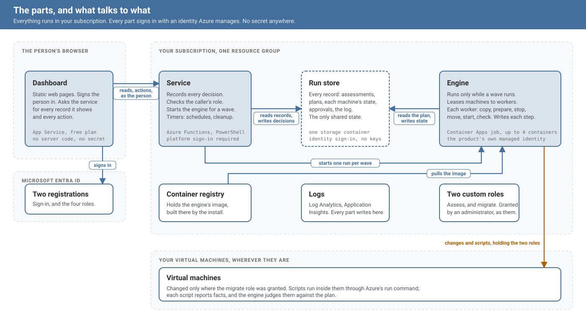
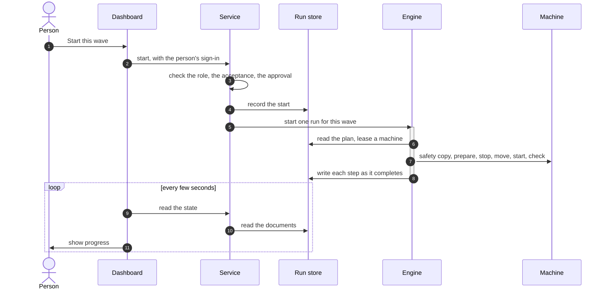

# Architecture

## The parts



**The dashboard** is a set of static web pages on an App Service. It holds no server code. It signs the person in with their work account. It asks the service for every read of the run store and for every action. A person who holds a role in this product sees every record, and a person who holds no role sees none.

**The service** is an Azure Functions app written in PowerShell. It is the only thing that writes decisions: an accepted assessment, an accepted set of wave settings, an approval, a start. It checks the person's role on every call. It starts the engine when a person starts a wave. The service has no right to change your machines, their disks or their safety copies, so every action that changes one runs in the engine. It also runs two timers. One starts scheduled waves and resumes stalled ones. The other finds expired safety copies and unused disks, and starts the engine to delete them.

**The engine** is a container job in Azure Container Apps. It runs only when the service starts it, once per operation. The main operations are an assessment, the target options for each machine, a plan, and a wave. Smaller ones restore a machine, reserve or release capacity, check or request quota, and delete expired safety copies. Another deletes a migration with its safety copies. After a wave or a restore, the engine writes the report and the migration record. The service starts the target options itself when an approver accepts an assessment. Inside, an orchestrator leases machines to worker processes, and each worker runs one machine through the steps. A wave above fifteen machines at once runs on more than one container. It stops when the operation ends.

**The run store** is a storage account. Every record lives there as a small document: what was found, what was planned, the state of each machine, every approval, and the log. It is the only shared state, and every other part talks through it. Each document has a schema and a format version.

**The container registry** holds the engine image and the publish image. The install builds both from the product's source in your subscription.

**The two application registrations** in your directory sign people in and guard the service. The service's registration carries the four roles: viewer, approver, operator, administrator.

**The two custom roles** in your subscription list exactly the operations the product performs: one set to assess, one set to migrate. An administrator grants them where the product may work, from the Admin page, as themselves.

## The one rule: contract first

No part passes live objects to another. Every hand-off is a document in the run store with a schema and a version. That lets the dashboard, the service and the engine change independently. It also lets a killed engine resume from the last document it wrote.

## One operation, end to end



## Where the guest scripts fit

The steps that run inside a machine are scripts that the engine sends through Azure's run command. Each script prints one record and nothing else. The engine judges the record against the plan. A guest script reports facts; it never decides.

## What talks to what

| From | To | How | As whom |
|---|---|---|---|
| Dashboard | Service | Reads records and calls for actions | The signed-in person |
| Dashboard | Azure and the directory | Reads and grants, on the Admin page | The signed-in person |
| Service | Run store | Reads for the dashboard, and writes | The service's own identity |
| Service | Engine | Starts | The service's own identity |
| Service | Application Insights | Sends its telemetry | The service's own identity |
| Service | Azure | Reads machines, places and features | The service's own identity, with VMF Assessment |
| Service | Container Apps environment | Reads the cores in use | The service's own identity, with Reader |
| Engine | Run store | Reads and writes | The product's identity |
| Publish job | Run store | Writes the program code of the service | The publish job's identity |
| Engine | Machines | Changes and scripts | The product's identity, with the two custom roles |

The engine and the publish job each have a user-assigned managed identity. The service has a system-assigned managed identity. Neither holds a secret.

## The service's call times

Each call to the service writes one line to Application Insights, in the `traces` table. The line holds `VMF-CALLS` and then the fields below. On an installation, the line starts with its level, `INFORMATION:`, so a query must find `VMF-CALLS` anywhere in the line. Its `operation_Id` is the same as the call's row in `requests`. So when a page or a timer pass is slow, the line shows where the time went.

| Field | What it holds |
|---|---|
| `ms` | The time of the whole call |
| `store` | The calls to the run store: the number, the total time, the longest time, and the failed calls |
| `token` | The time the service waited for a token for the run store. This time is part of the `store` time |
| `arm` | The calls to Azure Resource Manager, with the same four numbers |
| `other` | The time that is left. This is the service's own work |
| `ops` | The number, total time and longest time for each kind of call, for example `store read` or `store list`. `store read many` is the time of reads that the service sends together. The `store` total counts that time once |
| `slow` | The ten slowest calls that took one second or more, and the calls that failed |
| `partial` | `true` on a line that the service writes before the end of the call. The service writes one at the first run store or Azure Resource Manager call after four minutes, and one when a run store request waits 15 seconds or more with no answer |
| `held` | On a partial line for a run store request with no answer: the kind, the operation, the path, the attempt, and the time of that attempt. The service then sends the request again |

On the Free hosting choice, Azure Functions stops a call to the service after five minutes. An Azure Resource Manager request that gets no answer in 100 seconds stops. The service sends a run store request again when it gets no answer in 20 seconds. The request stops after 40 seconds with no answer. When the run store starts to answer, it has 100 seconds to send all of the answer. The line then shows it in `slow` as a failed call with no status, and the page shows an error. A call that the time limit stops writes no line at the end. Its partial lines show where the time went.

A run store call shows its path in the store. An Azure Resource Manager call shows its resource type, and `{}` replaces each name. The line never holds a token, a storage account name, a query string, or a subscription ID. A 404 from the run store is not a failure: it tells the page that a document does not exist yet.

The service makes no Microsoft Graph calls. The dashboard makes them in the browser, with the signed-in user's own token.

This query gives, for each function, the median and the 95th percentile of the store time and the Azure Resource Manager time:

```kusto
traces
| where message has "VMF-CALLS "
| extend j = parse_json(substring(message, indexof(message, "{")))
| where j.partial == false
| summarize calls = count(),
    storeP50 = percentile(toint(j.store.ms), 50), storeP95 = percentile(toint(j.store.ms), 95),
    armP50 = percentile(toint(j.arm.ms), 50), armP95 = percentile(toint(j.arm.ms), 95),
    otherP95 = percentile(toint(j.other), 95) by operation_Name
```

The workspace has a daily cap of 0.2 GB.

## The engine's call times

The engine job records the call times of each step of a machine in the activity log of the migration. It does not write a `VMF-CALLS` line. The workers of a wave write their console output to a file in the container, and not to Log Analytics.

The times are in the `calls` field of the line that ends an attempt of a step. That is the `ok` line, a `retry` line, or a `fail` line. The line also gives the machine and the step. The line that starts a step does not have the field.

| Field | What it holds |
|---|---|
| `ms` | The time of the attempt of the step |
| `store`, `token`, `arm` | The same numbers as on the service's line, for this attempt only. Each attempt of a step starts at zero |
| `other` | The time that is left. This is the engine's own work, and the time that it waits for Azure between calls |
| `ops` | The run store calls only, for each kind of call |
| `slow` | The ten slowest run store calls that took one second or more, and the run store calls that failed |

An Azure operation is not in `ops` or `slow`, because it has its own line in the activity log, with its time. Its step is `azureops:` and the name of the operation. The same rules as on the service's line keep a token, a storage account name and a query string out of the field.

The field adds about 400 bytes to a line, and at most about 2,300 bytes. A move of one machine writes about nine of these lines, and one more for each retry. The field adds no line to the activity log, and no data to the Log Analytics workspace. The migration record holds the same lines, in the activity of each machine.

Some work is not part of a step, so its calls have no times. That is a rollback, the return of a machine to its power state, and the work of a worker between two machines.

<!-- next:begin -->

---

**Next:** [How a machine moves, in detail](machine-state-machine.md)

<!-- next:end -->
