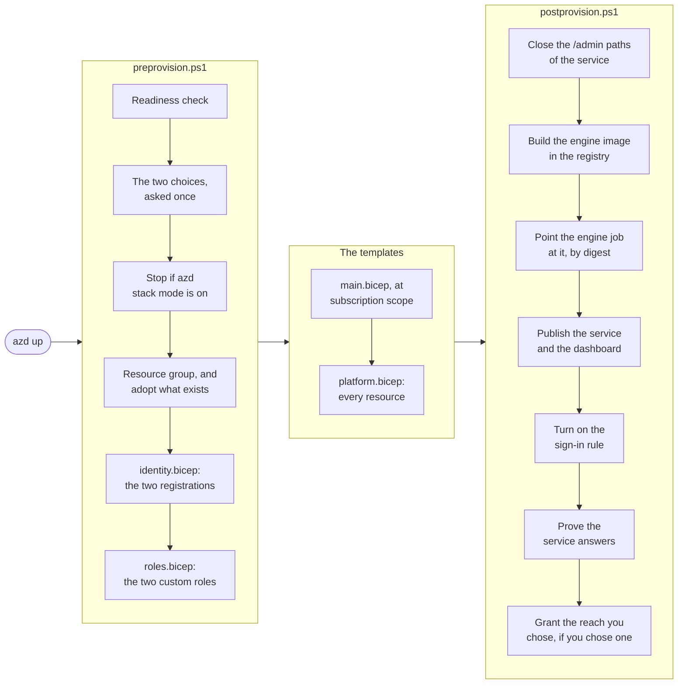

# The install, inside

The install is an Azure Developer CLI project. It has the file `azure.yaml` at the root of the repository, the templates in `infra`, and four scripts in `infra/hooks`. Two run before and after the templates of `azd up`, and two before and after `azd down`.

Read each column from the top down. The three columns are the first three parts of this page.

## Before the templates

`preprovision.ps1` runs first. It checks the subscription is ready. It asks the two choices and records them in the environment. It stops if the azd setting for deployment stacks is on. The product does not use stacks, and the install fails while that setting is on. Then it creates the resource group.

Then it adopts what exists. An existing platform in the group is recognised by its storage account, and its suffix and its engine image win over a fresh derivation. This is what lets `azd up` run again on an installed platform without creating a second one.

Then it deploys two things that live outside the product's resource group. The two application registrations are directory objects, not Azure resources. Each registration has a unique name with a key of six letters and digits. A first install makes a new key from a random source. When a registration with one of the two names already exists, the first install stops before it makes a registration. The install does not use a registration that it did not make. A later install of the same environment uses the key that the first install recorded. The two custom roles live at the subscription and are shared by every install in it, so the removal keeps them.

## The templates

`main.bicep` is deployed at subscription scope. It creates the resource group and calls `platform.bicep` inside it. The removal deletes the group, and Azure deletes what is in it.

`platform.bicep` creates every resource from Azure Verified Modules. That is the storage account, the network security perimeter, the registry and the Container Apps environment. It is also the engine job and the publish job, the hosting plans, the two sites, the logs and the two user-assigned managed identities. It also creates the role assignments the parts need to reach each other. The service's sign-in enforcement is part of the template. Every name derives from the resource group, so two installs never collide.

`identity.bicep` creates the two registrations with the Microsoft Graph Bicep extension. The service's registration carries the four roles and the scope the dashboard asks for. The dashboard's registration carries four delegated Microsoft Graph permissions that the Admin page needs to give roles: AppRoleAssignment.ReadWrite.All, Application.Read.All, User.ReadBasic.All and Group.Read.All. It also carries the permission to read Azure as the signed-in user, for the list of scopes on the Admin page.

`roles.bicep` creates the two custom roles from the map in `src/VmMigrationFactory/data/rbac-actions.json`.

There is one pair of these roles for a subscription, and the list of places
they may be granted GROWS. An administrator can bring in a new subscription
or a management group. The same two roles gain that place and keep their
identity, so every permission already given through them keeps working. A role
made in a subscription can be granted at a management group, once that group is
in its list.

Azure permits only ONE management group in that list. The product refuses a
second one and says why. It also names the two ways forward: choose a
management group that holds both, or make a second installation.

## After the templates

First, `postprovision.ps1` closes the `/admin` paths of the Functions host of the service. It sets the site property `functionsRuntimeAdminIsolationEnabled` to true. Then it reads the property again. When the value is true, the master key cannot open these paths. If Azure does not keep the value, the install stops. Next, the script adds the commit to the build stamp. It builds the engine image in the registry from the checkout. It points the engine job at the image by digest, and records the digest so the next run adopts it. It publishes the service and the dashboard. It gives the installer the administrator role. The publish job uploads the program code of the service with its own identity. It sets the sign-in rule once the directory shows the administrator role. It proves the service by listing its functions. Last, when you chose access at install, it grants that role to the engine on the whole subscription, and VMF Assessment to the service. If the grant fails, the install says so and the Admin page can make it.

Each Azure CLI step of the install runs through `infra/Invoke-VmfAzStep.ps1`. When Azure answers `Too Many Requests` (HTTP 429), the step waits and tries again, 4 times at most. Any other error stops the step at once, with the name of the step.

## The removal

`predown.ps1` runs before `azd down` deletes the resource group. It counts the safety copies with the lock `vmf-safety-copy` in the subscription of the install. It does not count a copy without a lock. It also counts and lists the capacity reservation groups that the product made in that subscription. These copies and capacity reservation groups are in the resource groups of the machines, so the removal does not delete them. The script prints the commands that find them by their tags, `vmfSafetyCopy=true` and `vmfCapacityReservation=true`. You can use these commands after the removal. The script does not stop the removal.

`predown.ps1` also records the name of the resource group as `VMF_DOWN_RESOURCE_GROUP`, because `azd down` clears `AZURE_RESOURCE_GROUP` before `postdown.ps1` runs. Then it reads the resource group. If Azure says `ResourceGroupNotFound`, the platform is already gone, and `predown.ps1` runs `postdown.ps1` itself. Then `azd down` stops on the same error. If Azure is deleting the group, the script reads it again every 30 seconds, for up to 30 minutes. The script deletes nothing itself.

`postdown.ps1` runs after `azd down`, and only when the removal succeeded. You can also run it with `azd hooks run postdown`. First it reads the resource group. It continues only when Azure says `ResourceGroupNotFound`. In all other cases it removes nothing and stops with an error. For example, the group is still in Azure, or the read fails. Then it asks if it removes the two registrations. The default answer is yes. If you answer yes, it removes each registration that it finds. If you answer no, it keeps them. A later install with the same environment name then stops, until an administrator removes them. Because this script runs after the removal, a removal that fails does not remove the registrations, and you can still sign in to the product.

## What the environment records

Every answer and every name lives in `.azure/<environment>/.env`, which the Azure Developer CLI manages and which is not committed. The values a person may set are listed in [Update the product](../install/update.md).

<!-- next:begin -->

---

**Back to** [the contents](../README.md).

<!-- next:end -->
