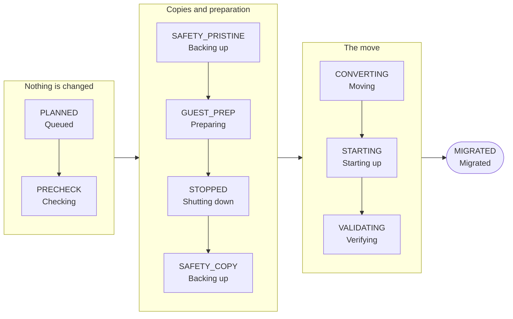

# How a machine moves, in detail

Every machine has one document in the run store that records its state, its history, and its safety copies. A worker moves the machine from state to state and writes the document after every step. A worker that dies is replaced, and the replacement continues from the last state written.

## The states

Read each column from the top down. The diagram shows only the steps of a move that succeeds. The table under **Where a machine stops**, below, shows where each step goes when it does not.

| State | The dashboard says | What happens |
|---|---|---|
| PLANNED | Queued | The machine waits for a worker. |
| PRECHECK | Checking | First, rights and locks. It checks the rights on the machine, and the join permission on each network interface, which can be in a different resource group. When it reads the machine, it checks for a network virtual appliance, a storage or backup appliance and a Marketplace purchase plan, from the image and the Marketplace plan of the machine, and for a shared disk, from the maxShares setting of each data disk. It checks the tags of the machine for a machine in an Azure CycleCloud cluster. It checks for a dedicated host, a host group and hibernation enabled on the machine. Then the identity, the target size in the machine's zone, and the number of network interfaces and data disks that the target size holds. The disk type of each disk and the size of each data disk, from each disk when the machine is not running. Azure Disk Encryption, for a move to v6 or v7 and for an in-place upgrade (Preview). A Marketplace purchase plan on the operating system disk. Encryption at host, Ultra Disk compatibility in the zone of the machine, and Premium Storage for each Premium SSD v2 or Ultra Disk, which the target size must support. Accelerated networking, when the target size requires it. If a Windows or Linux machine has the power state Running and has a SCSI temporary disk, the product reads the files on that disk. Last, a cluster node, from a read-only check inside the machine. Then, for a Linux move with accelerated networking on after it, a second read-only check reads the unmanaged setting for the drivers of accelerated networking. If the machine is not in the power state Running, the product starts it for the checks. If the machine stops here, the product stops it again, in its earlier power state, Stopped (deallocated) or Stopped. Every stop here leaves the machine untouched, with one exception: if the product started the machine for the check and cannot stop it again, the stop says so, and the machine is changed. |
| SAFETY_PRISTINE | Backing up | A snapshot of every disk, locked, taken with the machine stopped. The machine is then started again. Then the engine makes a rollback disk from each copy, and reads each new disk back. If Azure does not make one, or makes a different disk, the machine stops as FAILED_NEEDS_ATTENTION, untouched, with the reason rollbackDisksBeforeMoveNotMade. The engine deletes the disks that it made. |
| GUEST_PREP | Preparing | The guest scripts. For v6 and v7: on Windows, enable the NVMe driver in every control set and move the page file; on Linux, add the NVMe driver to the start-up image and, when LVM uses a devices file, install vmf-lvm-devices-refresh.service. It runs once, at the first start on NVMe: it finds each physical volume by its new device ID, activates the volume groups and removes itself. A temporary-disk task is installed when the target has an NVMe temporary disk. On Windows, first, when the target can use MANA and accelerated networking stays on: the MANA driver is added to the driver store when the store has none. A driver that is there is not replaced. On Linux, for v5 too, first, when the plan says Update the kernel and the kernel has no MANA driver on a release Microsoft lists: kernel-update.sh, a stop and start, the guest agent, and the driver read again. A failure there goes to FAILED_ROLLED_BACK at once, through the rollback before CONVERTING, which restores the disks only, with the reason kernelUpdateFailed. On Red Hat Enterprise Linux with a Microsoft RHUI client package, kernel-update.sh first updates that package from the Microsoft repository. That update is a change to the machine. If it fails, or the kernel update after it does not install a kernel, the machine goes to FAILED_ROLLED_BACK. When nothing was changed, it goes to NEEDS_DECISION, untouched: with the reason kernelNotInRepositories when the repositories hold no newer kernel, and kernelUpdateNoRule when the product cannot update the kernel. If an update cannot reach the minimum version, the machine goes to NEEDS_DECISION, untouched, before kernel-update.sh runs. The reason is kernelUpdateNoRule for an Ubuntu kernel that is not linux-azure. The reason is kernelUpdateCannotReachMinimum for Debian 12 on a 6.1 kernel, for SUSE 15 SP5 on kernel-azure, and for a releasever setting that holds the machine below the listed minor release. The Choose each target step does not read the kernel. It still offers Update the kernel for these machines. If the choice is Stop and ask, the machine stops with these two reasons, not with driverBelowFloor. A release that Microsoft does not list goes to NEEDS_DECISION, untouched, with releaseNotListedForMana. An Oracle Linux UEK kernel that Microsoft does not list, such as UEK R7, is updated to UEK R8 when the UEK R8 repository is enabled on the machine. When it is not enabled, the machine goes to NEEDS_DECISION, untouched, with uekKernelNotListedForMana. On Oracle Linux, kernel-update.sh updates the kernel that the machine runs, UEK or the Red Hat Compatible Kernel. On Red Hat Enterprise Linux, AlmaLinux, Rocky Linux, CentOS and Oracle Linux, it makes the new kernel the default boot kernel with grubby and reads the default again. The driver reading after the restart compares the kernel that runs with that default. When grubby is not on the machine, kernel-update.sh reports a WARN check, and the reading compares the kernel that runs with the installed kernel. For v5: a reading of the disks and the network driver, and on Windows a page file move only when the target has no temporary disk. On Linux, for v5 and Bsv2, when LVM uses a devices file, lvm-devices-task.sh installs the same vmf-lvm-devices-refresh.service. |
| STOPPED | Shutting down | The machine is deallocated. The preparation must be followed by deallocation with no restart between, because Windows rewrites the driver setting on every start on SCSI. |
| SAFETY_COPY | Backing up | A second snapshot, locked, of the stopped machine. |
| CONVERTING | Moving | First, the engine checks that the safety copies still exist, and sets accelerated networking on the primary network interface. In-place upgrade: for v6 and v7, the size and the disk controller change in one update; for v5, only the size changes. There is no rebuild: no move deletes the machine. |
| STARTING | Starting up | The machine starts, and the engine waits for its agent to answer. |
| VALIDATING | Verifying | Every disk is present, a storage volume built from several disks is complete, and the guest's own checks pass. On Windows, Set-DataDisksOnline.ps1 first changes each data disk to Online if captured.guestBefore shows it Online. It removes the read-only attribute from each data disk that was writable before the move and is read-only now. Then the validation script reads the machine again. Each volume that was mounted before the move (captured.guestBefore) is mounted again; one that is not fails the step with the reason storageVolumesLost. The boot disk is on the disk controller the plan names: NVMe for v6 and v7, SCSI for v5. Accelerated networking runs on MANA or on Mellanox, when it is on. A move to v5, v6, v7 or Bsv2 turns it on. When the first read finds no adapter, the step reads again every 30 seconds for up to 15 minutes, and then fails. The state document keeps the wait, so a worker that stops during it continues the same wait. A retry of the machine starts a new wait. The machine kept its managed identity, with each user-assigned identity. A system-assigned identity with a new object ID fails the step, and the engine rolls the machine back. Each extension is there and healthy. The patch settings, the Spot settings, encryption at host and each delete option are as they were before the move. |
| MIGRATED | Migrated | Terminal. The engine deletes the rollback disks that no rollback used. The copies stay until the wave's retention ends. |
| NEEDS_DECISION | Needs a decision | Terminal until a person resolves it. Nothing was changed. |
| FAILED_ROLLED_BACK | Rolled back | Terminal until a person resolves it. A step failed after the product changed the machine, and the engine rolled it back from the first copy. After a change to the size, the machine returns to its original size, and accelerated networking returns to how it was. Or the machine did not shut down before any change, and the engine returned the machine to the power state that Checking found, with no change. |
| FAILED_NEEDS_ATTENTION | Needs attention | Terminal until a person resolves it. A step could not finish, or a rollback also failed. The machine's panel says which. The disks and the copies exist. |
| SKIPPED | Not migrated | The machine was left out of the wave. |

## Where a machine stops

The engine tries each step again before it stops the machine. The number of attempts is different for each step. Each attempt that the engine tries again writes a retry line in the activity, with the cause. Only the attempt that ends the step writes a fail line.

| Step | The machine stops as | What the engine does first |
|---|---|---|
| PLANNED | NEEDS_DECISION | Nothing. The engine cannot reach the machine's subscription. |
| PRECHECK | NEEDS_DECISION, SKIPPED or FAILED_NEEDS_ATTENTION | Nothing. The machine is not changed. SKIPPED is for a platform-managed machine, or a machine that the assessment says cannot move. FAILED_NEEDS_ATTENTION is for a check that failed at every attempt, or for a retry that could not return the machine to its power state after an earlier stop (powerNotPutBack). |
| SAFETY_PRISTINE | FAILED_NEEDS_ATTENTION | The engine returns the machine to the power state that Checking found: it starts a machine that was running, and stops a machine that was not running again, deallocated or stopped. When a rollback disk is not made, the engine deletes the disks that it made first. |
| GUEST_PREP | FAILED_ROLLED_BACK, NEEDS_DECISION or FAILED_NEEDS_ATTENTION | When a guest script changed the machine in this attempt, or did not answer, the engine rolls it back from the first copy: FAILED_ROLLED_BACK. A NEEDS_DECISION stop comes before any change. A FAILED_NEEDS_ATTENTION stop is for a stop that changed nothing, or a rollback that did not finish (see below). |
| STOPPED | FAILED_ROLLED_BACK | When the preparation changed the machine, the engine rolls it back from the first copy. If not, the engine returns the machine to the power state that Checking found, with no change. If it cannot, the machine is FAILED_NEEDS_ATTENTION and recorded as changed. A guest that is not ready returns to GUEST_PREP instead. |
| SAFETY_COPY | FAILED_ROLLED_BACK or FAILED_NEEDS_ATTENTION | When the preparation changed the machine, the engine rolls it back from the first copy: FAILED_ROLLED_BACK. If not, the engine returns the machine to the power state that Checking found: FAILED_NEEDS_ATTENTION. |
| CONVERTING, STARTING, VALIDATING | FAILED_ROLLED_BACK | The engine rolls the machine back from the first copy, to its original size. After STARTING or VALIDATING, it keeps the boot diagnostics first. Then it returns the machine to the power state that Checking found. |

When the machine was not running at Checking, the cluster check starts it and records the power state that it found. A stop before CONVERTING that changed nothing then stops the machine again, as it was, in place of a start. If Azure refuses, the engine tries again three times in all, with a wait between. If Azure still refuses, the stop says so. The machine is recorded as changed. The stop names the power state that the engine could not return the machine to: Stopped (deallocated) or Stopped. A person's retry removes the record of the cluster check.

A stop that changed only the power state does not hold the retry. The disks, the size, the disk controller and the network are as they were. **Try this machine again** first returns the machine to that power state, as the first step of Checking, and only then runs the move again. If Azure refuses again at each try, the machine stops as FAILED_NEEDS_ATTENTION with the reason powerNotPutBack, and the engine does nothing else. **Stop this migration** records the same for a machine whose power state is the only change. This applies at Checking and at a preparation that changed nothing, for a machine that the cluster check started. It also applies at the first safety copy, at Shutting down and at the second safety copy, where the machine was stopped. The product then returns each machine to its power state with the engine operation powerback, three times in all. **Leave this machine out** does the same. The machine is free for another migration when its power state is back.

Some machines were running before the move, and a stop could not start them again. These are recorded in the same way, with the power state Running.

The end of a move keeps the power state too. When VALIDATING passes on a machine that Checking found Stopped (deallocated) or Stopped, the engine first records that it returns the machine (powerReturnPending). Then it returns the machine to that power state, and writes MIGRATED and removes that record in one write. A worker that stops in between leaves the record. The next worker finishes the return and never runs VALIDATING again on a stopped machine. A rollback starts the machine, then returns it to the power state that Checking found. **Finish the rollback** does the same. **Restore this machine** reads the power state of the machine before it changes anything, and keeps that reading in its record. At the end it returns the machine to that power state, and so does **Finish the restore**. A resume uses the first reading. If Azure refuses after three tries, the record names the power state, and **Return to the power state** returns it. A machine that was running stays running.

After the rollback starts the machine, and before the machine returns to its power state, the engine checks the volumes inside it. On Linux, lvm-devices-refresh.sh first runs lvmdevices --update --refresh when LVM uses a devices file, then vgchange -aay, then mounts the entries of fstab. On Windows, the engine first changes data disks to Online, as in VALIDATING. Then the validation script reads the machine, and the engine compares its volumes with captured.guestBefore. The result goes on rollbackPending.volumes before the machine returns to its power state, so a worker that stops after that uses the result. A volume that is not mounted again stops the machine as FAILED_NEEDS_ATTENTION, changed, with the reason volumesNotBack. A check that cannot run is said in the stop, and the stop stays FAILED_ROLLED_BACK. **Restore this machine**, **Finish the rollback** and **Finish the restore** make the same check and keep it on putBackJob.volumes. After **Finish the rollback**, if a volume is not mounted again, the engine records volumesNotBack in place of the stop that the rollback kept. A volume that is not mounted, or a check that cannot run, writes volumesCheckOwed in the same write as the stop. Then **Try this machine again** returns the machine to Checking, but keeps the safety copies and captured.guestBefore. The first step of Checking is the same check. When every volume is mounted, the engine removes volumesCheckOwed and starts the new attempt in one write, so the attempt takes new safety copies. A volume that is not mounted stops the machine again with volumesNotBack. A check that cannot run stops it with volumesNotChecked. No disk, size or setting changes. When the machine is Stopped or Stopped (deallocated), the engine first records that power state in captured.volumesCheckPower. Then it starts the machine for the check, and returns it to that power state whatever the check finds. A worker that stops after the start reads that record, and returns the machine to the recorded power state. The engine operation checkvolumes (**Check the volumes**) runs the same check with no move, in each state that no job works on. When every volume is mounted again, it records the machine restored and removes volumesCheckOwed in one write. Otherwise the machine stays changed.

A rollback before CONVERTING restores only the disks, because the size and the disk controller did not change. The engine reads its record of each guest script to know if the machine changed. A script that changes the machine is on record before it runs. A script that does not answer counts as a change.

If a rollback fails, the machine stops as FAILED_NEEDS_ATTENTION:

- A rollback before CONVERTING: the engine returns the machine to the power state that Checking found. If the rollback could not shut the machine down, no disk changed. The stop keeps its first reason, and the machine keeps the preparation.
- A rollback after CONVERTING: the engine leaves the machine as the rollback left it.
- Azure refused the original size (rollback:revertSize) with SkuNotAvailable, NotAvailableForSubscription, OperationNotAllowed that names a quota or the size, or RequestDisallowedByPolicy. That update changes only the size and the disk controller, so a refusal from an Azure Policy assignment is a refusal of the size. The rollback has not swapped a disk. The machine stays stopped on its new size, with the reason rollbackSizeRefused. The stop names each setting that the rollback restored before the size change. The stop gives the name of the policy assignment, and does not show the policy text from Azure. Any other failure of the size change has the reason rollbackFailed. A policy refusal of a different step of the rollback also has the reason rollbackFailed.

If the start at the end of a rollback (rollback:start) gets an allocation failure, the start tries again. Microsoft's page on allocation failures gives the codes: AllocationFailed, ZonalAllocationFailed, OverconstrainedAllocationRequest and OverconstrainedZonalAllocationRequest. The start makes 4 tries, 2 minutes apart. The engine renews the lease before and after each wait. At each poll, the start reads the failed provisioning state of the instance view. Azure reports an allocation failure there after it accepts the start.

If the last start fails, the rollback is still done: every disk is back. If Azure has no capacity, the stop is FAILED_ROLLED_BACK with the reason rollbackNoCapacity. The machine is stopped on its original size. For any other failure of the start, the stop keeps the first reason and says that the start failed. If a worker stops between two tries, rollbackPending stays. The next worker runs the rollback again.

A retry after rollbackNoCapacity of a move to v5 or Bsv2 starts the machine on the new size (captured.startOnTarget, vm-state v51). Checking writes the record before any change. If a volume check is owed, Checking first takes the new attempt and keeps the readings from before the earlier move (guestBefore, imdsBefore). Those readings are from the disks of the first safety copy, which the rollback swapped onto the machine. Checking does not run the volume check, the return to the power state owed or the cluster check. The first safety copy step does not start the machine after the copies. Preparing runs no script, and saves the accelerated networking decision with no driver reading. Moving resizes the stopped machine. Starting up starts it on the new size. Then it runs lvm-devices-refresh.sh on Linux, the cluster check, the check of the network settings for accelerated networking, and the driver check. A check that stops is a full rollback, with the reason of the check. A machine that owed the power state running gets a line after the start, which ends what it owed. The record belongs to the stop the machine was tried again from (stopUtc). A worker that stops after the record goes on with it. A worker that stops between the new attempt and the record takes no second attempt. A move to NVMe needs the machine to run on the original size first, as before. So does a Windows machine that moves its page file or needs the MANA driver.

After rollbackSizeRefused, the panel offers **Change to v5** too, with only a series on SCSI until a restore. Then a restore from the first copy goes onto the target size of the plan. That size must be on SCSI, and not the original size. The restore keeps that size in the record of its job (putBackJob.options.ontoSize), so a resume uses it. In the write of its record (restore.ontoTarget), the size becomes the size of the first capture, and captured.original.sizeReplaced keeps the size Azure refused. So every later rollback and restore returns the machine to that size. The restore is refused before any change for a first capture in a capacity reservation group, and for a Preview move.
- Azure refused to swap a data disk back, also after three tries: the engine leaves the machine stopped, with the reason dataDiskSwapRefused. The record (swapPending) names each disk that is left and keeps the stop that the rollback would have recorded. **Finish the rollback** (the engine operation finish) swaps only those disks, starts the machine, and then records that stop.
- A data disk swap stopped between its two changes, because Azure failed or the worker stopped: the LUN has no disk. The rollback reads each LUN and attaches the disk made from its copy to the empty LUN, as a restore does. A worker that continues a rollback reads each LUN before it swaps, so it never swaps a disk twice. If Azure refuses the disk, the rollback attaches the disk that the LUN had. If the attach stops with an error that is not a refusal, the rollback attaches no other disk. It says that the product did not read the LUN. Then the LUN is on swapPending with the reason dataDiskSwapRefused, for **Finish the rollback**.

A rollback does not create a new disk. It reads the rollback disks before it stops the machine, and only puts them on the machine. It marks each disk that it puts on the machine, and no later rollback or cleanup uses that disk again. If a worker stops while SAFETY_PRISTINE makes the disks, the next worker asks for the same names and gets the same disks.

Sometimes a rollback cannot use the rollback disks. The record can hold no rollback disks for the first copy. A disk can be gone or on a different machine, or an earlier rollback used them. A rollback before CONVERTING on other disk types cannot use them either. Then the rollback makes each new disk from the first copy before it stops the machine. If Azure does not make the operating system disk, or makes a different disk, the rollback stops before any change. The machine is then as the failed step left it, as FAILED_NEEDS_ATTENTION. A rollback before CONVERTING keeps its first reason.

Before a rollback changes anything, the engine records that it started. If a worker stops during the rollback, the next worker finishes the rollback first. It does not repeat the step that failed.

A machine that goes through too many steps without an end stops as FAILED_NEEDS_ATTENTION. That is a fault in the product, not in the machine.

A rollback is always in place. Every move is an in-place upgrade, so every rollback is one too.

## Resolving

A person resolves a stopped machine from the dashboard. The service records the decision with the person's name and note. The machine returns to the checking state, and the next worker starts it again from there. A machine whose move succeeded and whose checks failed returns to the verifying state instead.

A retry from the checking state is a new attempt. The engine keeps the safety copies of the earlier attempt on record, and takes new ones before it changes the machine. It also makes new rollback disks. The daily cleanup deletes the rollback disks of the earlier attempt. The new copies have names that end in `-a2` for the second attempt, and `-a3` for the third. The daily cleanup deletes the earlier copies with the current ones when the wave's retention ends. A retry that only verifies again keeps its copies, because the move it checks is theirs.

A machine whose rollback failed is not as it was, so the service refuses to try it again. Restore it first. The service refuses a retry, a decision and a restore of a machine with a swap that is left. Finish the rollback or Finish the restore ends it. The run page uses the same rule, and shows the reason in place of the retry.

The checking state reads the machine at the start of each attempt, and the attempt uses that reading for its safety copies. The reading from before the product first changed the machine is kept, and nothing writes it again. A rollback or a restore takes the size, disk controller, accelerated networking and disk types from that reading. It takes the disks from the latest attempt. Until the product changes the machine, each attempt replaces that reading with its own.

The service also refuses a retry, or a decision, while the machine's wave cannot start. It uses the same checks as the timer that starts a stopped wave again: the acknowledgement, the accepted wave settings, and the approval. The refusal says what is missing and which button on the migration's page does it, and the machine stays where it is. A machine sent back to the checking state in such a wave would wait there and show as running.

## Leases and claims

A worker leases a machine before it touches it, with a write that succeeds only if no lease exists. The lease carries a heartbeat. A worker that stops without releasing the machine leaves a stale lease, which the orchestrator reaps after a timeout and the machine resumes safely. When the engine stopped and no worker runs, the service starts the wave again on its next check, unless a person paused the wave. A wave runs while a worker holds one of its machines, also before the worker writes the machine's state. The Migrations page and the wave editor read the leases, so they show such a wave as running. The engine refuses a change to it. A worker can stop after its machine finished, before it removes its lease. Then the wave stays locked, and the pages say that the service removes the hold. The service removes it at its first check after the heartbeat is 15 minutes old.

Beside the runs, a claim records which run holds each machine, so two migrations cannot lease the same machine at the same time. A claim whose run no longer exists is reclaimed. When the engine records that a machine is migrated or left out, the worker releases its claim. If the worker stopped first, the end of the wave releases it. A machine that failed, or that waits for a decision, keeps its claim.

Two migrations can try to take one claim at the same time. Only one of them gets it. The other migration does not lease the machine, and its run history names the migration that holds the claim. A migration releases only its own claim, so a release never removes a claim that another migration took.

## The wave

The orchestrator starts as many workers as the wave's **machines at once** setting. Above 15, the service starts more than one container, each with a share of the number, and the run status records how many. A container that finds nothing to lease waits while other containers still hold machines, and leaves when the wave is done.

The orchestrator halts the wave after 3 failed machines in a row. It also halts the wave when 5 or more machines have ended and more than 20% of the last 10 failed. Then no new machine starts, and the dashboard shows the safety brake paused. A person resumes it after reading what failed.

A run lasts at most 24 hours. A wave that needs longer is resumed by the service's timer from where it stopped.

<!-- next:begin -->

---

**Next:** [The run store](run-store.md)

<!-- next:end -->
