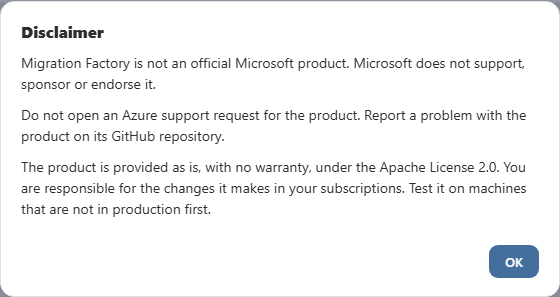

# Disclaimer

Migration Factory is not an official Microsoft product. Microsoft does not support, sponsor or endorse it.

Do not open an Azure support request for the product. Report a problem with the product on its GitHub repository.

The product is provided as is, with no warranty, under the Apache License 2.0. You are responsible for the changes it makes in your subscriptions. Test it on machines that are not in production first.

## Where the product shows it

| Place | What you see |
|---|---|
| Every page of the dashboard | A short line at the bottom of the page says it, with a link to this page. |
| Your first sign-in in a browser | The full notice opens once. Select **OK**, press Escape or select outside it to close it. |
| A report, a migration record, the file for pricing and the file for support | The short line. |
| The install | The full notice, before the install deploys anything. |

The short line says: "Migration Factory is not an official Microsoft product. Microsoft does not support or endorse it. It is provided as is, with no warranty."

To report a problem, use **Get help** on any page. See [Get help](../use/get-help.md).

<!-- next:begin -->

---

**Next:** [How a machine moves](how-a-machine-moves.md)

<!-- next:end -->
