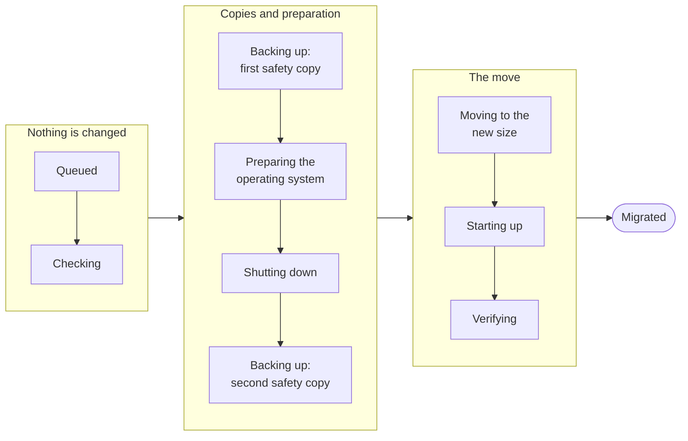

# How a machine moves

Every machine goes through the same steps, in the same order. The dashboard shows each step by name while it happens.

Read each column from the top down. A machine can stop at any step. **When a step fails**, below, tells what happens then.

## The steps

**Queued.** The machine waits for its turn in the wave. Nothing has been touched.

**Checking.** The product confirms that the machine is safe to move. Nothing has been changed. If anything needs a person, the machine stops here with a reason. The product checks these things:

- **Rights.** The product has the rights it needs on the machine. It also has them on the resources it uses, such as each network interface, its subnet and each user-assigned managed identity. A network interface can be in a different resource group from the machine.
- **Locks.** No lock blocks a change.
- **Scope.** The product reads the image and the tags. It reads the Marketplace plan of the machine and of its operating system disk, and the maxShares setting of each data disk. A network virtual appliance, a storage or backup appliance and a machine with a shared disk stop here. So does a machine with a Marketplace purchase plan or in a CycleCloud cluster. So does a machine on a dedicated host or with hibernation enabled. They are outside the scope of this tool.
- **Extensions.** The product reads the extensions of the machine. When Azure does not return them, the machine stops here.
- **The target size.** The target size holds every disk and network interface of the machine. When it requires accelerated networking, the machine has it or the plan turns it on.
- **Azure Disk Encryption.** Before a move to v6 or v7, or an in-place upgrade (Preview), the product asks Azure if the machine uses Azure Disk Encryption. The product finds the Azure Disk Encryption extension by its type, not by its name. The product also reads the Azure Disk Encryption setting of each disk. If only a data disk uses Azure Disk Encryption, the machine also stops.
- **Disks.** A rollback needs the encryption type, the disk encryption set and the disk type of each disk, and the size of each data disk. The product reads them. When the machine is not running, Azure gives these values only on each disk, so the product reads them there. If the product cannot read a value, the reason is **The product could not read the disk type or the size of a disk**.
- **The preview feature.** For an in-place upgrade (Preview), the product reads the preview feature VMTempDiskResizePreview on the subscription again.
- **Cluster check.** The last check runs inside the machine, reads only, and finds a cluster node. On Windows it reads the ClusSvc service and the key HKLM\Cluster. On Linux it reads the pacemaker and corosync services. A cluster node stops here, because the product does not move a cluster node.
- **Unmanaged drivers.** If accelerated networking is on after the move of a Linux machine, a second check in the machine reads its network settings. Microsoft says that NetworkManager and systemd-networkd must set the drivers mana, mlx4_core and mlx5_core of accelerated networking as unmanaged devices. The check finds one of these:
  - The udev rule `10-azure-unmanaged-sriov.rules` from azure-vm-utils. Before version 255, systemd-networkd also needs the file `01-azure-unmanaged-sriov.network`.
  - The unmanaged-devices setting of NetworkManager.
  - cloud-init version 23.2 or later.

  If the check finds none of them, the machine stops here. An approver can accept the move for this machine. The reason is **The network settings do not set the drivers of accelerated networking as unmanaged**.

If the machine does not run, the product starts it for the cluster check and for the check of the unmanaged drivers. If the machine must not move, the product stops it again, in the same power state that it found. If the move stops later, before it changes the machine, the product also stops the machine again, as it was. If Azure refuses, the product tries again, three times in all, with a wait between. If Azure still refuses, the stop names the power state, Stopped (deallocated) or Stopped. Then **Try this machine again** first returns the machine to that power state, before the move starts again.

**Backing up, first copy.** The product stops the machine and takes a snapshot of every disk exactly as it is now, before anything is changed. This is the copy that can roll the machine back as if nothing happened. The product then starts the machine again. The product restarts the machine on its original size, before it changes the machine. Microsoft's modernization guide tells you to restart the machine "to commit any pending changes and prove it boots cleanly". The machine is unavailable for a few minutes here, before the main stop. Then the product makes a rollback disk from each copy, and checks each one. A rollback only puts these disks on the machine. If Azure does not make one, the machine stops here, and nothing is changed. See [Rollback disks](safety-copies.md#rollback-disks).

**Preparing.** The product runs a script inside the machine. The machine must run for this, so the product starts a machine that was stopped. At the end of the move, the product stops that machine again.

- **Windows, for v6 and v7.** The script enables the NVMe driver and moves the page file off the temporary disk.
- **Linux, for v6 and v7.** The script adds the NVMe driver to the start-up image. When LVM uses a devices file, the script also installs a task that runs once, at the first start on NVMe. The devices file names each disk by its device ID, and on NVMe the disk has a different device ID. The task makes LVM find each disk by its new device ID before the file systems mount. Then the task removes itself.
- **The MANA driver on Windows.** When the target can use MANA, the product first reads the driver store for a MANA driver. When there is none, it downloads one MANA driver version from Microsoft and checks its checksum. It also checks that Microsoft signed each driver file. Then it adds the driver to the driver store. For this, the machine must connect to download.microsoft.com.
- **The kernel on Linux.** For v5, v6 and v7, a person can choose **Update the kernel** for the machine. Then, when its kernel has no MANA driver or is older than the minimum Microsoft lists, the product updates the kernel first. It uses the package manager of the distribution and only the repositories the machine already uses. On Ubuntu the package is linux-azure. Then it stops and starts the machine, waits for the guest agent, and reads the driver again. Only then does the rest of the preparation run, for the new kernel. If the update fails, the machine does not start, or the driver is still missing, the product rolls the machine back from the first copy. A Linux release that Microsoft does not list for MANA, such as Ubuntu 20.04, is not updated. A kernel update does not change the release. When accelerated networking stays on, it stops before anything changes. When nothing could be updated, the machine also stops before anything changes. When the repositories that the machine uses have no newer kernel, the stop says so. The product updates only the Azure kernel, and the stop says when the machine runs a different kernel. For a release that Microsoft does not list, the stop names a release to upgrade to. On Oracle Linux, Microsoft lists UEK R8 and not UEK R7. UEK R8 comes from its own repository, such as ol9_UEKR8. The product does not change repositories. So it updates a UEK R7 kernel to UEK R8 only when that repository is enabled on the machine. When the repository is not enabled, the stop says so. On Oracle Linux, the product updates the kernel that the machine runs: UEK or the Red Hat Compatible Kernel. On Red Hat Enterprise Linux, AlmaLinux, Rocky Linux, CentOS and Oracle Linux, the product then makes the new kernel the default boot kernel with grubby. Without grubby, the product does not set the default boot kernel. Then it compares the kernel after the restart with the installed kernel. A Red Hat Enterprise Linux pay-as-you-go image for one minor release, such as RHEL 9.4, uses the EUS repositories, which stay on that release. If an update cannot reach the minimum version, the product does not update the kernel. The machine stops before the product changes it. The stop names the cause. These are the cases:
  - On Ubuntu, a kernel that is not linux-azure, for example a FIPS kernel or a generic kernel.
  - On Debian 12, a kernel of series 6.1 from the Debian 12 repositories. Microsoft lists kernel 6.12.21 or later for Debian 12. If the machine runs a kernel of series 6.12 from bookworm-backports, the product updates it.
  - On SUSE Linux Enterprise Server 15 SP5, the kernel-azure kernel. Microsoft lists the minimum as a version of kernel-default. SUSE uses different version numbers for kernel-azure.
  - On Red Hat Enterprise Linux and distributions built from it, a releasever setting that holds the machine below the minor release that Microsoft lists. The EUS, SAP and HA RHUI clients set this value.
- **The RHUI client on Red Hat.** On a Red Hat Enterprise Linux pay-as-you-go machine, the product first updates the RHUI client package from the Microsoft repository. Then it updates the kernel. Microsoft documents this update as the fix for an expired RHUI certificate. An image can have an expired RHUI certificate. If the certificate has expired, the other repositories do not work. The product updates only the RHUI client package. If the update fails, the product rolls the machine back from the first copy.
- **The kernel version on Ubuntu.** On Ubuntu, the kernel release that `uname -r` shows has no upload number. The minimum version that Microsoft lists has an upload number. The product also reads the version of the kernel package, which has the upload number. If the machine does not report the package version, the product reads only the kernel release. If its numbers are the same as the first numbers of the minimum, the product does not know if the kernel is at the minimum. Then the product does not stop the move for the kernel version.
- **A MANA driver built into the kernel.** The product finds the MANA driver as a kernel module or as a driver built into the kernel. The check from Microsoft also reads both.
- **v5.** Nothing changes for NVMe. The product reads the disks and the network driver. On Windows, it moves the page file only when the target size has no temporary disk. If LVM on Linux uses a devices file, the script installs the same task. The task runs one time, at the first start on the new size. On SCSI, the disk usually keeps its device ID. The task writes the new device ID of each physical volume in the LVM devices file. Then the task activates the volume groups.

After each script that changes the machine, the product runs a second script at once. It reads only the machine name and the time. See [The last Run Command](safety-copies.md#the-last-run-command).

**Shutting down.** The product stops the machine again. From here the machine is unavailable until it starts again on the new size.

**Backing up, second copy.** With the machine stopped, the product takes a second snapshot of every disk. You can restore a machine from this copy and keep it on its new size. A rollback always uses the first copy.

**Moving.** The product moves every machine in place. The plan shows for each machine if the move is an in-place upgrade or an in-place upgrade (Preview).

- **In-place upgrade.** The product tells Azure to change the machine's size. For v6 and v7, Azure changes the disk controller to NVMe at the same time. For v5, the disk controller stays SCSI. Microsoft uses this name for the same operation. The machine keeps its identity, its network interfaces, its disks and its settings. Every Linux machine moves this way. A Windows machine moves this way when the kind of temporary disk does not change. That means a SCSI temporary disk on both sizes, an NVMe one on both, or none on either. A move between no temporary disk and an NVMe one is also an in-place upgrade, with no feature. Every v3 size, and every Dav4, Dasv4, Eav4 and Easv4 size, has a SCSI temporary disk with no d in its name.
- **In-place upgrade (Preview).** A Windows machine with a SCSI temporary disk whose target has another kind of temporary disk moves this way. It is an in-place upgrade, and the machine stays the same resource in Azure. Azure allows that change of temporary disk only when the subscription has the preview feature VMTempDiskResizePreview registered. The product moves the page file off the temporary disk. For a size with an NVMe temporary disk, it installs the task that prepares that disk at every start. A Generation 1 machine moves this way only to a size with no temporary disk. A Windows machine with no temporary disk, or an NVMe one, has no move to a size with a SCSI temporary disk. See [The in-place upgrade (Preview)](../use/plan.md#the-in-place-upgrade-preview).

A move never deletes the machine in Azure. So the machine keeps its unique ID in Azure, its system-assigned identity, its extensions and its role assignments. It also keeps the links from other services to the machine.

The product turns accelerated networking on for the primary network interface, before the new size. Microsoft requires it on every v6 size. When a machine has it off, the wave settings name the machine. On a target that can give the MANA adapter, accelerated networking is always on: v6, v7, Intel v5 and Bsv2. A Linux release that Microsoft does not list for MANA gets no such target. A kernel below the minimum stops in Preparing before any change, unless you choose **Update the kernel**.

**Starting up.** The product starts the machine on the new size and waits for it to report that it is running.

**Verifying.** The product checks that every disk is attached, and that a storage volume built from several disks is complete. It compares the mounted volumes with a reading from before the move. Each drive letter or folder on Windows, and each mount point in `/etc/fstab` on Linux, must be mounted again. Swap, a network share and the temporary disk are not compared. On Windows, the product first reads the status of each data disk. If a data disk was Online before the move and is Offline now, the product changes it to Online. If a data disk was writable before the move and is read-only now, the product removes the read-only attribute. The product does not change a data disk that was Offline or read-only before the move. **Activity** names each data disk that the product changed. It checks that the machine kept its patch settings, its Spot settings, encryption at host and each delete option. It checks that the machine kept its managed identity. A system-assigned identity with a new object ID fails this step. It checks that accelerated networking runs, on the Microsoft Azure Network Adapter (MANA) or on Mellanox, when it is on. A move to v5, v6, v7 or Bsv2 turns it on. The accelerated networking adapter can arrive some minutes after the machine starts. Until it arrives, the synthetic network interface carries the network. When the first check finds no adapter, the product checks again every 30 seconds for up to 15 minutes. If the adapter does not arrive in that time, the step fails and the product rolls the machine back. A present adapter is not enough. The script inside the machine sends three requests to the Instance Metadata Service. Then it reads the packet counters of the adapter. When the counters show no traffic, the product checks again in the same way, and then rolls the machine back. A script inside the machine confirms it starts from the disk controller the plan names: NVMe for v6 and v7, SCSI for v5. On v6 and v7 the NVMe temporary disk arrives empty at every start. The product installed a small task during preparation that prepares it on each start, so the machine keeps its D: drive or its /mnt.

**Migrated.** The machine is on the new size and passed its checks. When Checking found it Stopped (deallocated) or Stopped, the product now returns it to that power state. This comes after the last check of Verifying. A machine that was running stays running. If Azure refuses, the product tries again, three times in all. If Azure still refuses, the panel of the machine says the power state that it had. **Return to the power state** then returns it. The product deletes the rollback disks. Its safety copies stay for the number of days the wave chose, then a daily cleanup deletes them.

## When a step fails

If a step fails after the product changed the machine, the product rolls the machine back from the first safety copy. This includes a script inside the machine that fails after it changed the operating system. It also includes a shutdown or second safety copy that fails after the preparation. After moving, starting up or verifying, the machine also returns to its original size. It swaps the rollback disks onto the machine: the operating system disk and every data disk, in the zone of the machine. These disks do not have the data written after the first copy. That data stays on the disks that the rollback swapped off, and the product keeps them. Accelerated networking returns to how it was on each network interface. The machine starts again as it was. When Checking found it Stopped (deallocated) or Stopped, the product then returns it to that power state. The rollback does not restore some data disks, for example a shared disk. It names each one and the reason. A data disk on Premium SSD v2 or Ultra Disk is restored too, and the product checks its copy before it changes the machine. Each restored disk gets the encryption type and disk encryption set of the current disk. See [Safety copies and rollback](safety-copies.md). The dashboard shows it as **Rolled back** with the reason. After a restore onto a v5 size, because Azure refused the original size, the rollback returns the machine to that v5 size. See [Capacity for the original size, on a rollback](../use/capacity.md#capacity-for-the-original-size-on-a-rollback).

After the rollback starts the machine, the product checks the volumes inside it, before it returns the machine to its power state. The disks that the rollback made have new device IDs. So on Linux, when LVM uses a devices file, the product first makes LVM find each disk by its new device ID. Then it activates the volume groups and mounts the entries of `/etc/fstab`. On Windows, the product first changes data disks to Online, as in Verifying. Then it compares the mounted volumes with the reading from before the move. When a volume is not mounted again, the machine is not as it was. The reason is then **A volume is not mounted after the rollback or the restore**, and the machine shows **Needs attention**. When the product cannot check the volumes, the stop says so. **Restore this machine**, **Finish the rollback** and **Finish the restore** make the same check. After such a stop, **Try this machine again** first makes the same check again, before it changes the machine. If the machine is Stopped or Stopped (deallocated), the product starts it for the check, and then returns it to that power state. The move starts again only when every volume is mounted. **Check the volumes** on the panel makes the same check with no move.

After an in-place upgrade (Preview), the rollback to the original size changes the temporary disk again. So the rollback reads the preview feature VMTempDiskResizePreview before it makes a disk or stops the machine. When the feature is not registered, or the product cannot read it, the rollback does not change the size. The machine stays on its new size, with the reason **The rollback of the in-place upgrade (Preview) needs the preview feature**. It stays stopped when the failed step stopped it, or when an earlier try of the same rollback stopped it and did not finish. The stop says if the machine runs. The product does not start the machine on its new size. Register the feature again on that subscription, then use **Restore this machine**. When the machine is still on its original size, the rollback does not need the feature, and it goes on. See [The in-place upgrade (Preview)](../use/plan.md#the-in-place-upgrade-preview).

A rollback is always in place.

If checking fails, or a step fails before the product changed the machine, the machine stops with a reason. If the product started or stopped the machine, it returns the machine to the power state that it had before the move. A machine that was running starts again, and a machine that was not running stops again. If the product cannot, the stop says so. When only the power state is not as it was, **Try this machine again** first returns the machine to it. [How a machine moves, in detail](../technical/machine-state-machine.md) gives each step.

When a request to Azure fails with a temporary error, the product sends it again a few times. A temporary error is a throttle, a timeout, or a network error such as a connection reset. This applies to every step and to a rollback. A step that failed once and then succeeded on a retry is shown as recovered, not as an error.

## A machine in an availability set

At **Checking**, a machine in an availability set can get a line about its set in the **Activity** of the migration. A machine that is the only machine in its set gets no line. The product stops the machine at **Checking** only when both of these are true:

- The hardware of the set does not offer the target size.
- Azure reports that another machine in the set has the power state Running or Starting.

Nothing on the machine changes before this stop. In all other cases, the line does not stop the move.

Microsoft gives the rule behind the line:

| Microsoft's page | What it says |
|---|---|
| [Resize a virtual machine](https://learn.microsoft.com/en-us/azure/virtual-machines/sizes/resize-vm) | "If the new size for a VM in an availability set isn't available on the hardware cluster currently hosting the VM, then you need to deallocate all VMs in the availability set to resize the VM." |

So before the product changes the machine, it asks Azure for the other machines in the set and their power state. It also asks Azure for the sizes that the hardware of the set offers. The line says only what Azure answered. Unknown is not a yes or a no.

The product moves the machines in one availability set one at a time, also in a wave that moves more machines at once. A machine that waits for another machine in its set shows **waits for its pair**. So the other machines in the set keep running while one machine moves. The product does not stop them.

In the lines below, the machine shares its set with one other machine, vm-app-02, and its target size is Standard_D4ds_v6. Your line names your machines and your target size. It names up to 8 of the other machines, and gives the number of all of them.

| What Azure answered | The line in the activity | Mark | What to do |
|---|---|---|---|
| The other machines, and the hardware of the set offers the target size | This machine shares an availability set with 1 other machine: vm-app-02. The hardware that hosts the set offers Standard_D4ds_v6, so the machines move one at a time and the others keep running. Azure can still refuse a start if that hardware has no free capacity. | Not marked. This is information. | Nothing. |
| The other machines, and the hardware of the set does not offer the target size. Azure does not report that another machine in the set has the power state Running or Starting. | This machine shares an availability set with 1 other machine: vm-app-02. The hardware that hosts the set does not offer Standard_D4ds_v6. Azure can refuse to start this machine until every machine in the set is stopped, and 1 of them is running or could not be checked. | Marked **note**. This is a warning. | Read **When Azure refuses the new size**, below. The number counts each other machine whose power state Azure did not report. |
| The other machines, and the hardware of the set does not offer the target size. Azure reports that another machine in the set has the power state Running or Starting. | This machine shares an availability set with 1 other machine: vm-app-02. The hardware that hosts the set does not offer Standard_D4ds_v6. Azure can refuse to start this machine until every machine in the set is stopped, and 1 of them is running or could not be checked. Nothing on the machine changed. | The product stops the machine at **Checking**, before any change. The stop reason is **The hardware that hosts the availability set does not offer the target size**. | Read **When Azure refuses the new size**, below. The number counts each other machine that has the power state Running or Starting, and each other machine whose power state Azure did not report. |
| The other machines, but not the sizes that the hardware of the set offers | This machine shares an availability set with 1 other machine: vm-app-02. Azure did not say if the hardware that hosts the set offers Standard_D4ds_v6. If it does not, Azure can refuse to start this machine until every machine in the set is stopped. | Marked **note**. This is a warning. | Read **When Azure refuses the new size**, below. |
| Not the other machines, and the hardware of the set offers the target size | This machine is in an availability set, and Azure did not give the other machines in it. The hardware that hosts the set offers Standard_D4ds_v6, so the other machines can keep running. Azure can still refuse a start if that hardware has no free capacity. | Not marked. This is information. | Nothing. |
| Not the other machines, and the hardware of the set does not offer the target size, or Azure did not give the sizes | This machine is in an availability set, and Azure did not give the other machines in it. If the hardware that hosts the set does not offer Standard_D4ds_v6, Azure can refuse to start this machine until every machine in the set is stopped. | Marked **note**. This is a warning. | Read **When Azure refuses the new size**, below. |

**When Azure refuses the new size.** If the machine stops at **Checking**, the product did not change the machine. Do the steps below. Then select **Try this machine again**. After a line marked **note**, the move continues. If Azure then refuses the new size, at **Moving** or at **Starting up**, that step fails. The product rolls the machine back to its original size from the first safety copy, as after each failure that comes after a change. The machine shows **Rolled back**. Before you try it again, speak to the owner of the machines in the set. When the hardware does not offer the new size, Microsoft says to stop every machine in the set, to the status Stopped (deallocated). The product does not stop the other machines. To do it, stop each other machine in the set in Azure. Then all the machines in the set are unavailable at the same time. If a machine had the power state Running before its move, it has the power state Running after the move. Stop that machine again before you try the next machine in the set. Then select **Try this machine again**. To move the machine in a later change window, select **Leave this machine out**, and plan it again in a new migration. See [When a machine stops](../use/when-a-machine-stops.md).

## What the people using the machine notice

- The machine is unavailable while it is stopped and moving. Plan the wave for a time that suits them.
- After the move, the machine has the same name, the same addresses, the same disks and the same data.
- A move keeps the system-assigned identity, because every move is in place.
- On v6 and v7, the NVMe temporary disk is empty at every start. Nothing stored on it survives a restart. The product moves the Windows page file off it. A v5 size with a d in its name keeps a SCSI temporary disk, as the machine had before.

## A move to v5

A move to v5 goes through the same steps, and changes less on the way.

- **No NVMe preparation.** The product does not enable the NVMe driver, change the start-up image, or change the disk controller. It still reads the disks and the network driver before the move.
- **The page file.** On Windows, the product moves the page file only when the target size has no temporary disk. For a machine with a temporary disk, the product looks first for a v5 size that has one too.
- **Accelerated networking.** Microsoft requires it on the Intel D-family and E-family v5 sizes. When a machine has it off, the wave settings name the machine, and the move turns it on before the resize. A machine the plan could not judge stops for an approver instead.
- **The network adapter.** An Intel v5 host gives MANA or Mellanox, and this differs by region and by host. An AMD v5 size never gives MANA. Verifying accepts either adapter.
- **Rollback.** A rollback returns the machine to its original size and restores every disk, from the first safety copy. The disk controller was never changed, so it stays SCSI. Accelerated networking that the move turned on is turned off again. If Azure refuses that, the machine's record says so.

<!-- next:begin -->

---

**Next:** [Safety copies and rollback](safety-copies.md)

<!-- next:end -->
