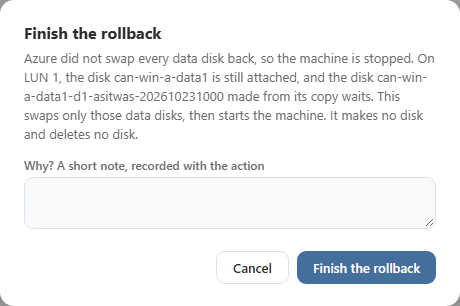

# Safety copies and rollback

A safety copy is a snapshot of a machine's disks. The product takes two of them for every machine it moves, and it uses them to roll the machine back if something goes wrong.

## The two copies

| Copy | When it is taken | What it is for |
|---|---|---|
| First copy | Before anything is changed, with the machine stopped for a moment | Rolls the machine back to exactly how it was, as if the migration never started. Every rollback uses this copy. |
| Second copy | After the operating system is prepared and the machine is stopped | Restores the machine and keeps it on its current size, when you choose **Just before the resize** in **Restore this machine** |

Each copy is a snapshot of every disk of the machine: the operating system disk and each data disk. The copies live in the same resource group as the machine.

A rollback restores every disk from the first copy, in the zone of the machine. It swaps a new disk onto the machine for each disk. The new disks do not have the data written after the first copy. The rollback keeps the disks that it detached, and that data stays on them. They cost money until you delete them. The machine's panel lists them under **Original disks, not in use**, and **Delete these disks** deletes them. See [Delete the original disks](../use/put-back.md#delete-the-original-disks). The activity of the machine names each disk a rollback makes, as soon as Azure makes it, also when the rollback then fails.

## Rollback disks

After the first copy, and before anything on the machine changes, the product makes a new disk from each copy. It makes one for the operating system disk and one for each data disk that a rollback restores. Each new disk gets the type, size, zone and encryption that the rollback needs. A Premium SSD v2 or Ultra Disk disk also gets its IOPS and throughput. The product reads each new disk and compares it with the old disk.

A rollback only puts these disks on the machine. It does not create a new disk, so a disk quota or a policy cannot stop it at that time. Before the rollback stops the machine, it reads each disk again. **Restore this machine** from the first copy uses them too.

If Azure does not make one of these disks, or makes a different disk, the move stops before it changes the machine. The product deletes the disks that it made. If it cannot delete a disk, the reason for the stop names that disk. The reason is **The product could not make the rollback disks**.

**Cost.** During the move, each disk exists two times: the disk of the machine and the rollback disk. You pay for both. A disk made from an instant access copy also has a restore fee. See Microsoft's pricing for managed disks. When the move completes, the product deletes each rollback disk that a rollback did not use. If it cannot delete a disk, the daily cleanup tries again. A CanNotDelete lock on the resource group of the machine prevents the delete. Then the activity of the machine names the lock, and the daily cleanup cannot delete the disk while the lock is on. Checking names such a lock before the move changes the machine. The daily cleanup also deletes the rollback disks that nothing used after a rollback, and those of an earlier attempt. A machine that waits for a person keeps its rollback disks, so that a restore can use them.

A rollback and **Restore this machine** also make disks from the copies when they cannot use the rollback disks. The machine's record keeps each of these disks as soon as Azure makes it. If a stop leaves such a disk that the machine does not use, the next restore names it. The daily cleanup deletes it when the move of the machine has ended: the machine is migrated, rolled back, or skipped. Before it deletes a disk, the cleanup reads the disk in Azure. The cleanup reads and deletes only a managed disk in the subscription of the machine. That disk must be in the resource group of the machine, or in the resource group of a disk of the machine. The cleanup does not touch a different disk on the record, and the activity of the machine names it. It never deletes a disk that is attached to a machine, or a disk that a finish needs. While a restore or a wave works on a machine, the cleanup does not touch the disks of that machine. It also keeps them when Azure does not have the machine, or when it cannot read the machine. The activity of the machine says so. A disk that a rollback or a restore put on the machine is the disk of the machine from then on. The cleanup never deletes it. The machine's record marks each of these disks when Azure attaches it, so this is also true when the restore stops after that. The machine's panel lists each of these disks that the record says no machine uses, and what the daily cleanup does with it. An operator can also delete them from the panel before the cleanup does, with **Delete these disks now**. See [Managed disks made from the safety copies](../use/put-back.md#managed-disks-made-from-the-safety-copies).

Sometimes a rollback cannot use these disks. Then it makes each new disk from the first copy before it stops the machine:

- No rollback disks are on record for the first copy.
- Azure no longer has a rollback disk, or the disk is on a different machine.
- An earlier rollback or restore already put the disks on the machine.
- A rollback before the move finds disk types that are different from the first reading of the machine.

If Azure then does not make a new disk, or makes a different disk, the rollback stops before it changes the machine. This applies to the operating system disk and to each data disk. The machine stays as the failed step left it, and needs attention. The reason for the stop names each disk.

## Disk types that the move changed

A move can change the type of a disk: Standard SSD for a Standard HDD operating system disk, or Premium SSD. See [Plan a migration](../use/plan.md). A rollback or a restore puts each disk back on the type it had, before the machine returns to its size. This applies to a rollback and to **Restore this machine** from the first copy. Rollback disks get the type from the first reading of the machine.

Azure allows two type changes for each disk in 24 hours. A move needs both of them: its own change, and the change back if the move fails. So a disk with a type change in the last 24 hours stops the move before it changes the machine. The reason says when the machine can move.

If Azure does not set a type back, the activity of the machine names the disk and its type. The rollback or the restore continues. A disk that stays on Standard SSD does not stop it, because every size takes Standard SSD. A disk that stays on Premium SSD stops it before the size, when the original size takes no Premium SSD. Azure refuses the machine on that size.

## What a rollback does not restore

The rollback does not restore some data disks. It names each one and the reason in the machine's record and in the reason for the stop:

- A shared disk. Other machines use it too.
- A data disk with no copy on record, for example a disk attached after the copies were taken. The machine keeps the disk it had.

Any other data disk that Azure cannot make from its copy stops the rollback before the rollback changes the machine. This includes a disk that Azure did not make, or made with different values or a different encryption. It also includes a Premium SSD v2 or Ultra Disk copy that Azure cannot use.

## When Azure does not swap a data disk back

The product makes each disk before it stops the machine. It can swap a data disk only on the stopped machine. If Azure refuses that swap, the old disk stays on its LUN. Then the product tries the swap again, three times in all, with a wait between the tries.

If Azure still refuses, the machine is never started with disks from two moments. The same applies when a restore swaps some data disks and Azure does not swap the others. It also applies when the product cannot show that a data disk is back. For example, a restore can stop at one data disk before it gets to the next. Or a data disk swap can fail, and then Azure does not tell the product which disk is on a LUN. The machine stays stopped. Every other disk is back from the copy. A rollback deletes no disk, and nor does a restore that gives the new disks new names. A restore that deletes the current disks has deleted the current disk of each LUN that is back. This applies to a rollback and to **Restore this machine**.

- **The record names each disk.** The machine's record and the reason name each disk that is back. For each disk that is not back, they name the disk that is still on the LUN and the disk made from its copy. If the product did not read a LUN, they say so, and they name the disk made from its copy. They also give the words of Azure.
- **A rollback** stops with the reason **Azure did not swap a data disk back**, and the machine needs attention. The row shows **Stopped: finish the rollback**.
- **A restore** stops with an error that says the machine is stopped. The row shows **Stopped: finish the restore**. The Reports page and the report count the machine as a machine that needs attention, not as a restored machine.
- **The machine's panel** shows **Finish the rollback** or **Finish the restore**. It does not show **Restore this machine** or **Try this machine again**, and the product refuses each of them.
- **The disks made from the copies are kept.** The daily cleanup does not delete them, because the finish needs them. You pay for each of them until the finish puts it on the machine.

To finish, open the machine's panel and select **Finish the rollback** or **Finish the restore**. The dialog names each disk that is left. Write a short note, then select the button. **Cancel** or Escape closes the dialog and changes nothing. You need the operator role.

For each LUN that is left, the dialog says what the record shows is on the LUN:

| The record shows | The dialog says |
|---|---|
| The disk that the LUN had | That disk is still attached, and the disk made from its copy waits. |
| No disk | The LUN has no disk, and the disk made from its copy waits to go on it. |
| No disk, and no disk that the record can prove | The LUN has no disk, and the finish stops before it changes the machine. |
| A disk that the product did not read | The product did not read the LUN. The finish reads it first. It puts the disk made from the copy on the LUN only when the LUN has the disk it had, or no disk. |
| A different disk | The LUN has a disk that the record does not name. The finish changes nothing while that disk is on the LUN. |

The finish deletes no disk. Each disk that it removes from a LUN stays in Azure, and is not attached.

A restore that keeps the names puts each data disk first on a temporary disk made from the copy. If the restore then stops before it puts the disk under the old name on the LUN, the LUN runs on the temporary disk. The dialog says so. After the finish, the temporary disk is not attached. **Activity** names it. It costs money until it is deleted, and the daily cleanup deletes it when the move of the machine has ended.

The finish reads each LUN that is left before it changes the machine. It swaps only the disks that are left. It makes no disk and deletes no disk. Then it starts the machine. The disks made from the safety copies have new device IDs. The finish then checks the volumes inside the machine, as the rollback does. See [When a step fails](how-a-machine-moves.md#when-a-step-fails). The finish can find a volume that was mounted before the move and is not mounted now. The finish then records the reason **A volume is not mounted after the rollback or the restore**. **Finish the rollback** then returns the machine to the power state that Checking found before the move. **Finish the restore** returns it to the power state that it had when the restore started. A data disk that the rollback or the restore did not restore, for example a shared disk, stays as it is. The record names that disk with the disks that are left, and the finish does not change it. A rollback then records the stop that it would have recorded with every disk back, and a restore adds each disk to its record. The job of a restore can stop after it records the disks that are left, but before it writes its own record. If the product then stops starting the restore again, the finish writes the record of the restore from the data that the restore saved. The record and the **Activity** of the migration say that the finish wrote it. After the finish, the daily cleanup goes on as usual. If Azure refuses again after three tries, the machine stays stopped, and the record gives the new words of Azure. Try again later. If a LUN holds a disk that the record does not name, somebody changed the machine. The finish then changes nothing and names that disk.

Azure can stop the job of the finish before it ends. For example, the job can use all its memory or reach its time limit. Then the product starts the finish again by itself, in 15 to 20 minutes. The finish reads each LUN again and swaps only the disks that are left. It starts the machine one time. **Activity** says that the finish started again after its job stopped. Until the finish ends, the product refuses a second finish and a restore of the machine. The **Safety copies** card says that a finish of the machine runs. The product starts a finish again three times at most. If it does not end after that, **Activity** gives the reason. The machine stays stopped, and the panel shows the finish again. Look at the machine and its disks, then select the finish again.

A LUN can have no disk. Azure swaps a data disk in two changes, and a swap that stopped between them leaves its LUN empty. A rollback does not leave it so. When Azure fails between the two changes, or the worker stops there, the rollback attaches the disk made from the copy to the empty LUN. It uses the caching that the capture recorded for the LUN. If the record does not prove the disk, or Azure refuses it, the rollback stops with **Azure did not swap a data disk back**. If the attach of the rollback stops with an error that is not a refusal from Azure, the rollback attaches no other disk. It says that the product did not read the LUN, never that the LUN has no disk. The finish attaches the disk made from the copy to that LUN, with the caching that the LUN had. If Azure refuses that disk, the finish attaches the disk that the LUN had before, and the machine stays stopped. The attach can also stop with an error that is not a refusal from Azure, for example when the product cannot read the machine. Then the finish attaches no other disk, and the machine stays stopped. The product does not know which disk is on the LUN, so the record says that the product did not read the LUN. Use the finish again. It reads each LUN before it changes the machine. The finish changes nothing if the disk from the copy does not exist or is attached to a machine. It also changes nothing if Azure shows that the disk was made from a different copy. It names the LUN and the disk.

## No restore rebuilds a machine

**Restore this machine** restores the machine in place. It does not delete the machine in Azure. See [Restore a machine](../use/put-back.md).

## Disk encryption and customer-managed keys

Every disk that the product makes from a safety copy gets the encryption of the current disk on the machine. This applies to every disk type, to the operating system disk and to each data disk. It applies to a rollback and to **Restore this machine**.

- **Before it changes anything**, the product reads the encryption type and the disk encryption set of each disk. If Azure does not return them, or returns an encryption type that the product does not know, the machine stops with no change. The reason is **The product could not read the encryption of a disk exactly**.
- **Before it changes anything**, the product also checks that its identity can read each disk encryption set. A disk encryption set can be in a different resource group. If the right is missing, the machine stops with no change, and the reason names the disk encryption set.
- **Each safety copy** gets the disk encryption set of its disk. Microsoft requires that a disk and its incremental snapshots have the same disk encryption set.
- **Each new disk** gets the encryption type and the disk encryption set of the old disk. The product reads the new disk and compares its encryption with the old disk. Only a disk with the same encryption goes on the machine. If a new disk is different, the rollback or the restore stops before it changes the machine. This applies to the operating system disk and to each data disk. The new disk is kept, and the reason for the stop names it with each other disk that the product made. Each of these disks costs money until you or the daily cleanup delete it.

Double encryption at rest is a different encryption type from a customer-managed key. The product keeps each type as it was.

A customer-managed key must be enabled while the product makes a disk, and while the machine runs. If a key is disabled, deleted or expired, Azure stops each machine whose disks use it. The product cannot read your key vault, so it does not check the key.

## Premium SSD v2 and Ultra Disk

The product restores a data disk on Premium SSD v2 or Ultra Disk from its first copy, as it does every other disk. Azure cannot make a disk from a copy of these types until it finishes copying the data, unless the copy has instant access. So the product takes some more steps for these disks:

- **Before it changes anything**, the product reads the IOPS, throughput, sector size and zone of each such disk. Soon after a rollback, Azure can still be filling a disk from a copy. Then the machine stops, and nothing is changed. The reason is **Azure is still filling a Premium SSD v2 or Ultra Disk data disk from a copy**. If Azure does not return one of the values, the machine also stops with no change, and the reason names the disk.
- **A machine in an availability set** with a data disk on Premium SSD v2 or Ultra Disk is outside the scope of this tool. Azure does not attach such a disk across fault domains while it has an instant access snapshot. So the product stops the machine before it changes anything.
- **The first copy** of each such disk is an instant access snapshot, for 300 minutes. The machine changes only when Azure can make a disk from every copy. While Azure cannot, the machine stays stopped for at most 30 minutes. The product never waits while the machine runs. After 30 minutes, the move stops with no change, and the reason is **Azure could not use a safety copy in time**. The machine starts again. When the machine was not running before the move, the product stops it again, as it was.
- **Just before the move**, each such copy must be complete, or usable for at least 120 more minutes. If a copy is not, the machine does not move. If the preparation changed the machine, the product rolls it back at once. The reason is **A safety copy would not last through the move**.
- **The rollback** makes each new disk with the same type, size, zone, IOPS and throughput. It reads the new disk and compares it with the old disk, sector size included. Only a disk that is the same goes on the machine.

The second copy of these disks is an ordinary snapshot. Azure can use it only when it finishes copying the data. An instant access copy has a restore fee for each disk that Azure makes from it. See Microsoft's pricing for managed disks.

Each attempt takes its own two copies. When an operator selects **Try this machine again**, the product keeps the copies of the earlier attempt on record and takes new ones. So a second rollback never returns a disk from before the first attempt. The daily cleanup deletes the earlier copies with the current ones.

A rollback or a restore takes the size, disk controller, accelerated networking and disk types from the reading made before the first change. A retry reads the machine again for its own steps, but it does not change that reading. So a rollback or a restore after a retry returns the machine to that size and setup, on the disks of the latest attempt. If a machine stopped before the product changed anything, the next attempt reads it again. Then a change that you made to it as the stop asked is kept.

## The last Run Command

The product runs its scripts in the machine with Azure Run Command. When a machine starts on disks from a copy, Azure can run the last Run Command of the machine again. If that script changed the machine, it changes the restored disks too.

So after each script that changes the machine, the product runs a second script at once, before anything else happens to the machine. This script reads only the machine name and the time. It changes nothing, and it reads the same on every move. If Azure runs the last Run Command again, it runs this script. A move that runs no script that changes the machine runs no second script.

If the second script does not run, the product tries it once more. If it fails again, the move continues, because the second script changes nothing. A line in **Activity** says so, and names the script that Azure can run again if the machine is restored from a copy. If the script that changes the machine failed too, the move stops as for any other failure. On the machine's panel, **Work done inside the machine** shows each run of the second script.

## Locks

When the product takes a copy, it places a lock on it. A lock stops a person or a script with Contributor rights from deleting the copy by accident. The dashboard shows the lock on each copy as **Locked**.

The VMF Migration role holds the right to place a lock. If the identity of the product does not hold it, the product still takes the copies. The dashboard then says **Not locked** beside them with a warning. See [What the product may do in Azure](../reference/permissions.md).

Before the product changes a machine, it checks that both copies are still there. If one is missing, the machine stops before anything is changed, with the reason **A safety copy is missing**.

The first copy is not a choice. A plan from this product always asks for it.

## How long the copies stay

Each wave has a setting: **How long the snapshot is kept**, in days. The default is 7 days. The count starts when the machine is migrated.

A daily cleanup starts at 03:30 UTC. The cleanup finds each copy whose retention has ended. It removes the lock from the copy. It waits until Azure does not show the lock. Then it deletes the copy. If the cleanup cannot delete a copy, it puts the lock back on that copy. The **Activity** of the migration names the copy and the reason. It also says if the cleanup put the lock back. The next daily cleanup tries again. The cleanup examines the migrations in hourly passes until it has examined each one, so a large store can need some hours. If the service stops two passes on the same migration, the next pass goes on to the next migration. The card names that migration. The next daily cleanup examines it again. It also deletes the disks made from the copies that nothing used, as **Cost** above says. While a restore of a machine has not ended, the cleanup keeps its copies and every disk made for it. The product starts that restore again, and the restore needs them. If the restore still does not finish, the cleanup keeps them until a restore of the machine finishes. The card says that the machine needs a person. See [When the job of a restore stops](../use/put-back.md#when-the-job-of-a-restore-stops). The Reports page and each migration page show a **Safety copies** card. It says how many copies are kept, how many are due for the next cleanup, and when the cleanup last ran. On the Reports page, the card lists each migration that keeps copies, 10 on each page, with **Project** and **Search**.

Copies of a machine that has not migrated yet are never deleted by the cleanup.

## Restoring a machine

The product rolls a machine back on its own when a step fails after the machine was changed. You can also restore a machine from a safety copy yourself, from the migration page, with **Restore this machine**. The restore makes a new managed disk from each snapshot of the copy. It does this for the operating system disk and each data disk, and swaps the new disks onto the machine. The new disks do not have the data written after the snapshot. The dialog asks two questions and a note.

**Which safety copy?** **Before the migration** is the first copy. It also returns the machine to its original size and disk controller, and accelerated networking returns to how it was. **Just before the resize** is the second copy. It keeps the machine on its current size and disk controller. Each copy shows the size and disk controller from the record of the machine. A machine with only one copy shows only that copy. From one day before the date Microsoft retires the original size, the product refuses the first copy. A return to that size is outside the scope of this tool. See [Restore a machine](../use/put-back.md).

There is one exception. Azure refused the original size in a rollback, and you selected **Change to v5**. Then a restore from **Before the migration** changes the machine to the v5 size of the plan. The machine then has every disk from the first safety copy on that size, and every later rollback and restore returns it there. See [Capacity for the original size, on a rollback](../use/capacity.md#capacity-for-the-original-size-on-a-rollback).

**Keep its current managed disks?** The answer applies to every disk. The restore leaves the same data disks as a rollback does, and names each one.

- **Yes. Keep them, detached, in Azure.** This is the recommended choice. The new disks get new names. The current disks keep the data written after the snapshot. The machine's panel lists them under **Its earlier managed disks**. Each one costs money until you delete it. **Delete these disks** on the panel deletes them. See [Delete the earlier managed disks](../use/put-back.md#delete-the-earlier-managed-disks).
- **No. Delete them, and give the new disks their names.** Data written after the snapshot is lost. Each new disk gets the name and resource ID of the current disk, but not its tags, role assignments or backup. The safety copies are then the only copies, and the daily cleanup deletes them when the retention of the wave ends. The dialog names each disk and asks you to confirm that you understand this. The product does not delete a Premium SSD v2 or Ultra Disk disk while a copy in instant access depends on it. It leaves that disk, and says why.

**A short note**, which the machine's record keeps.

From the first copy, the restore uses the rollback disks when they are there, and makes no disk before the stop. The machine starts again when every disk is attached. For a machine in an availability zone, the new disks are in the same zone. The machine's record shows when it was restored, by whom, which disks it swapped, and whether they got new names.

## When you delete a migration record

Deleting a migration from the dashboard deletes the record. Your machines are not touched. The dialog asks about the safety copies and the disks made from them, because the record is the only thing that knows they exist:

- **Keep the copies.** You find them, and the disks made from them, and remove them yourself.
- **Delete the copies as well.** The product also deletes each disk made from them that no machine uses. Nothing will be left to restore a machine from.

When you delete the copies as well, the product also deletes the rollback disks that nothing used. It also deletes each disk that a rollback or a restore made from a copy, if no machine uses it. This includes a disk of a machine whose move ended less than one day before, or of a machine that waits for a person. Before it deletes a disk, the product reads the disk in Azure by its resource ID. It never deletes a disk that is attached to a machine, or a disk that a finish needs. It also keeps each disk that the record names as a disk of the machine. If the product cannot read a disk, it does not delete that disk. It removes the lock from each copy. It waits until Azure does not show the lock. Then it deletes the copy. Then it makes sure that Azure no longer has the copy. It deletes the documents of the migration only after all the copies are deleted. Until then, the migration stays on the page, and the page shows that the product is deleting it. During the delete, you cannot restore a machine, try a machine again or start a wave in that migration. You also cannot make a new record of it. The records that the product kept stay under **Records of each migration** on the Reports page.

The product always keeps the safety copies of a machine that is not as it was before the move. For example, its rollback did not finish. It keeps them for **Keep the copies** and for **Delete the copies as well**, because they are the only way to restore that machine. The dialog names each such machine. The product still deletes the disks made from those copies that no machine uses. After the delete, the daily cleanup does not find the kept copies, and no migration holds the machine. The migration record that the product keeps for 90 days names each machine and its safety copies. The copies keep their tags and their locks. Find them by their tags, as [Remove the product](../install/remove.md) shows, and remove them yourself when you no longer need them.

The product refuses to delete a migration while a restore or a finish of one of its machines has not ended. It also refuses after the product stopped one that did not finish, until a new one of that machine finishes. That machine can be part way. The product needs its record and its safety copies to restore it. The product refuses for **Keep the copies** and for **Delete the copies as well**. The page names each machine and tells you what to do. Wait until the action ends, or use the same action again. Then select **Delete this migration** again.

If Azure still shows the lock on a copy after one minute, the product does not delete that copy. If Azure refuses the delete because a lock covers the copy, the product sends the delete again for about one minute. If the product cannot delete a copy, it keeps the migration record. If Azure refuses the delete, or still shows the lock, the product puts the lock back on that copy. The page shows the reason. The run history names each copy that it did not delete. Correct the cause, then select **Delete this migration** again. The product does not touch the copies that it deleted before.

If the product cannot read or delete a disk made from a copy, it also keeps the migration record. The run history names each disk that it did not delete, with the reason. Correct the cause, then select **Delete this migration** again. The product does not touch the disks that it deleted before.

## When you remove the product

Removing the product stops the daily cleanup. The remove command counts the locked safety copies and lists them, then continues. The copies stay in the resource groups of their machines, and bill until you delete them. See [Remove the product](../install/remove.md).

<!-- next:begin -->

---

**Next:** [Who does what](roles.md)

<!-- next:end -->
