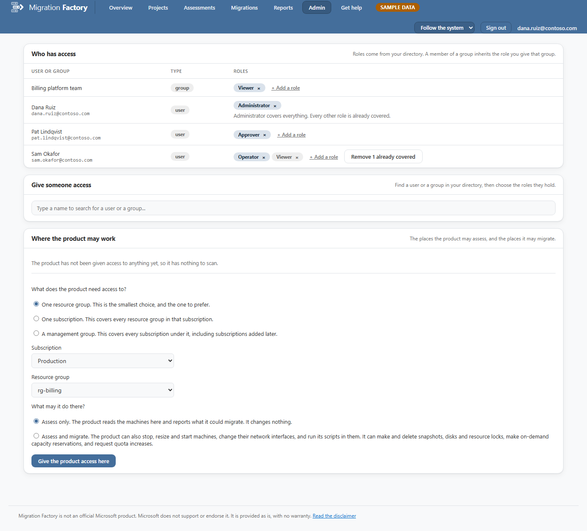
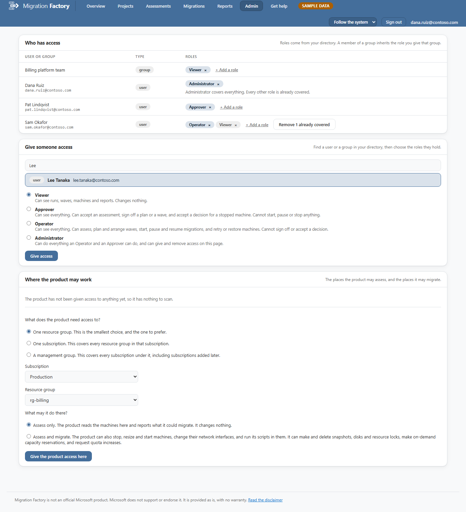

# The Admin page

The Admin page answers two questions: who can use the product, and where in Azure the product may work. Only administrators see it. Every change you make here is made as you, with your own rights. The Microsoft Entra audit log records the role changes for users. The Azure activity log records the access changes in Azure.

## If this page says it needs an administrator

This page reads your directory, and gives and removes roles. Microsoft Entra keeps those permissions for a directory administrator. **No user can approve them, not even the person who owns the subscription.** Owning a subscription gives you authority over Azure resources, and none in the directory.

Until an administrator approves the product once, this page says:

> The Admin page needs a directory administrator to approve it once. No user can approve this permission for themselves. Every other page works without it.

Assessments, plans, waves, migrations and reports all work on the approval you can give yourself. Only this page waits.

**The card "Where the product may work" still works.** It is on this page, but it does not touch your directory. It gives the product access to a subscription or a resource group in Azure, which needs only your own rights there. Use it, and the product can find your machines.

[Sign in and find your way](sign-in.md) lists the directory roles that can give the approval, and the two ways to give it.

## Who has access

The card lists every person and group that holds a role, with the roles.

**Give someone access.** Type a name. The page searches your directory. Choose the person or group, choose the roles, and select **Give access**. The change takes effect the next time they sign in. See [Who does what](../understand/roles.md) for what each role allows.

**Add a role** on a row gives another role. **Remove this role** removes one. The page asks first, on a line under the row, and names the role and the user. Select **Yes, remove**, or select **Cancel** or press Escape to keep the role. When another role already covers a role, the page says so and offers to remove the roles that are already covered. That removal asks first in the same way.

Give roles to groups when you can. A group's members inherit the role, now and later.

## Where the product may work

The card lists every place the product has been given access to, with the level and what it may do there. With no access, the card says **The product has not been given access to anything yet, so it has nothing to scan.**

**Connect to Azure.** The page needs your permission for Azure before it can show or change where the product may work. That permission is separate from the one it holds for your directory. Select the button once and allow it.

**Give the product access here.** Choose a level, the place, and what the product may do there:

- **Assess only.** The product reads the machines here and reports what it could migrate. The role holds only read actions.
- **Assess and migrate.** The product may also stop and resize the machines here. To do this, it also starts machines, takes snapshots, makes and deletes managed disks, and runs its own scripts inside machines. See [What the product may do in Azure](../reference/permissions.md).

**Assess and migrate includes assess.** You do not give both for the same place. Give assess where you want the product to look, and assess and migrate only where you want it to act. For example, give **Assess only** on the subscription, and **Assess and migrate** on the resource groups that hold the machines of a wave.

If the virtual network of a machine is in another resource group, give **Assess and migrate** there too. Azure checks the join actions on the subnet and on each resource that the network interface links to.

The levels:

- **One resource group.** The smallest choice, and the one to prefer.
- **One subscription.** Every resource group in it.
- **A management group.** Every subscription under it, including subscriptions added later. Granting here needs rights above a subscription, which most accounts do not hold. The two roles can reach only one management group. For a second management group, grant at a management group that holds both, or install the product again.

**Remove** removes access. A place that no longer exists is marked, and the access to it can be removed.

**The card shows one row for each grant.** A grant on a management group shows one time, at the management group. It does not show one time for each subscription under it. **Remove** on that row removes the grant at the management group.

**Remove removes the grant and the web service read access for that place.** Each grant is two role assignments: the chosen role for the identity that does the work on machines, and **VMF Assessment** for the web service. The web service never gets **VMF Migration**. The web service holds one read access for each place. If you gave two grants for one place, the two grants use the same web service read access. Remove on one of them keeps the web service read access, and the page tells you this before and after. Remove on the last grant removes it. If the page cannot read the other grants on the place, it removes the grant, keeps the web service read access, and tells you.

**A row marked *The web service only* has no grant on that place.** The web service can read the machines there. If no wider grant covers the place, the product cannot scan or migrate them. The page can keep the web service read access when it removes a grant. Somebody can also remove a grant in the Azure portal. **Remove** on that row takes the web service read access away. If a grant on the place uses that access now, the page keeps it and tells you. To use the place again, give the product access to it again.

**The web service reads a place through a grant on a place that contains it.** Azure role assignments are inherited. A grant on a subscription lets the web service read every resource group in it. A grant on a management group lets it read every subscription under it. A row with no web service read access of its own then shows *The web service reads this place through the grant on ...*. If the web service cannot read a place, at that place or above it, the row says so, and its lists of machines stay empty. **Give the web service access** on that row gives it.

**Remove on the wider grant names each place that loses the web service read access.** The question before **Remove** lists those places. After the removal, their lists of machines stay empty, and each row says that the web service cannot read the place. Remove on a smaller grant never removes the read access of a wider grant.

**A row can show *Cannot tell*.** The page could not read a management group above the place. Thus it cannot say whether the web service reads the place. It does not show the place as covered.

**A row marked *Already covered by the grant on ...* is inside a wider grant.** A grant on a subscription also applies to every resource group in it. A grant on a management group also applies to every subscription and every management group in it. **Assess and migrate** includes **Assess**, so a grant of **Assess** below a grant of **Assess and migrate** is also marked.

**A new row shows *just added* for a short time.** Azure takes a minute or two to list a change to access. The card shows what you did immediately, so a row can appear here before Azure repeats it. The row shows all of the access you gave, and keeps the mark until Azure lists all of it. A row you remove goes immediately for the same reason. The product can use the new access as soon as the card shows it.

If the two custom roles do not reach the place you chose, the page asks to add the place to them. Select **Add the place and grant**. This needs Microsoft.Authorization/roleDefinitions/write on each place that the roles reach now. If a pipeline creates the roles, add the place to that pipeline too.

If the page says your account cannot grant access, you need the Owner or User Access Administrator role at that place. No identity of the product can assign roles.

<!-- next:begin -->

---

**Next:** [Get help](get-help.md)

<!-- next:end -->
