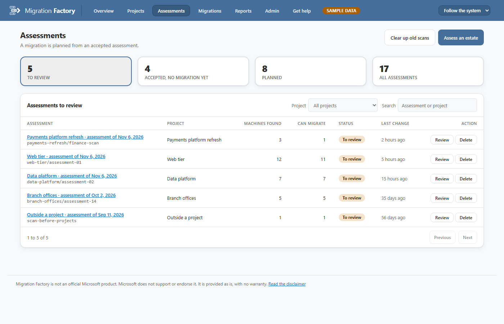
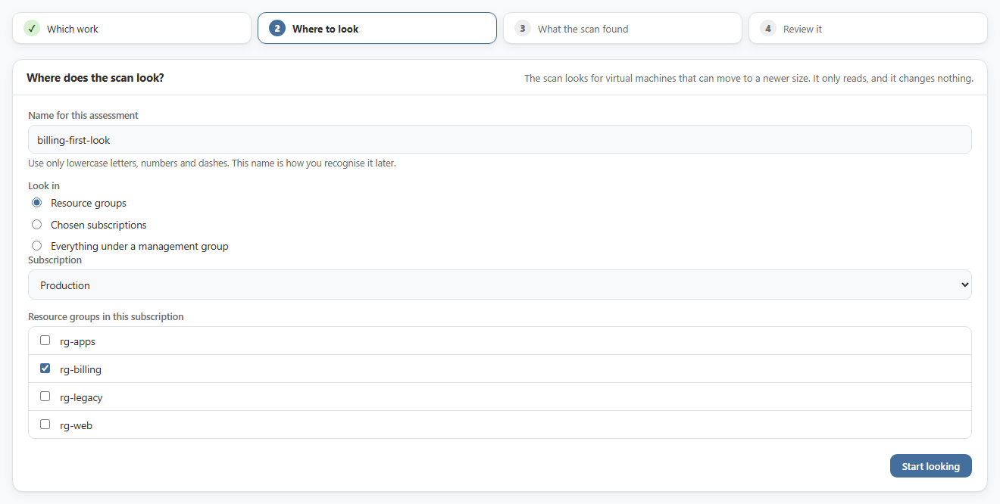

# Assess an estate

An assessment is a look at your machines that changes nothing. It records every machine it can find, finds which ones can move to a newer size, and says why the rest cannot move yet.

You need the operator role to start one. Anybody with a role can read the result.

## Before you start

The product finds only the machines it has been given permission to see. If an assessment finds nothing, the usual cause is that nobody gave the product access to that place on the Admin page. See [After the install](../install/after-install.md).

## Start the wizard

1. Select **Assess an estate** on the Overview page, or **New assessment** on a project's row.
2. **Which project is this for?** Choose an existing project, or create one here. When the product cannot read the projects, the step says **The product could not read the list of projects.** The reason is at the top of the page. Select **Try again**.
3. The next step is **Where does the scan look?** First, type the **Name for this assessment**. Use lowercase letters, numbers and dashes. The name is how you recognise it later. A name that already exists is refused, because the same name would replace what is there.
4. Under **Look in**, choose one of three levels, then the place:
   - **Resource groups.** Choose the subscription, then tick the groups. The smallest choice, and the right one for a first assessment. If the machines of one application are in several groups, tick all of those groups. The assessment records only the machines in the groups that you tick. These checks read the whole subscription that holds the groups:
     - Network interfaces
     - Azure Virtual Desktop
     - AKS
     - Azure Databricks
     - SAP
     - SQL Server
     - Shared disks
   - **Chosen subscriptions.** Tick one or more whole subscriptions.
   - **Everything under a management group.** Every subscription under it, now and later.

   Include the subscription that holds your Azure Virtual Desktop host pools in the scan. The scan reads host pools only in the place that you choose. A host pool can be in a different subscription from its session hosts.
5. Select **Start looking**.

The page says **Looking for machines.** When the product has found the machines, the page says how many it found. You can leave the page and open it again later. The wizard remembers where you were.

When the scan stops before it completes, the page says **The scan stopped.** and gives the reason. To start the scan again, select **Back**, and then select **Start looking**. If the job of the scan stops and records no reason, the product finds this in approximately five minutes. The page then gives the status of the job execution in Azure, for example **Failed**.

One assessment has one scan. While a scan of the assessment runs, the service refuses a second scan of it. If two scans of one assessment run, the product keeps the scan that completes first. The other scan stops and saves nothing.

## What the assessment does

It reads every virtual machine in the place you chose. It records its size, its generation, its operating system, its disks, its network interfaces, its image and its identity. It never runs anything inside a machine at this stage. For each machine it applies a set of rules and puts the machine in one of five groups:

| Group | Meaning |
|---|---|
| Current | Microsoft puts the size of the machine in the Current lifecycle stage, as it does v6 and v7. Its row says, for example, **Standard_D2ds_v6 is in the Current lifecycle stage.** You cannot select it for a migration. |
| Can migrate | The machine can move. Some machines need preparation first, and the product does that itself during the migration. A machine that already has the NVMe disk controller can migrate too when its size is not in the Current lifecycle stage, such as an Ebsv5 machine. |
| Some targets only | A finding holds the machine back from some size series, and at least one other series stays open to it. A Generation 1 machine, for example, can move to v5 and not to v6 or v7. |
| Cannot yet | Something holds the machine back on every size series. The row of the machine says what, and the assessment says what to do about it. |
| Not eligible | The product leaves the machine alone. Another Azure service manages it, such as Kubernetes, virtual desktop or a scale set. Or it is outside the scope of this tool, such as a machine on a dedicated host. |

The product reads the lifecycle stage from its own lifecycle data, which names the Microsoft page for each stage. It does not read the stage from the size name.

## When it finishes

The wizard moves to **What the scan found**. That is a table of every machine, its resource group and region, its current size, whether it can migrate, and what it needs. Select **Review it** to go to the step of that name, which shows one row for each machine. Continue with [Read an assessment](read-an-assessment.md).

## After the assessment: choose the machines that move

An assessment finds every machine in the place you chose, and many of them are not for one migration. You choose the machines after an approver accepts the assessment. Select **Plan a migration** on the row of the assessment, and the wizard opens at **Choose the machines**. See [Plan a migration](plan.md).

## If it finds no machines

The page names the place it looked and offers **Look somewhere else**. Either there are no machines there, or the product cannot see them yet. Check the Admin page: the place must be listed under **Where the product may work**.

<!-- next:begin -->

---

**Next:** [Read an assessment](read-an-assessment.md)

<!-- next:end -->
