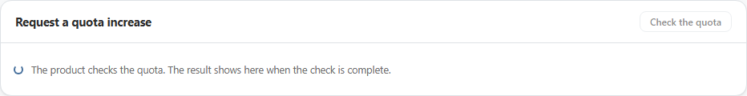
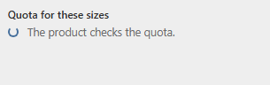
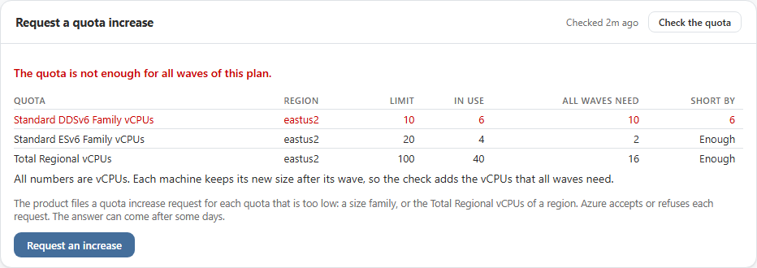
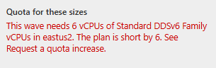
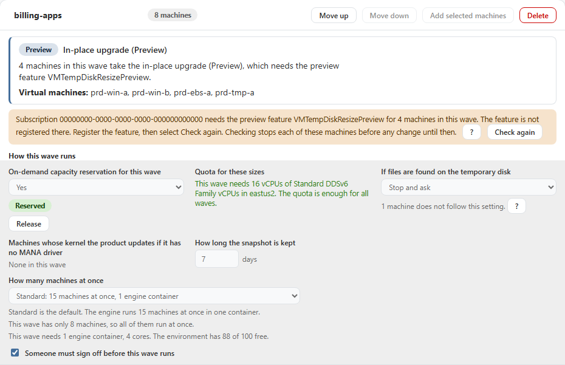
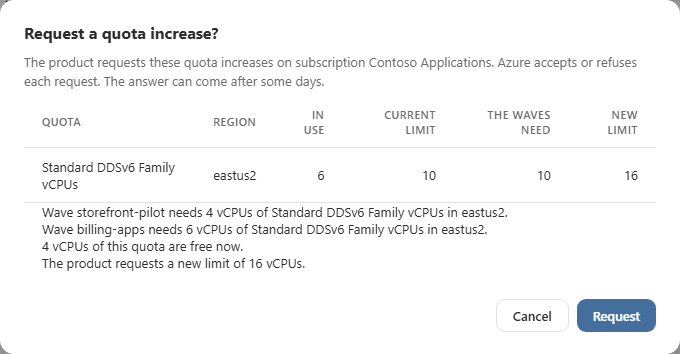
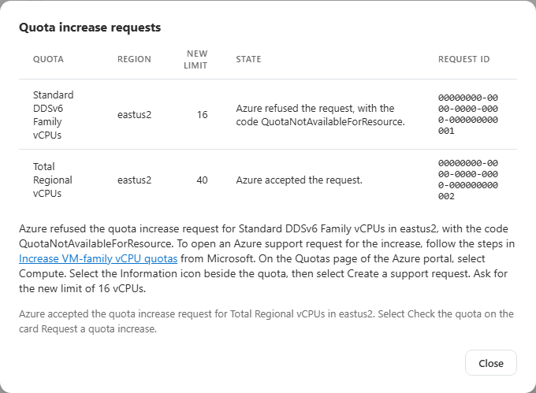
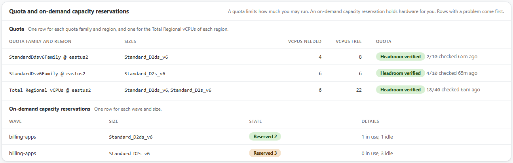

# Capacity and quota

Quota and capacity are separate checks. A quota is the permission of the subscription to deploy vCPUs of a size family in a region. Capacity is the infrastructure that Azure has in a region or zone. A quota does not reserve or guarantee capacity. A capacity reservation guarantees capacity for the wave, with a service-level agreement (SLA).

## Check the quota of the plan

You check the quota in the wave editor, which is the wizard's step **Arrange the waves**. The card **Request a quota increase** is at the top of the wave editor. It is for the whole plan. Select **Check the quota** in the header of the card. One check covers each wave that has machines. The product reads the quota of each size family that the machines move to. It also reads the **Total Regional vCPUs** quota of the subscription in each region. Azure refuses a resize when either quota is not enough.

While the check runs, the card shows a turning circle and **The product checks the quota. The result shows here when the check is complete.** Each wave shows a turning circle and **The product checks the quota.**

Then the header of the card shows the time of the check, and the time moves on while the page is open. The card shows the state of the plan:

| The card shows | Meaning |
|---|---|
| **The quota is enough for all waves of this plan.** | Each wave that has machines has a result, and each quota of the plan has the vCPUs that all waves need. |
| **The quota is not enough for all waves of this plan.** | At least one quota is short. Request a quota increase. |
| **The product did not check the quota of this plan yet. Select Check the quota.** | Nobody checked the quota of this plan. |
| **The product has no quota result for these waves:** ... | The check of these waves failed, or found machines with no quota record, or did not run. The wave shows why. Select **Check the quota** again. The card is not green until each wave has a result. |
| **Azure does not list the quota of some sizes of this plan.** ... | A row of the table shows **Not listed**. This is a known reporting gap for some v6 sizes, not a refusal. The first machine of each size confirms the quota. |

Under the state, a table shows one row for each quota family and region that the plan uses. It also shows one row for the Total Regional vCPUs quota of each region. The rows with a problem come first. All numbers are vCPUs:

| Column | What it shows |
|---|---|
| Quota | The quota, as Azure names it. For example, **Standard DDSv6 Family vCPUs**, or **Total Regional vCPUs**. |
| Region | The Azure region of the quota. |
| Limit | The quota limit at the check. **Not listed** means that Azure did not report it. |
| Usage | The vCPUs in use at the check. |
| All waves need | The vCPUs that all waves of the plan need from the quota. Each machine keeps its new size after its wave, so the check adds the vCPUs that all waves need. For Total Regional vCPUs, the vCPUs that the machines add to their old sizes. |
| Short by | All waves need, minus the vCPUs that are free. **Enough** means that the quota has the vCPUs. **Not listed** means that a figure of the row is missing, so the product cannot check the quota. |

## The quota of each wave

Each wave has the row **Quota for these sizes** under **How this wave runs**. After a check, the row has one line for each quota family that the wave uses:

| The wave shows | Meaning |
|---|---|
| **This wave needs** ... **The quota is enough for all waves.** | The quota has the vCPUs that all waves need. |
| **This wave needs** ... **The plan is short by** ... **See Request a quota increase.** | The quota does not have the vCPUs that all waves need. The line also shows for the Total Regional vCPUs quota when it is short. See [The Total Regional vCPUs quota](#the-total-regional-vcpus-quota). |
| **This wave needs** ... **Azure does not list the limit of this quota.** | Azure did not report the quota family. This is a known reporting gap for some v6 sizes, not a refusal. The first machine of each size confirms it. |
| The size ... is not available to subscription ... in region ... | Azure does not offer the size in the region, or it restricts the size for the subscription. The answer names each size, its subscription and its region. Select **Change target** on the machine, then choose another size. |
| Not checked yet | Nobody checked the quota of this wave. |
| This machine has no quota record | The quota check did not write a record for the machines it names. Select **Check the quota** again. |
| Azure did not answer. Try again. | The check did not finish. Select **Check the quota** again. |

The check reads the saved plan. If you have changes that are not saved, the check saves them first. A wave in which no machine changes size needs no quota, and the row says so.

Check the quota before you start the plan.

## Request a quota increase
When the quota of a size family or the Total Regional vCPUs quota is too low, the card shows **Request an increase**. Select it. The product files nothing yet. It opens the confirmation **Request a quota increase?**. While the product works, it shows a turning circle and **The product reads the last quota check and calculates the new limits. This step can take up to 1 minute.** Then it shows each quota that the product will request:

| Column | What it shows |
|---|---|
| Quota | The quota, as Azure names it on the **Quotas** page of the Azure portal. For example, **Standard DDSv6 Family vCPUs**. |
| Region | The Azure region of the quota. |
| Usage | The vCPUs in use at the last quota check. |
| Current limit | The quota limit at the last quota check. **Not listed** means that Azure did not report it. |
| The waves need | The vCPUs that the waves of the plan need from the quota. |
| New limit | The limit that the product asks for: the vCPUs in use, plus the vCPUs that the whole plan needs from the quota. The product never asks for less than the current limit. |

Above each table, a line names the subscription of the quotas. Under each quota, a line for each wave says the vCPUs that the wave needs, of which quota, in which region. For the Total Regional vCPUs quota, the line gives the vCPUs that the machines of the wave add to their old sizes. Then a line says the vCPUs of the quota that are free now, and a line says the new limit that the product requests. Select **Request** to file the requests. To close the confirmation and file nothing, select **Cancel**, press Escape, or select outside it.

After you select **Request**, the title of the confirmation changes to **Quota increase requests**. While the product works, it shows a turning circle and **The product sends the quota increase requests to Azure. This step can take up to 2 minutes.** Then it shows a table with one row for each request:

| Column | What it shows |
|---|---|
| Quota, Region | The quota of the request, and its Azure region. |
| New limit | The limit that the product requests. |
| State | **Azure accepted the request.** means that Azure gave the new limit. **Azure refused the request, with the code** ... means that Azure refused the request, and gives the code that Azure sent. **The product filed the request. The product reads the answer of Azure.** shows while the product reads the request. **The product filed the request. Azure did not answer yet.** means that Azure did not answer in 2 minutes. **The product filed the request. The product could not read the answer of Azure.** means that Azure did not let the product read the request. **The product did not file the request.** means that Azure did not get the request. |
| Request ID | The ID that Azure gave the request, as a record. **None** means that Azure gave no ID. |

Under the table, a sentence gives the reason for each request that is not filed. The reason is the error that Azure sent, a quota record with no subscription, or no access. Correct the cause, then select **Check the quota** again.

When Azure takes a request and does not accept it at once, the product reads the request in Azure for 2 minutes. While it reads, the confirmation shows a turning circle and **The product reads the answer of Azure to each filed request. This step can take up to 3 minutes.** Then a sentence under the table says what to do for each filed request:

| Answer of Azure | What to do |
|---|---|
| Accepted | Select **Check the quota** on the card **Request a quota increase**. |
| Refused | The sentence gives the quota, the region and the code that Azure sent. To open an Azure support request for the increase, follow the steps from Microsoft. The sentence links to the page and gives the new limit to ask for. For a size family, the page is [Increase VM-family vCPU quotas](https://learn.microsoft.com/azure/quotas/per-vm-quota-requests): on the **Quotas** page of the Azure portal, select **Compute**, select the Information icon beside the quota, then select **Create a support request**. For the Total Regional vCPUs quota, the page is [Increase regional vCPU quotas](https://learn.microsoft.com/azure/quotas/regional-quota-requests): select the quota, then select **New Quota Request**. If Azure does not give the increase, the portal shows a link to open a support request. |
| No answer in 2 minutes | Look again later on the **Quotas** page of the Azure portal. |
| The product could not read the request | Look again later on the **Quotas** page of the Azure portal. |

The activity log of the migration shows each answer, with the request ID. If the product stopped before it said which requests are filed, the confirmation says so. Some requests can be filed, and the activity log of the migration shows each request.

The button **Close** closes the confirmation. It does not stop the requests. If you close it before the answer comes, the page shows the answer at the top. This is also true for the answer of Azure to each filed request. If the product does not answer in 10 minutes, the confirmation says so. Then the activity log shows each request.

The confirmation uses the quota records of the last quota check. It does not read Azure again. If a quota record does not name a subscription, the confirmation names its quota, because the product cannot request an increase for it. Select **Check the quota** again. If the product does not send the list in 5 minutes, the confirmation says so, and the activity log shows what the product did.

### When the product cannot request a quota increase

A quota belongs to a subscription. Azure gives a role on a resource group to that resource group and to the resources in it, not to the subscription. So a grant of **Assess and migrate** on a resource group does not let the product request a quota increase. When the quota check finds a quota that is too low, it also reads the permissions of the product on the subscription. The card then shows one of these:

| The card shows | What to do |
|---|---|
| **Request an increase** | The product has access on the subscription. Select the button. |
| **The product cannot request a quota increase on subscription** ... **That needs the Assess and migrate role on the subscription**, with **Open the Admin page** | On the Admin page, give the product **Assess and migrate** on the subscription. The same role lets the product stop and resize the machines there. Then select **Check the quota** again. When no subscription gives access, the card has no **Request an increase**. You can also request a quota increase on the **Quotas** page of the Azure portal. |
| **The product could not read its access on subscription** ... | The product could not read its permissions. The card keeps **Request an increase**. The request can fail if the product does not have this access. |

You need the operator role.

## The Total Regional vCPUs quota

Azure gives each subscription two vCPU quotas in a region. One is for each size family. The other is **Total Regional vCPUs**, for all the size families together. The product checks both.

A machine uses the vCPUs of its old size until its move, also when it is stopped. A resize changes the size in one step. Thus a machine needs only the vCPUs that its new size adds to its old size. A machine that moves to a size with the same vCPUs or fewer needs none. In a wave with an on-demand capacity reservation, a machine needs all the vCPUs of its new size. Azure makes the on-demand capacity reservation before the wave, while the old machines still use their vCPUs. The vCPUs that a machine releases do not count for a different machine. The machines of a wave do not move in a known order.

When the machines need more vCPUs than the region has free, the product blocks their quota record. Select **Request an increase**, then select **Check the quota** again. The product requests one increase for each subscription and region. The new limit is the vCPUs in use in the region, plus the vCPUs that the whole plan adds there. If the quota of the size family is also too low, the record shows the size family. The **Total Regional vCPUs** row of the **Quota and on-demand capacity reservations** card also says that this quota is not enough. The product requests both quotas when you select **Request an increase** one time, and the confirmation shows a row for each. A machine that needs no more vCPUs is not blocked by this quota.

If Azure does not report the Total Regional vCPUs quota of a region, the product does not check it, and the record says so.

## Reserve capacity

In the wave editor, set **On-demand capacity reservation for this wave** to **Yes**. **No** reserves nothing. Then **Reserve capacity** asks Azure to hold the exact capacity the wave needs. While Azure makes the on-demand capacity reservation, the wave shows **Reserving...**. Then it shows **Reserved**, with **Release** next to it. From the moment it succeeds, it bills whether or not anything uses it. It bills until every machine of the wave has ended and the product releases it, or until you select **Release**. Write a short note saying why. The note is recorded with the action.

Azure can refuse to start a machine when it has no capacity for the target size. To prevent this, select **Reserve capacity** for the wave of that machine.

An on-demand capacity reservation is sized from the wave as it is saved. Save the plan first.

Machines in an availability set cannot use an on-demand capacity reservation. Azure does not allow a capacity reservation for a machine in an availability set. The page names such machines, and they have no capacity reservation.

A wave with **On-demand capacity reservation for this wave** set to **Yes** does not wait for these machines. It starts when its other machines have their on-demand capacity reservation, and the machines in an availability set move with no capacity reservation. If every machine in a wave is in an availability set, the wave needs no on-demand capacity reservation. After the quota of the wave is checked, the wave editor shows **No capacity reservation** in place of **Reserve capacity**. The wave starts without an on-demand capacity reservation, and the activity log of the migration says so.

**Reserve capacity** reserves nothing while the quota check of a size in the wave is blocked. The wave cannot start then, so an on-demand capacity reservation would bill for nothing. Correct the quota, select **Check the quota** again, then reserve.

With this setting at **Yes**, the wave starts only when every machine that moves has a quota record for its size, region and zone. A machine that an on-demand capacity reservation can hold needs that record reserved. A machine in an availability set, or in its own capacity reservation group, needs only its quota check. Machines that have migrated, or that were skipped, need no record.

A quota check can stop before it writes every record, for example when Azure does not answer. **Reserve capacity** checks the quota again for the machines with no record. The start checks the quota of the wave again every time. If this check cannot finish, nothing is reserved and the wave does not start. The message says why the check stopped. If the check finishes and a machine still has no record, nothing is reserved and the wave does not start. The message names each machine and its size. After **Check the quota**, the wave names the same machines. Select **Check the quota** again, then **Reserve capacity**.

## Before a wave starts

Before a wave starts, the product checks the quota of the wave again. A quota record can be old, and another wave can use the quota after the check. This check reserves nothing, and it does not replace an on-demand capacity reservation. With **None**, every machine that moves needs a quota record for its size, region and zone. The record must not be blocked. Machines that have migrated, or that were skipped, need no record. When the wave has an on-demand capacity reservation, the product checks it too.

A machine that is in the middle of its move does not stop the wave. It finishes its move, or its move fails and the product rolls it back. Until Azure has changed its size, the check keeps its quota for it first. The other machines must fit in the quota that is left. A machine that rolled back, or that waits for a decision, is checked like a machine that has not started. If every machine that is still to run is in the middle of its move, the start does not check the quota.

If this check cannot finish, for example when Azure does not answer, the wave does not start. The message names the machines, and the activity log shows what Azure said. The quota records stay as they were. If the check finishes and a machine has no record, the wave does not start. The message names each machine and its size. Select **Check the quota**, then select **Start this wave** again.

If the quota is not enough for a machine, the wave does not start. The message names each machine and its size. In the wave editor, select **Request an increase**, then select **Check the quota**. This also applies to the Total Regional vCPUs quota. If Azure does not offer the size of a machine in its region, select **Change target** on the machine.

The **Quota and on-demand capacity reservations** card has one row for each quota family and region. It also has a **Total Regional vCPUs** row for each region.

Each row shows the vCPUs that the plan needs from the quota and the vCPUs that are free, at the newest quota check. On the Total Regional vCPUs row, the vCPUs needed are the vCPUs that the machines add to their old sizes. When this quota is not enough, its row comes first and says **Not enough Total Regional vCPUs quota**. This is also true when the size family quota of the same machines is too low. After you select **Request an increase**, the row comes first and says **Increase requested** until the next quota check, as the size family row does. When a wave reserves capacity, the card is called **Quota and on-demand capacity reservations**. It also has an **On-demand capacity reservations** list. That list has one row for each wave and size of the waves that use one. It shows the state of each on-demand capacity reservation, and how much of the reserved quantity is in use and idle. Azure bills the idle quantity too. See [Watch a migration](watch.md).

When every machine of a wave has ended, the product releases its on-demand capacity reservation. The card says **Released**.

## A machine in your own capacity reservation group

A machine in a capacity reservation group that this migration did not make stays in that group through the move. Azure resizes a machine in a group only to a size that has a capacity reservation in the group. So before the product changes the machine, it reads the capacity reservations of the group:

- If the group has a capacity reservation for the target size, the move keeps the machine in the group. The resize leaves the machine in it. The capacity reservation of the wave is not used for this machine, and the activity log says so.
- If the group has no capacity reservation for the target size, the machine stops, and nothing changes. The reason is **The capacity reservation group of this machine has no capacity reservation for the target size**. Create a capacity reservation for the target size in the group, or remove the machine from the group. A reserved quantity of 0 needs no more quota. Then try the machine again.
- A capacity reservation in a zonal group is for one availability zone. If the machine is in an availability zone, the capacity reservation for the target size must be in the same zone. If the group has one only in another zone, the machine stops with the same reason, and nothing changes. The details of the stop name the zone of the machine and the zone of the capacity reservation. Create a capacity reservation for the target size in the zone of the machine. A regional group, or a machine with no zone, does not need a zone match.

The product does not read the reserved quantity of the group. Azure lets a group hold more machines than its reserved quantity.

The assessment records the capacity reservation group of each machine. **Check the quota** and **Reserve capacity** do not count a machine that the assessment found in a group that this migration did not make. So the on-demand capacity reservation of the wave does not bill for it, and does not use quota for it. The **Quota and on-demand capacity reservations** card names these machines. If each machine of a wave is in its own group or in an availability set, the wave needs no on-demand capacity reservation. The wave editor then shows **No capacity reservation**.

A machine can leave its group after the assessment. The on-demand capacity reservation of the wave then has no place for it, so it does not join the group of the wave. If **On-demand capacity reservation for this wave** is **Yes**, the machine stops before anything changes. The reason is **This machine left its capacity reservation group after the assessment**. Add the machine to the group again, then try the machine again. Or run a new assessment and plan again, then select **Check the quota** and **Reserve capacity**. If it is **No**, the machine moves with no capacity reservation, and the activity log says why.

Before a move changes a machine, the product records the capacity reservation group that the machine is in. A rollback and **Restore this machine** return the machine to that group, after the machine is back on its original size. If the machine is in the same group as before the move, or in no group as before, the activity log says so. They remove the machine from a group that it was not in before the move, for example the group of the wave. If that group is not a group of this migration, the activity log and the reason for the stop name it. Add the machine to it again if the machine must stay in it. After a retry, the group before the move is the group before the first change. So if you put the machine in a group between two attempts, a rollback removes the machine from that group.

Azure puts a machine in a group only when the group has a capacity reservation for the size of the machine. If Azure refuses, the machine runs in no group, and Azure does not guarantee capacity when it starts. The rollback continues. The activity log and the reason for the stop name the group and what Azure said. Add the machine to the group again when the group has a capacity reservation for its size.

Before the product changes the machine, it checks that it has permission on your group. If it does not, the machine stops, and nothing changes. The reason is **The product's managed identity is missing a permission on the capacity reservation group of this machine**. On the Admin page, give the product **Assess and migrate** on the resource group of the capacity reservation group. Then try the machine again.

After a retry, the machine can be in a different group from the group it was in before the first change. The move keeps the machine in the group that it is in now, so the product checks the permission on that group too. If the permission is missing on the two groups, the details of the stop name the two groups.

The record of each machine says the group that the machine was in before the first change, or that it was in no group.

## Capacity for the original size, on a rollback

A rollback returns a machine to its original size. Microsoft restricts capacity growth for older size series. In the scope of this tool, they are F, Fs, Fsv2, D, Ds, Dv2, Dsv2, Dv3, Dsv3, B, Bs, Av2, Amv2, Ev3 and Esv3. Microsoft's page on retirements and capacity growth restrictions lists them. Azure can refuse new deployments and capacity expansion for these series. A quota is not capacity. A machine can fail to start when the quota is sufficient.

A rollback can find no capacity for the original size. The product does not guarantee capacity for the new size. On a rollback, the product does not guarantee capacity for the original size. Azure can also refuse an on-demand capacity reservation for an older size. A wave can have a machine with an original size in one of these series. Then **Run it** in the wizard and **Review & accept options** show one line about it.

At the end of a rollback, the product starts the machine. If Azure has no capacity for the size, Azure shows one of these error codes:

- AllocationFailed
- ZonalAllocationFailed
- OverconstrainedAllocationRequest
- OverconstrainedZonalAllocationRequest

The product then tries to start the machine 4 times in all, 2 minutes apart. If the last start fails, the machine stops. The reason is **After the rollback, Azure has no capacity to start the machine on its original size**. Every disk is back from the first safety copy. The machine is stopped on its original size. When Azure has capacity for the original size again, start the machine.

Or move the machine to v5. A move to v5 or Bsv2 keeps the disk controller SCSI, so the machine needs no change inside it before the move. The product does not start the machine on its original size:

1. Select **Change to v5** on the machine. Accept the wave settings, and get the sign-off again.
2. Select **Try this machine again**.
3. Checking runs every check that reads Azure. It does not start the machine.
4. The product takes new safety copies of the disks. These are the disks of the first safety copy, which the rollback swapped onto the machine.
5. The product changes the size to the v5 size, and then starts the machine.
6. The product runs the checks inside the machine. First come the LVM devices file and the cluster check. Then come the check of the network settings for accelerated networking and the MANA driver check. Verifying then compares the machine with the readings that the earlier attempt took of these disks.

If a check after the start stops the move, the product rolls the machine back to its original size, from the new safety copies. This is safe, because the disks are the original disks and the checks ran on them before the earlier move. A Windows machine that needs a change inside it before the move must run on its original size first, as before. This is a machine whose page file moves off the temporary disk, or a machine on a size that can give the MANA adapter. The activity of the machine says why.

Azure can refuse the original size, for example with NotAvailableForSubscription. Then the rollback stops before it swaps a disk, with the reason **The rollback stopped because Azure refused the original size**. The machine is stopped on its new size. The rollback did not swap a disk. The stop names each setting that the rollback restored before the size change. If Azure restricts the size for your subscription, open an Azure support request to remove the restriction. Then use **Restore this machine**, and choose the safety copy **Before the migration**.

An Azure Policy assignment can also refuse the original size, with RequestDisallowedByPolicy. The stop has the same reason, and it gives the name of the policy assignment. To restore the machine to its original size, change the policy assignment, or add a policy exemption for the machine. Then use **Restore this machine**, and choose the safety copy **Before the migration**.

Or move the machine to v5 from the first safety copy:

1. Select **Change to v5** on the machine. Until a restore, the panel offers only a series on SCSI. The first safety copy is from before the changes for NVMe, so it starts only on SCSI.
2. Select **Restore this machine**, and choose the copy **Before the migration**. The restore changes the machine to the v5 size of the plan, not to its original size. The dialog names the size.
3. Accept the wave settings, get the sign-off again, and select **Try this machine again**.

After that restore, the machine has every disk from the first safety copy and every setting from before the move, on the v5 size. The record of the machine says so. Every later rollback and restore returns the machine to the v5 size, not to the size Azure refused. The product refuses that restore before it changes anything for a machine in a capacity reservation group of its own. It also refuses it for an in-place upgrade (Preview).

## Release an on-demand capacity reservation

To give an on-demand capacity reservation back, select **Release** beside it in the wave editor. Write a short note saying why. Azure stops the charge when the release completes, in a few minutes.

- The product refuses a release while machines of the wave are migrating, because they can use the on-demand capacity reservation. The editor does not show **Release** then.
- Machines of the wave that wait for a decision or a retry lose the capacity the on-demand capacity reservation held for them.
- To reserve again, select **Check the quota**, then **Reserve capacity** on the wave.

A wave that holds an on-demand capacity reservation cannot change. The editor refuses to save a change to it, and so does **Change target** on its machines. The save would delete the only record of the on-demand capacity reservation. Release it first, then change the wave.

## If an on-demand capacity reservation shows Not confirmed

**Not confirmed** means Azure did not say that it holds the capacity. Azure did not answer in time, or the product stopped before the answer came. Azure can still make the on-demand capacity reservation, and then it bills.

A capacity reservation uses the vCPU quota of its size family and of its region, also when no machine uses it. Azure refuses to make a capacity reservation that is more than the vCPU quota.

Every 5 minutes, the service reads from Azure each on-demand capacity reservation that shows **Reserving...**, when no reserve or release job of the migration runs. It reads the on-demand capacity reservation by the resource ID that the product recorded before it asked Azure. It records what Azure says, and the activity log shows it:

| Azure says | The card shows | What it means |
|---|---|---|
| provisioningState **Succeeded** | **Reserved** | Azure holds the capacity, and it bills. The wave can use it. |
| provisioningState **Creating** or **Updating** | **Not confirmed** | Azure is still making it, and it can bill. The service reads it again 5 minutes later. |
| provisioningState **Failed** or **Canceled** | **On-demand capacity reservation failed**, in the Quota column | Nothing is held. |
| Azure has no such on-demand capacity reservation, 10 minutes or more after the product asked for it | **Released** | Nothing bills. Before 10 minutes, the card does not change, because Azure can still make it. To reserve again, select **Check the quota**, then **Reserve capacity** on the wave. |

A wave with an on-demand capacity reservation that is not confirmed cannot start. Select **Release** beside it, on the **Quota and on-demand capacity reservations** card of the migration or in the wave editor. Write a short note saying why. **Release** releases each capacity reservation of the wave. An operator sees it while no machine of the wave is migrating. The product deletes the on-demand capacity reservation by its resource ID, which names its subscription and resource group. If Azure has not made it, nothing is deleted. The product records the release only when Azure shows the on-demand capacity reservation gone.

If Azure refuses the release because it is still making the on-demand capacity reservation, the wave keeps **Not confirmed**. Select **Release** again a few minutes later.

The service reads the on-demand capacity reservation with its own role. If that role does not cover its resource group, the on-demand capacity reservation shows **Reserving...** for up to 60 minutes. After that, the product shows **Not confirmed**.

## The product's own quota

One more quota is the product's own. Above 15 machines at once, the product runs more than one container, and the Container Apps environment must have free cores for them. The wave editor says whether it does, with the number of containers, the cores they need, and the environment's free cores. Start fewer at once, or request a quota increase for the Container Apps environment.

<!-- next:begin -->

---

**Next:** [Start a migration](start.md)

<!-- next:end -->
