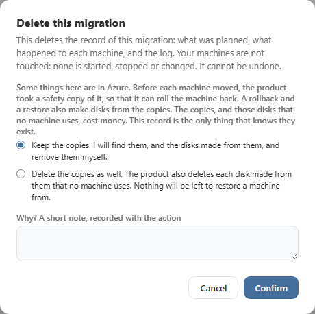

# Finish a migration

A migration is finished when every machine in every wave is migrated, rolled back, or left out on purpose.

## After each wave

1. Check the migrated machines with the people who use them. The product verified the disks, the network and the machine's own checks. Only the people who use the machine can confirm that their application works.
2. If the plan is not signed off, approve and start the next wave.

A signed-off plan starts the next wave when this wave finishes. It does not when a machine waits for a person or the run is paused. A wave with a start time waits for that time. See [What stops a plan that runs on its own](start.md#what-stops-a-plan-that-runs-on-its-own).

## Capacity

When every machine of a wave has ended, the product releases its on-demand capacity reservation. The **Quota and on-demand capacity reservations** card shows **Released**. If the card still shows a reserved quantity that is idle after a wave finished, the release did not complete. Select **Release** on the row of the wave in that card, or beside **Reserved** in the wave editor.

## Safety copies

The copies of each migrated machine stay for the days the wave chose, then the daily cleanup deletes them. Nothing for you to do. The **Safety copies** card shows when each one goes.

## Reconcile your infrastructure code

If Terraform, Bicep or another tool defines the machines, update those definitions now. Update the size, the disk controller for a move to v6 or v7, and accelerated networking. Also update disk types changed to Standard SSD or Premium SSD, and any disk a rollback or a restore swapped. The report lists each change for each machine. A machine rolled back before its move keeps the machine definition it had, so the report shows no change to it, only its new disks. The next apply from an old definition can undo the migration.

## The report

The product writes the report of the migration when each wave finishes. You do not produce it. Open it from the line of the migration on the Reports page with **Open the full report**. An administrator can also download the migration record, which holds the engineering detail. See [Reports](reports.md).

## Delete the migration

A migration that finished can stay on the Migrations page for as long as you want. Its records do not change. When you no longer need it, **Delete this migration** removes the migration and its documents. The product keeps the migration record for 90 days. It asks what to do with the safety copies and the unused disks made from them: **Keep the copies**, or **Delete the copies as well**. Write a short note, then select **Confirm**.

If you delete the copies as well, the product deletes them first, and the migration stays on the page until all of them are deleted. In place of **Delete this migration**, the page says that the product is deleting the migration. If a copy is not deleted, the migration stays, and the top of the page gives the reason. Correct the cause, then select **Delete this migration** again. If a delete stops and the activity does not show why, the product does not make a new record of the migration. Then select **Delete this migration** again. While the page says that the product is deleting the migration, it shows the button again after 15 minutes with no activity. See [Safety copies and rollback](../understand/safety-copies.md).

You can delete a migration when all its waves are complete and some machines are in no wave and never ran. No wave moved such a machine, so it has no safety copies.

The product refuses to delete a migration when a wave did not start and an earlier wave started. In place of **Delete this migration**, the page then shows **Stop this migration**. Select it to leave out the machines of the waves that did not start. The product does not change these machines and makes no safety copy of them. Then select **Delete this migration**. See [Stop a migration](watch.md#stop-a-migration).

If a machine of the migration is not as it was before the move, the dialog names it. For example, its rollback did not finish. The product always keeps the safety copies of that machine, also if you select **Delete the copies as well**. After the delete, no migration holds that machine, and the product no longer shows its copies. Restore the machine before you delete the migration, if you can. See [Safety copies and rollback](../understand/safety-copies.md).

The product refuses to delete a migration while one of its waves holds an on-demand capacity reservation. The migration holds the only record of it. Release it on the wave first.

The product also refuses to delete a migration while a restore or a finish of one of its machines has not ended. It also refuses after the product stopped one that did not finish. That machine can be part way, and the product needs the record and the safety copies to restore it. The page names each machine and tells you what to do. Then select **Delete this migration** again.

The product also refuses to delete a migration while it runs a job for that migration. These jobs include a wave, a restore, **Reserve capacity**, **Release** and **Check the quota**. They also include a quota increase request, the cleanup of the safety copies, and the return of a machine to its power state. Then the page gives the reason. Wait until the job ends, then select **Delete this migration** again.

<!-- next:begin -->

---

**Next:** [Reports](reports.md)

<!-- next:end -->
