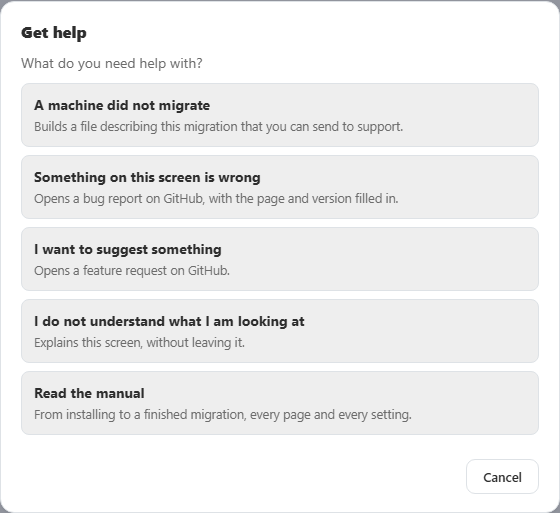

# Get help

**Get help** in the top bar opens a menu with five choices. **Cancel** or Escape closes it.

**A machine did not migrate.** Collects a support bundle for the migration you have open. It holds the plan, the state of every machine, the log, and any errors this page hit in your browser. The dialog says what the file holds: the names of runs and machines, and no passwords, keys or tokens. Select **Download the file**. Open the file and remove any part before you send it. Attach it to a problem report. The file also holds the short line of the [disclaimer](../understand/disclaimer.md).

The browser errors are the ones this page met since you opened it. They stay in your browser and go nowhere until you send the file. Nothing is sent on its own.

**Something on this screen is wrong.** Opens a report in the product's repository, in a new tab, with the page, the version and the migration already filled in. Add what you did, what you expected, and what happened instead.

**I want to suggest something.** Opens a suggestion in the repository, in a new tab.

**I do not understand what I am looking at.** Explains the page you are on: what it is, how to read it, and what to do next. The same words are in this manual. **Close** or Escape closes it.

**Read the manual.** Opens this manual in the same tab. **Back to the dashboard**, at the top of each page, or Escape takes you back to the page that you came from.

The dashboard and this manual open no new window. Two kinds of link open in a new tab, so your page stays open. One is a link to a Microsoft Learn page. The other is the two choices above that open the repository. Every other link opens in the same tab. Use the Back button of the browser to return to the page.

## Before you report a problem

- Read the machine's own panel. It says why the machine stopped and what to do. See [Why a machine stopped](../reference/stop-reasons.md).
- Check the version with the version control in the top bar. A problem in an older version may be fixed in a newer one. See [Update the product](../install/update.md).

<!-- next:begin -->

---

**Next:** [The whole journey](../journey/the-whole-journey.md)

<!-- next:end -->
