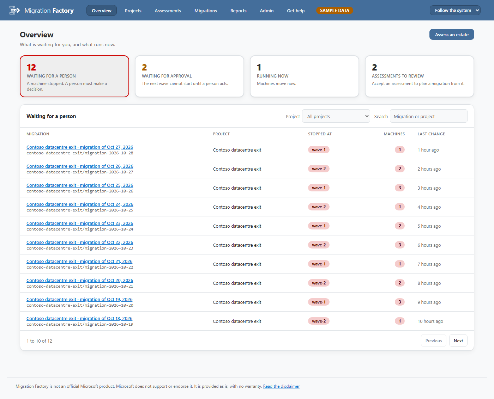

# The Overview page

The Overview page answers two questions: what is waiting for you, and what runs now. Nothing on this page changes a machine.

## The count tiles

Four tiles at the top count the migrations and assessments that need you. Each tile is a button. Select a tile to show its rows in the list below it. The selected tile has a heavier border.

**Waiting for a person.** The migrations that stopped and cannot continue without a decision. The count includes every wave of a migration. A machine that you restored after its stop does not wait, and the tile does not count it. A machine that a restore left stopped, because Azure did not swap a data disk back, waits until somebody uses **Finish the restore**. The tile counts it. See [When a machine stops](when-a-machine-stops.md).

**Waiting for approval.** The migrations whose next wave cannot start until a person acts. These are the same migrations that the Migrations page shows under **Waiting for approval**. See [The Migrations page](migrations.md).

**Running now.** The migrations that move machines at this moment. The Migrations page shows each of them under **In progress**. When the wave ends, the migration leaves this tile. When every machine is finished, the Reports page shows the migration under **Finished**.

**Assessments to review.** The assessments that nobody accepted yet. A migration can only be planned from an accepted assessment.

When the page opens, the list shows **Waiting for a person**. When no migration waits for a person, the list shows the first tile that has rows. The page reads your projects in parts. Until it has read the first project, the page says **Reading your projects and migrations.** Then, while it reads the others, each tile says **Reading** in place of its count, and the list says the same sentence. The list can change to the first tile that has rows. If the page cannot read them, each tile says **Not known**, and the list says **The list could not be read. The message at the top of the page gives the reason.** After you select a tile, the list stays on that tile.

## The list

The list shows the rows of the selected tile, 10 rows on each page.

- **Migration** or **Assessment**. The project name and the date that the run was made. Select the name to open the migration, or the review of the assessment. The run ID shows in small text below the name.
- **Project**. The project that holds the run.
- The third column is different for each tile:
  - **Stopped at** shows the waves that have a machine that waits.
  - **Next action** shows what to do and the wave that it is for: **accept**, **approve** or **start**. For an assessment, **Review** opens its report.
  - **Wave** shows the wave that runs now.
- **Machines**. For **Waiting for a person**, the machines that wait, in all the waves. For **Waiting for approval**, the machines in the migration. **Machines moving** counts the machines that the running wave moves now. **Machines found** counts the machines that the assessment found.
- **Last change**. How long ago the run changed.

Use **Project** to show the rows of one project only. Use **Search** to find a run by its name, its run ID or its project. Below the list, a line such as "1 to 10 of 23" tells you which rows you see. When **Project** or **Search** is set, the line ends with "that match the filter". The tile still counts all of its rows. Use **Previous** and **Next** to go to the other pages.

## Assess an estate

The blue button at the top right starts the wizard. See [Assess an estate](assess.md).

## The first time

When nothing exists yet, the page shows **Start here** with one button: **Create a project**. A project holds one estate. Create it, then assess the machines in it.

<!-- next:begin -->

---

**Next:** [Projects](projects.md)

<!-- next:end -->
