# Plan a migration

A plan says which machines move, to which size, in which way, and in which waves. Planning writes a plan only. Nothing moves until a wave is accepted, approved and started.

You need the operator role to plan.

## Start planning

Planning starts from an accepted assessment. On the Assessments page, select **Plan a migration** on the row. Or, in the wizard just after you accept the assessment, select **Plan a migration from this**. The wizard opens at the first planning step, **Choose the machines**. If the assessment is not accepted yet, the row says **Review** instead; see [Read an assessment](read-an-assessment.md).

The top of the wizard shows the five planning steps. In order, they are **Choose the machines**, **Choose each target**, **How to group them**, **Arrange the waves** and **Run it**.

## Step: choose the machines

An assessment of a resource group, a subscription or a management group finds every machine there. Many of them are not for this migration. In this step, you select the machines that this migration moves.

This step uses the target options that the acceptance starts. While the product makes them, the step shows **The product is making the target options.** When the product writes them, the step shows the list of machines. If the product cannot make them, the step shows the reason and the button **Make the target options**. The step also shows this button when the assessment has no target options. Select it to start them again.

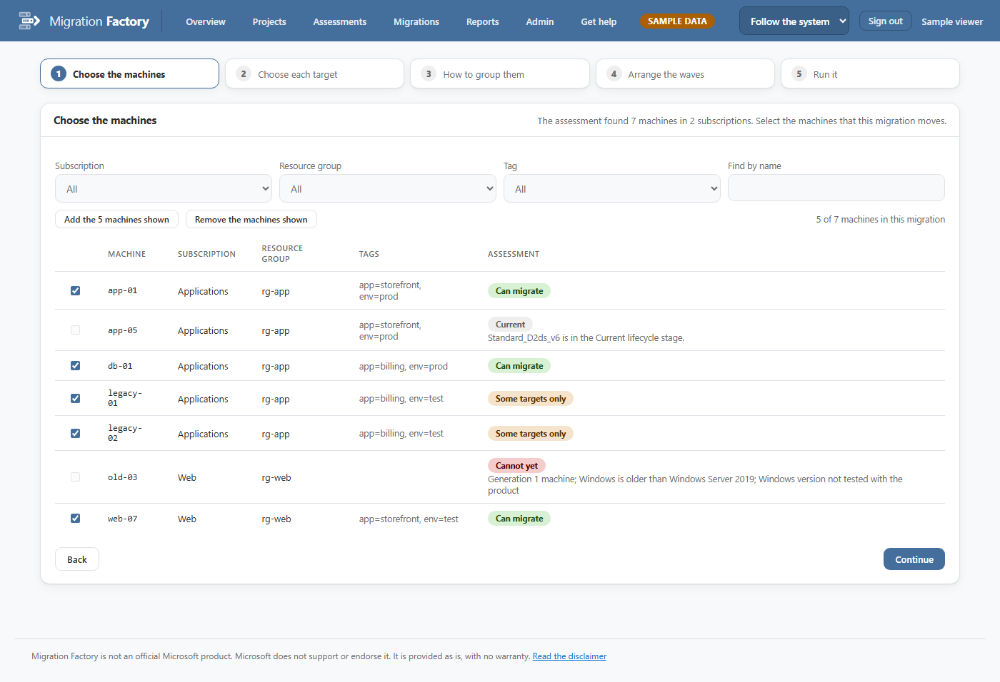

The list shows each machine that the review shows, with its **Subscription**, **Resource group**, **Tags** and **Assessment** group. A machine that is not eligible, such as a machine that a platform manages, is not in the list. At first, no machine is selected.

- **Can migrate** and **Some targets only.** You can select the machine. If the target options have no size for the machine, you cannot select it, and the row says so.
- **Cannot yet.** No size series is open to the machine, so you cannot select it. The row shows the findings that hold the machine back.
- **Current.** Microsoft puts the size of the machine in the Current lifecycle stage, so you cannot select it. The row shows, for example, **Standard_D2ds_v6 is in the Current lifecycle stage.**
- **The migration <name> holds this machine.** Another migration holds the machine, so you cannot select it. A machine can be in one migration at a time, and **Start the plan** refuses a machine that another migration holds. The machine is free after that migration migrates it, or skips or stops it with no change on it, or after you delete that migration. If the page cannot read which machines other migrations hold, it says so under the list. Then **Start the plan** checks again before it changes a machine.

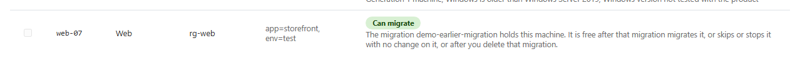

Use the four filters to find machines. You can use them together:

- **Subscription.** The machines in one subscription.
- **Resource group.** The machines in one resource group. When you choose a subscription, this list shows only its resource groups.
- **Tag.** The machines that have one tag name and value, in all subscriptions.
- **Find by name.** The machines whose name contains the text you type.

**Add the <n> machines shown** adds every machine that the filters show and that you can select. It adds the machines on all the pages of the list, not only on the page you see. **Remove the machines shown** removes every machine that the filters show. The count says how many machines are in this migration.

The list shows 50 machines at a time. **Show more** shows 50 more. **Show fewer** or Escape shows only the first 50 again.

Select **Continue**. The product saves the list. If no machine is selected, the step tells you to select one. Only the machines in the list get a target and a wave. The other machines stay in the assessment and its report. A user without the operator role sees the list with its boxes off, and the step says that an operator does it.

To add a machine later, select it in this step, save the targets again, and plan again. The wave editor cannot add a machine that is not in the list.

## Step: choose each target

Each machine that you selected moves to the target you choose here. The options appear on their own when an approver accepts the assessment. If they are not there yet, the step says so and waits. This step shows only the machines that you selected. If you change the list of machines, save the targets again.

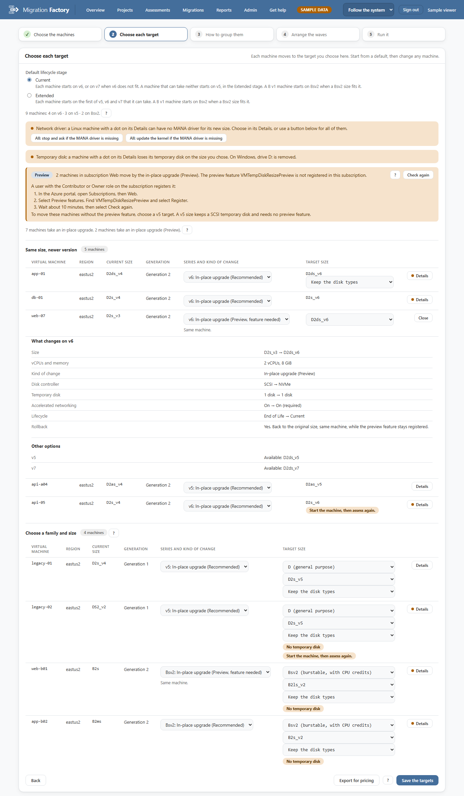

Choose a **Default lifecycle stage** for the migration. The stages are Microsoft's. The line under each stage tells you where each machine starts:

- **Current.** **Each machine starts on v6, or on v7 when v6 does not fit. A machine that can take neither starts on v5, in the Extended stage.** v6 and v7 are in the Current stage. v5 is in the Extended stage.
- **Extended.** **Each machine starts on the first of v5, v6 and v7 that it can take.** A machine starts on v5. If it cannot take v5, it starts on v6, and then on v7.

Both lines also say **A B v1 machine starts on Bsv2 when a Bsv2 size fits it.**

When you change the default, a machine that you changed in its own list keeps your change. The other machines follow the new default.

The line under the stages counts the machines on each series. An example is **10 machines: 4 on v6 · 3 on v5 · 2 on Bsv2 · 1 with no target.** Select **?** at the end of the line to read why each group is not on the series of the default. For example, **2 on v5: Generation 1 machines cannot use v6 or v7.** Each reason comes from the target options of the machines. **Close** or Escape closes it.

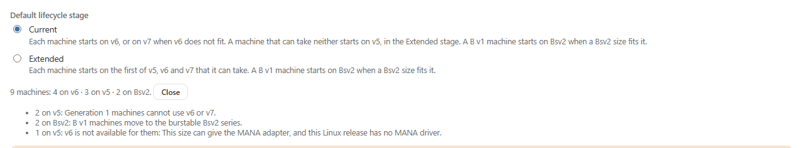

A machine on a B v1 size starts on its Bsv2 size with both defaults, when the region has a Bsv2 size that fits it. Bsv2 is in the Current stage. A Windows machine on a B v1 size reaches Bsv2 by the in-place upgrade (Preview), so its subscription needs the preview feature VMTempDiskResizePreview. See [The in-place upgrade (Preview)](#the-in-place-upgrade-preview).

Every other machine starts on the first series of the default that it can take. For example, a Windows D4ds_v4 machine starts on D4ds_v6 with the Current default, and on D4ds_v5 with the Extended default. D4ds_v6 has an NVMe temporary disk, so the move to it is the in-place upgrade (Preview). D4ds_v5 keeps a SCSI temporary disk, so the move to it is an in-place upgrade with no preview feature. You can change the series of each machine. See [In-place upgrade or in-place upgrade (Preview)](#in-place-upgrade-or-in-place-upgrade-preview).
A machine that uses accelerated networking does not start on a series where accelerated networking stops working, when another series keeps it. See [A Linux release with no MANA driver](#a-linux-release-with-no-mana-driver).

Some Linux releases are not on Microsoft's MANA list, such as Ubuntu 18.04. When the Azure Linux Agent reports such a release, the step offers no size that can give the MANA adapter. These are v6, v7, Intel v5 and Bsv2. So an Intel machine has no target, and a machine on an AMD size gets its AMD v5 size. When only the image gives the release, the step offers every series, because the machine can run a later release.

What each series does:

- **v5** keeps the SCSI disk controller. Nothing inside the machine changes for NVMe, so it changes the least. A machine whose size has a temporary disk gets a v5 size with one, when the region has it. The Intel D-family and E-family v5 sizes require accelerated networking. When a machine has it off, the wave's settings name the machine, and accepting them turns it on. An Intel v5 host gives the Microsoft Azure Network Adapter (MANA) or Mellanox. An AMD v5 size never gives MANA.
- **v6** moves the machine to the NVMe disk controller, in every region that has any of this hardware. Every v3 size has a temporary disk. So a v3 machine gets the v6 or v7 size with a temporary disk that Microsoft names, such as D4s_v3 to D4ds_v6. Every Dav4, Dasv4, Eav4 and Easv4 size has a temporary disk too. So a machine on one of these AMD sizes gets the AMD size with a temporary disk, such as D4as_v4 to D4ads_v6. Its other choice is the AMD size without one. Each machine gets the size with a temporary disk only when the region has it. Every Intel D and E size on v6 and v7 has an s after its number. So a machine on a Dv4, Dv5, Ev4 or Ev5 size gets the size with an s, such as E8_v5 to E8s_v6. A machine on a Ddv4, Ddv5, Edv4 or Edv5 size keeps its temporary disk, such as D4d_v5 to D4ds_v6. Every v6 size requires accelerated networking. When a machine has it off, the wave's settings name the machine, and accepting them turns it on.
- **v7** is the newest, in fewer regions. Microsoft supports accelerated networking on v7 and does not require it. The product turns it on for every v7 size, because v7 gives the MANA adapter.
- **Bsv2** is for a machine on a B v1 size only. Bsv2 is a burstable size with CPU credits, as B v1 is. It keeps the SCSI disk controller and takes Generation 1, as v5 does. So the step offers it on v5, and the **Series and kind of change** list shows **Bsv2** in place of v5. Microsoft supports accelerated networking on Bsv2 and does not require it. The product turns it on, because a Bsv2 host can give the MANA adapter. Bsv2 has no temporary disk. So a Windows machine on a B v1 size, which has a SCSI temporary disk, moves to Bsv2 by the in-place upgrade (Preview). Bsv2 is Intel, as B v1 is. The product does not offer Basv2, which is AMD.

A move from v4 to v5 keeps the machine in the Extended stage. A move from v3 or older leaves the End of Life stage. A machine that is already on v6 or v7 cannot choose v5. Its **Details** show v5 as **Not available: Already on a newer size**.

A machine with no option it can take starts on no target. Some sizes have no size of the same name on v5, v6 or v7. For a D, Dl or E size, **Details** say which fact stops the move. **Not available: Not a size Microsoft lists as a target** means that Microsoft has no size of that name. For example, Microsoft has no Ebsv7 series, so an E8bs_v5 machine has no v7 size, in any region. **Not available: No size in this region** means that Microsoft has the size and this region does not. For example, Microsoft lists E8bs_v6, and some regions do not have it.

An isolated size, such as E104is_v5 or E112ibs_v5, has no v6 or v7 size of its name. An isolated E80is_v4 or E80ids_v4 size has no v5, v6 or v7 size of its name. **Details** name the isolated sizes that Microsoft lists for the processor of the machine. A person chooses the size of an isolated machine, and the product does not choose one. An Intel constrained vCPU size, such as E8-4s_v5, has no v7 size. Microsoft lists E v7 constrained vCPU sizes for AMD only. An AMD constrained vCPU size, such as E8-4as_v5, has no v6 size. Microsoft lists E v6 constrained vCPU sizes for Intel only.

The machines are in two areas, by how the target is chosen. The title of each area shows how many machines it holds, for example **3 machines**.

| Area | The machines it holds |
|---|---|
| **Same size, newer version** | The machines whose target is a newer version of their size, such as D4s_v4 to D4s_v6. A machine that has no target is in this area too. A Generation 1 machine, or a machine on an older size, is in the other area. A machine on a v3 size, or on a Dav4, Dasv4, Eav4 or Easv4 size, has a **Target size** list here when both sizes fit it. The size with a temporary disk is selected first. |
| **Choose a family and size** | Generation 1 machines, and machines on older sizes that have no v5 size of the same name: B v1, A v1, Av2, Amv2, D v1, DS v1, Dv2, DSv2, F, Fs and Fsv2. A Generation 2 machine on one of these sizes is here too. The **?** next to the title of the area lists them. |

Each row shows the machine's **Region** and its **Generation**: Generation 1, Generation 2, or Unknown when Azure does not report it. Change any machine with its **Series and kind of change** list, which shows only the options that machine can take. v6 and v7 need Generation 2.

Some machines have no target. **Details** say why:

| Details say | The machine |
|---|---|
| **Retired size (not in scope)** | Is on a size that Microsoft retires, from one day before the retirement date. A v1 is one now. |
| Why, for example **GPU size (not in scope)** | Is on a size that is outside the scope of this tool. |
| **More than 32 data disks (not in scope)** | Has more than 32 data disks. |

Azure allows accelerated networking on one network interface of a size with 2 vCPUs. A move turns it on for the primary network interface and keeps it on the other interfaces. So the step does not offer a 2-vCPU size when a network interface other than the primary has it now. It does not offer a larger size instead. Under **Other options**, **Details** give the reason for that size: **This size has 2 vCPUs, so Azure allows accelerated networking on one network interface only**. To use that size, turn off accelerated networking on the other network interfaces in Azure. Then assess the machines again.

A machine in **Choose a family and size** also has a **Target size** list, and a **Size family** list when more than one family fits. A Generation 1 machine has them on v5. A Generation 2 machine on an older size has them on v5, v6 and v7, when the region has a size that fits. The product gives each family its smallest size that keeps at least the vCPUs and the memory of the machine. The size keeps the processor of the machine: AMD stays AMD, and Intel stays Intel. An AMD machine has no Dl size on v5. When the region has no AMD size that fits an AMD machine, that machine has no target, and the step says why. When the size catalog of the region does not give the vCPUs and memory of the machine's size, the product cannot choose a size. That machine has no target, and its **Details** say **Azure does not give the vCPUs and memory of this size**.

| Size family | Memory for each vCPU |
|---|---|
| **Dl (general purpose, less memory)** | 2 GiB |
| **D (general purpose)** | 4 GiB |
| **E (memory optimized)** | 8 GiB |

The best choice has the fewest vCPUs, then the least memory. It is selected first. An E size can also be a constrained vCPU size. It keeps the memory and has fewer active vCPUs, for software that is licensed by core. If a machine is on a constrained vCPU size, the best choice has the same number of active vCPUs. For example, DS13-4_v2 has 8 vCPUs, and 4 of them are active. Its best choice is E8-4ds_v5. If the region has no constrained vCPU size with that number of active vCPUs, the best choice is a size with all its vCPUs active.

A machine on a B v1 size also has **Bsv2 (burstable, with CPU credits)** on v5. It is the first family. Its size is the smallest Bsv2 size that keeps at least the vCPUs and the memory of the machine. When no Bsv2 size in the region fits the machine, the best Dl, D or E size is first, and **Details** says why. The product does not offer Bsv2 to a machine that uses Azure Disk Encryption when the move to Bsv2 changes the kind of temporary disk. **Details** shows the vCPUs and the memory of the size you chose.

A machine whose operating system disk is Standard HDD has a **Disks** list in both areas, on every size. Microsoft retires Standard HDD as the type of an operating system disk on 8 September 2028. On that date, Azure changes each one that is left to Standard SSD, and the workload can stop. This does not apply to a Standard HDD OS disk that Azure Site Recovery made, which has the tag `ASR-ReplicaDisk` or `ASR-FODisk`. The list shows for that disk too. **Standard SSD: OS disk** changes the operating system disk to Standard SSD during the move, while the machine is stopped. Then you do not stop the machine again later. Every size takes Standard SSD. The data disks keep their types. When the scan did not read the type of the disk, the list does not show.

In **Choose a family and size**, a size with an s after its number takes Premium SSD, for example D4s_v5. On such a size, the **Disks** list also has **Premium SSD: OS disk** and **Premium SSD: every disk**. They change those disks to Premium SSD during the move, while the machine is stopped. A zone-redundant disk stays zone-redundant. A Premium SSD v2, an Ultra Disk or a shared disk keeps its type. **Keep the disk types** is the first choice, and it changes no disk. If the move stops, the rollback puts each disk back on the type it had. See [Safety copies and rollback](../understand/safety-copies.md#disk-types-that-the-move-changed).

**Details** on a row shows what changes on the target you picked, before and after. It covers the size, the kind of change, the disk controller, the temporary disk, accelerated networking, the lifecycle stage and rollback.

The **Kind of change** row names the way the machine moves, with the words of the list. An example is **In-place upgrade (Recommended)**, or **In-place upgrade (Preview)**. The **Rollback** row says **Yes. Back to the original size, same machine.** for an in-place upgrade. For an in-place upgrade (Preview) it says **Yes. Back to the original size, same machine, while the preview feature stays registered.** See [How a machine moves](../understand/how-a-machine-moves.md).

The **Accelerated networking** row says **On** after the move when the move turns it on for the primary network interface. A Bsv2 size does not require it, and the move turns it on there too. When the size requires it, the row says **On (required)**. The row says **Unknown** when the product cannot tell, for example when the scan did not read the network interfaces. A move never turns accelerated networking off. When the step cannot read the Linux release, the **Accelerated networking** row says **Start the machine, then assess again.**

For a machine on a B v1 size, **Details** also shows **CPU performance**. A B size uses CPU credits. On a Bsv2 size the machine keeps its CPU credits. A size in the Dl, D or E family has full CPU performance all the time.

**Details** also lists the other options, and why each one is not available. For a Linux machine whose target can use MANA, **Details** first shows the network driver choice, described below. **Close** or Escape closes it. A choice that you make in **Details** stays when you close it, and **Save the targets** saves it.

Select **Save the targets**. A machine with no target is not moved. The product refuses to plan a migration from the app until the machines and their targets are saved.

**Export for pricing** downloads a CSV file of the targets. First it saves the targets that are not saved, and you stay on this step. If the save is refused, nothing downloads and the page shows why. A user without the operator role sees every choice off. Their file holds the targets that an operator saved, and nothing is saved first. If the saved targets are not the targets on the step, nothing downloads, and the step says that an operator saves them again. The file counts each target size by region and operating system. Then it lists each machine with its resource group, region, operating system, size now, series, target size and disks. Two more columns give the type of the operating system disk now and after the move, in the names that Azure uses. **Unknown** means that the scan did not read the type. The file holds only the machines that you selected. Its last line is the short line of the [disclaimer](../understand/disclaimer.md). Give it to your Microsoft account team for the price of the change. The last step of the wizard has the same button, with the wave of each machine. See [Start a migration](start.md).

To choose the series of the machines again after planning, choose again here and plan again. To change one machine after planning, use **Change target** in the wave editor. The wave editor gives the machine the best size of the series. When the new series changes the kind of temporary disk of a Windows machine, the wave editor plans the in-place upgrade (Preview). To choose another family or size, choose again here and plan again. See [Arrange the waves](waves.md).

### In-place upgrade or in-place upgrade (Preview)

Every machine moves by an in-place upgrade. The product changes the existing machine where it stands. The machine keeps its machine definition, its system-assigned identity, its extensions and the links from other services. The product does not rebuild a machine. An **In-place upgrade (Preview)** is an in-place upgrade that needs the preview feature VMTempDiskResizePreview on the subscription. It is the move of a Windows machine whose target has another kind of temporary disk. A Linux machine never needs the feature.

The **Series and kind of change** list of each machine names the series and the kind of change of each option. The words in brackets tell you more, without colour:

- **v5: In-place upgrade (Recommended)**. **(Recommended)** is only on the option the machine starts on, at its own size, when that option needs no preview feature.
- **v6: In-place upgrade (Preview)**. The in-place upgrade with the preview feature. While the subscription does not have the feature, it says **(Preview, feature needed)**. You cannot choose it then, unless the machine is already on it.
- **v7: In-place upgrade**. An option that the machine does not start on has no words in brackets, unless it is a Preview.

For a Preview, **Same machine.** shows under the list, in the same cell. The preview feature is a fact of the subscription, so a notice above the tables shows it one time for each subscription. See [The in-place upgrade (Preview)](#the-in-place-upgrade-preview). Nothing opens on its own.

Above the tables, a line counts the machines of each kind of change, for example **7 machines take an in-place upgrade. 2 machines take an in-place upgrade (Preview).** The line does not count a kind of change that no machine takes. Select **?** at the end of the line to read the facts of each kind of change. **Close** or Escape closes it.

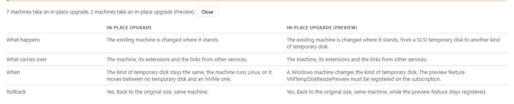

| | In-place upgrade | In-place upgrade (Preview) |
|---|---|---|
| What happens | The existing machine is changed where it stands. | The existing machine is changed where it stands, from a SCSI temporary disk to another kind of temporary disk. |
| What carries over | The machine, its extensions and the links from other services. | The machine, its extensions and the links from other services. |
| When | The kind of temporary disk stays the same, the machine runs Linux, or it moves between no temporary disk and an NVMe one. | A Windows machine changes the kind of temporary disk. The preview feature VMTempDiskResizePreview must be registered on the subscription. |
| Rollback | Yes. Back to the original size, same machine. | Yes. Back to the original size, same machine, while the preview feature stays registered. |

The save keeps the kind of change of each machine. The target options can change after a save. When the kind of change of a target is then not the saved one, the product does not plan the migration. It names the machines, and you choose their targets again. In the wave editor and on the step **Run it**, each wave names its machines that take the in-place upgrade (Preview).

A Windows machine whose move changes the kind of temporary disk has no target in two cases. The first case is a machine whose generation the scan did not read. Its option says that, and **Scan the machine again**. The second case is a change that the product does not make, such as an NVMe temporary disk to a SCSI one. The option says so. A machine with no temporary disk can move to a size with an NVMe temporary disk, or back. That move needs no preview feature, because Azure moves it as a normal in-place upgrade.
### The in-place upgrade (Preview)

Azure resizes a Windows machine in place from a SCSI temporary disk to another kind of temporary disk only with a preview feature. The feature is VMTempDiskResizePreview, registered on the subscription. Without it, Azure refuses that resize. With the feature, the machine keeps its machine definition, its system-assigned identity, its extensions and the links from other services. The product uses it for a Windows Generation 2 machine with a SCSI temporary disk, to v5, v6, v7 and Bsv2. It uses it for a Windows Generation 1 machine with a SCSI temporary disk, to a size with no temporary disk on v5 or Bsv2. Microsoft publishes no terms, limits or date of general availability for this preview.

The product reads the feature on each subscription. It never registers the feature. A notice above the tables shows each subscription where the target of a machine is the in-place upgrade (Preview). It shows **Preview**, a sentence about the feature, a **?** and **Check again**. The notice shows one time for each subscription, not on each row. When the subscription does not have the feature, or the product cannot read it, the notice is amber and tells you what to do. The **Series and kind of change** list says **(Preview, feature needed)**.

When the feature is not registered, the notice says, for example, **2 machines in subscription Applications move by the in-place upgrade (Preview). The preview feature VMTempDiskResizePreview is not registered in this subscription.** Then it gives the steps. A user with the Contributor or Owner role on the subscription registers the feature:

1. In the Azure portal, open **Subscriptions**, then the subscription.
2. Select **Preview features**. Find VMTempDiskResizePreview and select **Register**.
3. Wait about 10 minutes, then select **Check again**.

Sometimes each machine in the notice has a v5 size that keeps its SCSI temporary disk. Then the notice also says: **To move these machines without the preview feature, choose a v5 target. A v5 size keeps a SCSI temporary disk and needs no preview feature.** A machine on an F size has no v5 target.

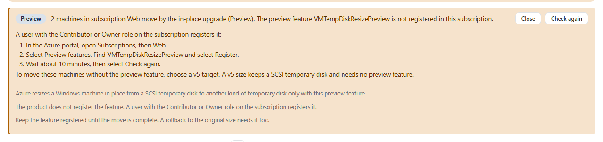

When the product cannot read the feature, the notice says, for example, **1 machine in subscription Applications moves by the in-place upgrade (Preview). The product cannot read if the preview feature VMTempDiskResizePreview is registered. Error code from Azure: AuthorizationFailed.** Azure did not let the product read the feature state. For AuthorizationFailed, the notice gives the steps: open the Admin page, and under **Where the product may work**, give **Assess** on the subscription. Then select **Check again**. For another error code, select **Check again**. See [Permissions](../reference/permissions.md) and [Admin](admin.md).

**Check again** reads the feature again and does not load the page again. When the feature is registered, the notice is not amber and says that the feature is registered. Then the Preview can be chosen on every machine in that subscription. You can save the targets before that: **Checking** reads the feature before it changes a machine. Select **?** in the notice to read what the feature does, and that you keep it registered until the move is complete. **Close** or Escape closes the help.

A machine on the Preview, for example **v6: In-place upgrade (Preview)**, shows **Same machine.** under its list. When the feature is registered, the notice of its subscription says, for example, **2 machines take the in-place upgrade (Preview). It needs the preview feature VMTempDiskResizePreview on subscription Applications. The feature is registered.**

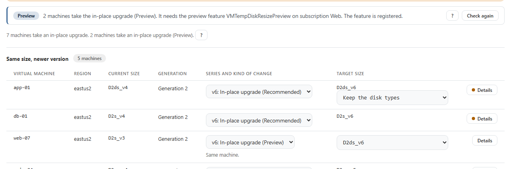

A machine whose first series of the default is a Preview starts on it. A Windows machine on a B v1 size starts on **Bsv2: In-place upgrade (Preview)**. It keeps its CPU credits.

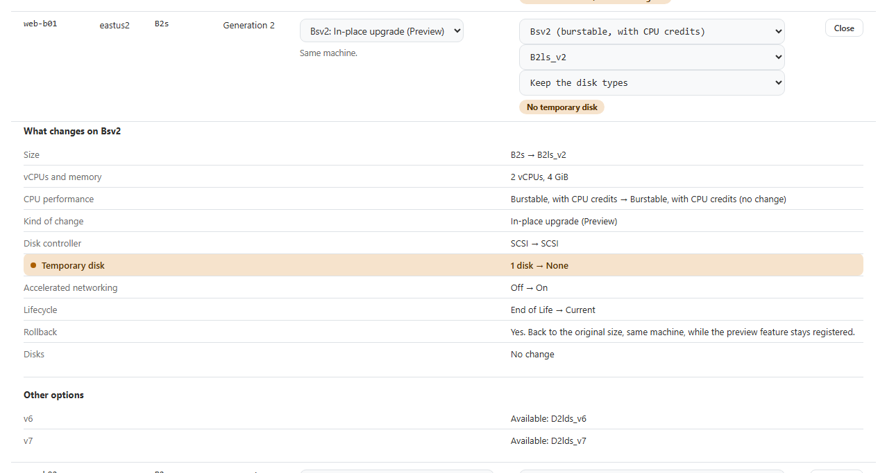

The save keeps a Preview that you chose, also when the feature is not registered later. Before it changes a machine, **Checking** reads the feature again. When the feature is not registered, or the product cannot read it, the machine stops. The reason is **The preview feature for the in-place upgrade (Preview) is not registered**. Nothing on the machine changes. Register the feature, then try again. Or choose another target for the machine, and plan again.

Keep the feature registered while the machine can still need its rollback or a restore. The rollback and **Restore this machine** from the copy **Before the migration** change the temporary disk again, so they need the feature too. Each one reads the feature before it makes a disk or stops the machine. When the feature is not registered, or the product cannot read it, it stops there and does not change the size. A rollback then stops with the reason **The rollback of the in-place upgrade (Preview) needs the preview feature**. The machine stays on its new size. It stays stopped when the failed step stopped it. It also stays stopped when an earlier try of the same rollback stopped it and did not finish, for example when its worker stopped. The stop says if the machine runs. The product does not rebuild the machine, and it does not start it on its new size. Register VMTempDiskResizePreview again on the subscription that the stop names. Microsoft gives the steps in [Set up preview features in Azure subscription](https://learn.microsoft.com/azure/azure-resource-manager/management/preview-features). In the Azure portal, open **Subscriptions**, select the subscription, then select **Preview features**. Then use **Restore this machine** and choose **Before the migration**. When you start that restore, the product reads the feature first. If the feature is not registered and the machine is not on its original size, the dialog shows the reason. No restore starts. When the product cannot read the feature there, the restore starts and reads it again before it makes a disk. A restore that the product refused for the same reason changed nothing: register the feature again, then use **Restore this machine** again. A machine that is still on its original size does not need the feature for a rollback or a restore.

### The MANA network driver of a Linux machine

On a v6, v7, Intel v5 or Bsv2 size, accelerated networking can use the Microsoft Azure Network Adapter (MANA). Linux gets the MANA driver from its kernel. A kernel older than the minimum Microsoft lists counts as one with no MANA driver. So you choose what the move does when the kernel of a Linux machine has no MANA driver.

The choice is at the top of the **Details** of each Linux machine whose target can use MANA. Its title is **MANA network driver for** and the name of the machine. Choose **Stop and ask** or **Update the kernel**. A line below each choice says what it does. **Stop and ask** is selected first. A Windows machine has no choice, because the product adds the MANA driver to its driver store. A Linux machine whose target cannot use MANA, such as an AMD v5 size, has no choice. A Linux machine has no choice when its Azure Linux Agent reports a release that is not on Microsoft's MANA list, such as Ubuntu 18.04. A kernel update does not change the release, so it cannot give that machine a MANA driver.

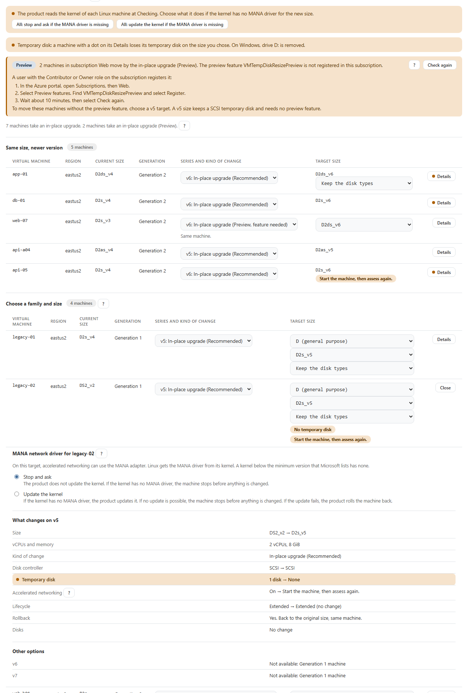

Until you open its **Details**, each such machine has an amber dot on its **Details** button. While a machine has a dot, an amber notice shows above the tables: **The product reads the kernel of each Linux machine at Checking. Choose what it does if the kernel has no MANA driver for the new size.** The choice does not say that the kernel has no MANA driver. Checking reads the kernel, and the choice applies only when the kernel is below the minimum. The notice has two buttons:

- **All: stop and ask if the MANA driver is missing.**
- **All: update the kernel if the MANA driver is missing.**

A button sets that choice on each machine that has a dot. Then the network driver notice goes. A machine that also loses its temporary disk keeps its dot until you open its **Details**. You can change one machine in its **Details** after that. When the page loads again, the dots show again, and the choices stay as you saved them.

With **Stop and ask**, the product does not update the kernel. If the kernel has no MANA driver, the machine stops before anything is changed. See [Wave settings](wave-settings.md). With **Update the kernel**, the product updates the kernel during the move, but only when the kernel has no MANA driver. If no update is possible, the machine stops before anything is changed. If the update fails, the product rolls the machine back. It uses only the repositories that the machine uses. A Red Hat Enterprise Linux pay-as-you-go image for one minor release, such as RHEL 9.4, uses the Extended Update Support (EUS) repositories. They have no kernel of a later minor release, so the move stops before anything is changed. Before the move, move such a machine to the RHEL release that Microsoft lists for MANA, on EUS or non-EUS repositories. The Microsoft page Red Hat Update Infrastructure gives the steps for both. See [Stop reasons](../reference/stop-reasons.md). See [How a machine moves](../understand/how-a-machine-moves.md). Select **?** beside the title to read about the update, and **Close** or Escape to close it. The plan keeps the choice as the setting of that machine, and the wave settings name the machine.

A Red Hat Enterprise Linux machine can show an amber note in its choice: **This machine was made from a Red Hat EUS image**. The step shows it when all of these are true:

- The image is the RHEL pay-as-you-go image of Red Hat, with no license type on the machine.
- The image name has a minor version, such as `RedHat:RHEL:94_gen2`. Microsoft says that such an image uses the EUS repositories of Red Hat Update Infrastructure (RHUI).
- The machine runs that minor release.
- Microsoft lists only a later minor release of that major release for MANA.

EUS repositories hold updates for one minor release only, so **Update the kernel** finds no kernel of a later minor release there. The note names the lowest RHEL release that Microsoft lists for MANA. To use this target, move the machine to that release before the move, on EUS or non-EUS repositories. The step still offers **Update the kernel**.

### A size with no temporary disk

When the size you chose has no temporary disk and the machine has one now, the row shows **No temporary disk** under the size. Its **Details** button has an amber dot until you open **Details**, and the **Temporary disk** row in **Details** is amber. While a machine has a dot, an amber notice above the tables says what the dot means. The buttons of the network driver notice do not remove this dot. On Windows, the move is the in-place upgrade (Preview), and drive D: goes away. The step reads the temporary disks of each size from Azure, not from the size name. When Azure does not report them, the step shows no mark.

For a machine with a temporary disk, the product tries the size with a temporary disk first, for example D4ds_v6. When that size does not fit the machine, the product uses the size without one, for example D4s_v6. Then a **?** shows next to **Temporary disk** in **Details**. Select it to read which size the product did not use, and why. These are the reasons:

- Microsoft does not list the size.
- The region does not offer the size.
- The size is not a target size that the product offers.
- The size does not take Generation 1 machines.
- The size holds fewer network interfaces or data disks than the machine has.
- The size has fewer vCPUs or less memory than the machine.
- The catalog of the region does not give the vCPUs and memory of the size.
- The size allows accelerated networking on one network interface only, and the machine has it on more than one.

When this makes the move of a Windows machine the in-place upgrade (Preview), the text says so. **Close** or Escape closes it. The plan keeps the same reason as a note under the machine on the step **Run it**.

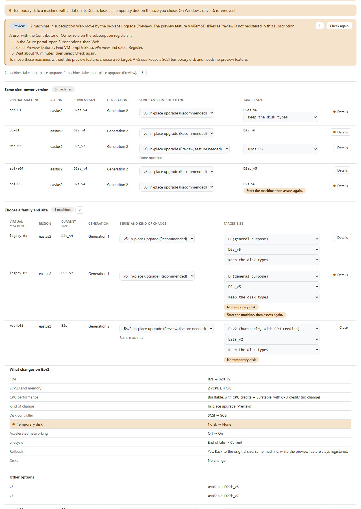

### A SQL Server machine on a size with an NVMe temporary disk or none

The scan can find SQL Server on a machine. If the size you chose has an NVMe temporary disk or none, the row shows **Check where SQL Server keeps tempdb** under the size. The machine has a SCSI temporary disk now. If tempdb is on that disk, SQL Server can fail to start after the move. A v5 size with a temporary disk keeps a SCSI temporary disk, and the row shows no tag. A machine where the scan did not find SQL Server shows no tag. The step **Run it** asks for a sign-off for these machines. See [SQL Server and the temporary disk](../reference/before-a-machine-moves.md#sql-server-and-the-temporary-disk).

### A Linux release with no MANA driver

Accelerated networking after the move depends only on the Linux release and on the network adapter of the target size. The number of network interfaces does not change it. A machine with one network interface is affected in the same way as a machine with more.

| Target size | Network adapter | Release on Microsoft's MANA list, for example Ubuntu 22.04 or Red Hat Enterprise Linux 9.6 | Release not on the list, for example Ubuntu 18.04 or Red Hat Enterprise Linux 8 | Windows |
|---|---|---|---|---|
| v6 | MANA | On | Not offered | On |
| v7 | MANA | On | Not offered | On |
| AMD v5 | Mellanox | On | On | On |
| Intel v5 | MANA or Mellanox, by host | On | Not offered | On |
| Bsv2 | MANA or Mellanox, by host | On | Not offered | On |

A size with 2 vCPUs allows accelerated networking on one network interface only. That is a different rule. See [Step: choose each target](#step-choose-each-target).

On a size that can give the MANA adapter, the product always turns accelerated networking on. Azure gives that adapter when the setting is off too, so the setting does not keep it off. Linux gets the MANA driver from its kernel. On a release that is not on the list, a kernel update does not help, because it does not change the release. So the step offers no such size to that machine, whether it uses accelerated networking now or not. Its **Details** show each of these series as **Not available: This size can give the MANA adapter, and this Linux release has no MANA driver**.

An Intel machine on such a release has no target, so you cannot select it on **Choose the machines**. The product never offers it an AMD size. A machine on a B v1 size is the same, because Bsv2 can give the MANA adapter. A machine on an AMD size gets its AMD v5 size, where Mellanox carries accelerated networking. For example, an Ubuntu 18.04 machine on D2as_v4 starts on D2as_v5.

On **Choose the machines**, the row of an Intel machine of this kind says what to do. On this step, the **Details** of an AMD machine of this kind start with the same words. For example: **Microsoft does not list Ubuntu 18.04 for MANA, so this machine cannot move to a size that can give the MANA adapter. Upgrade the operating system to Ubuntu 22.04 or a later release, then assess again.** The release it names is the first release of the same distribution on the list. Select **?** beside **Other options** to read the table above, and **Close** or Escape to close it.

Red Hat Enterprise Linux, Rocky Linux and AlmaLinux 9.4 are on the list through 9.6. A normal update within the major release reaches 9.6, so the step offers v6 and v7 with **Update the kernel**. See [The MANA network driver of a Linux machine](#the-mana-network-driver-of-a-linux-machine). SUSE Linux Enterprise Server 15 SP4 is not on the list, because a service pack is not a normal update.

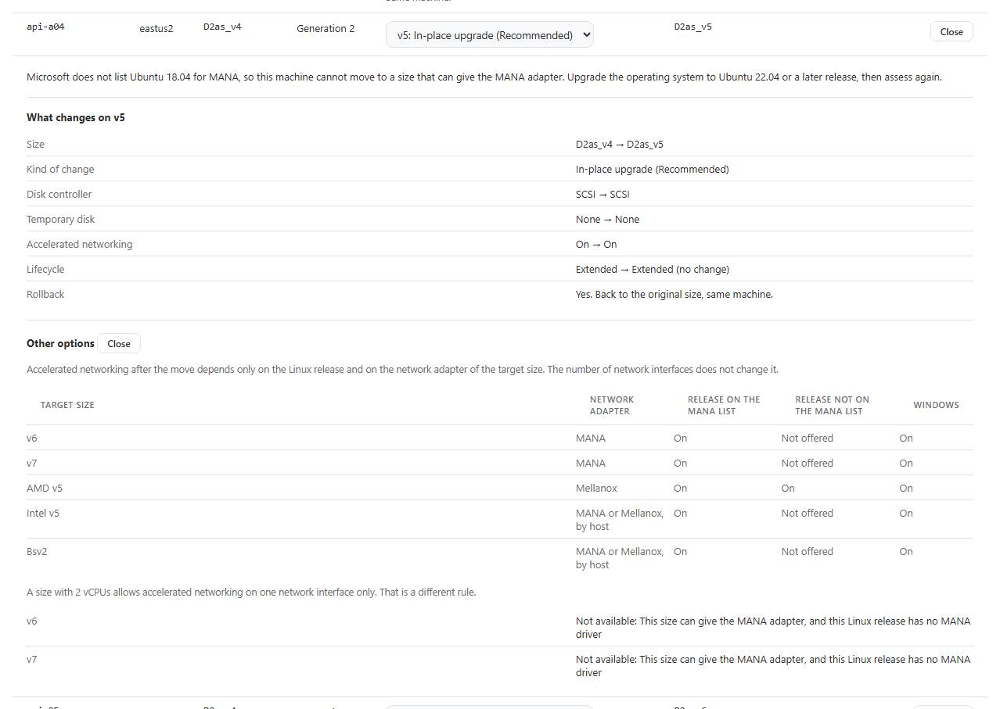

### When the release could not be read

The step reads the Linux release from Azure. First it uses the release that the Azure Linux Agent reports while the machine runs. For MANA, only this release removes a series from the step. When the machine was stopped during the assessment, the agent reports nothing. The release of the image is not proof, because an upgraded machine can have a later release. Then the step keeps the default target, and the row shows **Start the machine, then assess again.** under the size. **Details** shows the same words in the **Accelerated networking** row. Do that, and the step can then say **On**, or that the machine needs a later release. If you move the machine without that, Preparing reads its MANA driver before any change, and stops the machine if it has none.

### A Linux release that is not on the NVMe list

Microsoft lists the Linux releases that support NVMe disks. If a machine runs another release, the assessment shows the finding **Linux release is not on the NVMe list**. The step then offers no v6 or v7 size. If a v5 size fits the machine, the step offers v5. If the Azure Linux Agent reports no release, the assessment reads the release of the image. If the assessment cannot compare the release, it shows **Linux release not compared with the NVMe list**.

The step then offers v6 and v7. The [Support matrix](../reference/support-matrix.md#linux-releases-for-nvme) lists the releases.

### Encryption at host and Ultra Disk

A target size must support each feature that the machine uses. The assessment reads two of them from Azure: encryption at host, and Ultra Disk compatibility. For each size, the step reads the size list of the region. A machine in an availability zone needs Ultra Disks in its zone.

The step does not offer a size that does not support a feature that the machine uses. It also does not offer a size when Azure does not say that the size supports it. Then **Details** show the series as **Not available**, with one of these reasons:

- **This machine uses encryption at host. Azure does not say that this size supports it.**
- **This machine has Ultra Disk compatibility enabled. Azure does not say that this size supports Ultra Disks in the zone or region of this machine.**

The plan keeps the same reason as a note under the machine.

Before it changes a machine, **Checking** reads the machine and the size list again. For each Premium SSD v2 or Ultra Disk of the machine, the target size must support Premium Storage. If the target size does not support a feature or a disk type of the machine, the machine stops. If Azure does not say, the machine stops too. The reason is **The target size does not support a feature or a disk type that this machine uses**. Nothing on the machine changes.

The wave of that machine has started, so its target cannot change in this migration. To move the machine to another target, select **Leave this machine out**. Then assess the machines again, and plan the machine in a new migration. See [Stop reasons](../reference/stop-reasons.md).

## Generation 1 machines

The assessment counts a Generation 1 machine under **Some targets only**, because v5 takes it and v6 and v7 do not.

On this step, a Generation 1 machine starts on v5 under both defaults, when a v5 size fits it. A Linux release with no MANA driver gets no Intel v5 size, so an Intel Generation 1 machine with such a release has no target. See [A Linux release with no MANA driver](#a-linux-release-with-no-mana-driver). Its **Details** show v6 and v7 as **Not available**, with the reason **Generation 1 machine**.

A Generation 1 machine gets no target when no v5 size fits it.

v6 and v7 take Generation 2 machines only. A Generation 1 machine that no v5 size fits is outside the scope of this tool.

## Step: how to group the machines into waves

A wave is a group of machines that move together. You can change the waves after this step. Choose how the first grouping is made:

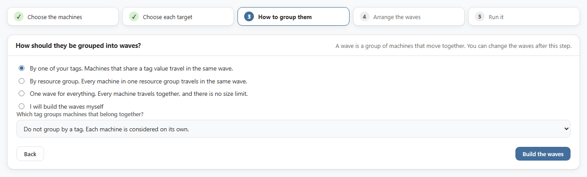

- **By one of your tags.** Machines that share a tag value travel in the same wave. Choose the tag. This is the best choice when your machines already carry an application or environment tag.
- **By resource group.** Every machine in one resource group travels in the same wave.
- **One wave for everything.** Every machine together, with no size limit.
- **I will build the waves myself.** Every machine starts outside any wave, and you arrange them on the next step.

Each tag value, resource group or availability set becomes one wave, whatever its number of machines. The wave setting **How many machines at once** sets how many of its machines the product works on at the same time. See [Wave settings](wave-settings.md). To make a wave smaller, move machines out of it on the next step.

**Back** goes to the step **Choose each target**, where you can change a target and save the targets again. The wizard stays on the step that you return to.

When the grouping is correct, select **Build the waves**. The product makes a migration from the assessment and writes its plan. The step shows **Building the waves.** When the plan is written, the wizard goes to the next step.

If you open the migration while the plan is not written yet, this step waits for the plan in the same way. **Back** goes to the assessment.

The product can refuse to plan. For example, a machine has no saved target, or the targets were saved for a different list of machines. Then the step stops the wait and shows **The product did not make the plan**, with the reason. Select **Back** to go to the assessment, correct the problem, and then select **Build the waves** again.

If the product sends no plan and no error in 10 minutes, the step tells you. It continues to look for the plan.

After the plan is written, this step cannot group the machines again. To group them in a different way, delete the migration and plan a new one from the assessment.

## Step: arrange the waves

This step is the wave editor. Move machines between waves, rename the waves, and set how each wave runs. Check the quota of the plan here, before you start the plan.

**Save the plan** saves your changes and goes to the last step, **Run it**. **Back** goes to the step **How to group them**. See [Arrange the waves](waves.md) and [Capacity and quota](capacity.md).

## Step: run it

This is the step that starts the machines moving. No earlier step changes a machine. Two controls in the wave editor act in Azure before it: **Reserve capacity** and **Request an increase**. This step shows every wave, then what you confirm before the plan starts.

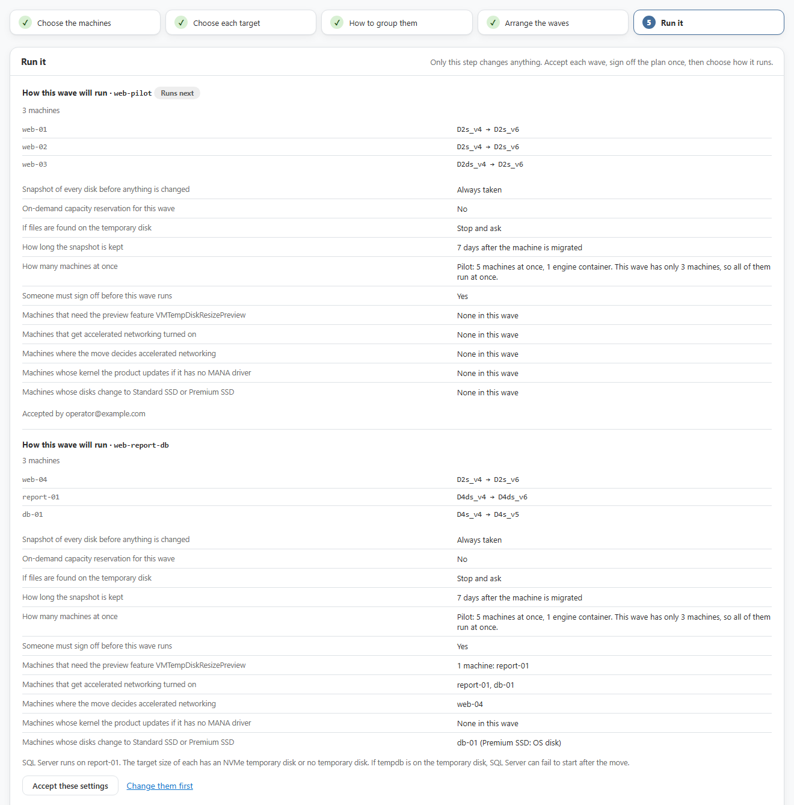

**How this wave will run.** One section for each wave, in the order the waves run. The first one shows **Runs next**. Each section lists the machines with their size now and their target size, then the settings of the wave. Under a machine, a note from the plan can tell you what to check first. For example, a Windows machine that can get the MANA driver during the move must connect to download.microsoft.com over HTTPS. Another note names the size with a temporary disk that the product did not use, and why. An example is **The product did not use Standard_D4ds_v6 because it holds 4 data disks, and this machine has 6. The target is Standard_D4s_v6.** Under **Machines that get accelerated networking turned on**, it names each machine whose move turns it on. Under **Machines where the move decides accelerated networking**, it names each machine whose network interfaces the scan did not read. Under **Machines whose disks change to Standard SSD or Premium SSD**, it names each machine whose move changes the type of its disks. Each name has the change after it: **Standard SSD: OS disk**, **Premium SSD: OS disk** or **Premium SSD: every disk**. You choose this for each machine on the step **Choose each target**. A wave with no such machine shows **None in this wave**. Read the settings, then select **Accept these settings**. **Change them first** opens the wave editor at that wave. When more than one wave waits, one button accepts all of them, for example **Accept all 3 waves**. You need the operator role to accept the settings. Without it, the section says who accepts them. See [Choose how a wave runs](wave-settings.md).

**Temporary disks.** When a target size has a different temporary disk from the current size, the step says so, machine by machine:

- **These machines lose their temporary disk.** Their target size has no local temporary disk, so the machine loses the one it has. On Windows, the D: drive goes away. Move anything that writes there to another disk before the move.
- **These machines gain extra local drives.** Their target has more local NVMe disks than one temporary disk. The product combines them into one temporary disk at every start. On Windows, that drive is D:.

**Before you sign off: SQL Server and the temporary disk.** This section shows only for a machine where the scan found SQL Server. It shows only when that machine moves from a SCSI temporary disk to an NVMe temporary disk or none. It lists these machines by name. If tempdb is on the temporary disk, SQL Server can fail to start after the move. Check where tempdb is on each machine. If it is on the temporary disk, put tempdb on another disk before the migration. Or, on the step **Choose each target**, choose a v5 size with a temporary disk. Then tick **I checked where tempdb is on each of these machines.** You need the approver role to tick it. **Sign off the plan** does not sign off until you tick it. The sign-off records the machines with who signed off and when, and the report shows them in its Sign-off table. After the sign-off, the step does not show the section again. Each wave section also names these machines under its settings.

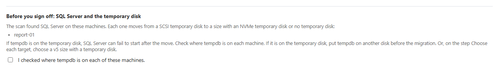

**Before you start: machines defined in code.** The step shows this note:

> Terraform, Bicep, Pulumi, ARM templates and Ansible keep their own definition of each machine. This migration makes these changes, and those definitions do not know about them:
>
> - The size of the machine changes.
> - A move to v6 or v7 changes the disk controller from SCSI to NVMe.
> - A move can change accelerated networking.
> - A move can change the disk type to Standard SSD or Premium SSD.
> - A rollback or a restore puts the machine on new disks, made from its safety copies. A restore can keep the disk names.
>
> The next apply can undo these changes, or replace the machine. Reconcile your definitions after the migration.

Tick **I understand, and I will reconcile our definitions after the migration.** to say you understand. You need the operator role to tick it. The product records the tick when you sign off the plan or select **Start the plan**. After that, the step does not show the note again. The product refuses to start a migration without it. The migration's page shows the same note in **Accept and let this run start**.

**Machines that need the preview feature VMTempDiskResizePreview.** Each section names the machines of the wave that take the in-place upgrade (Preview). Their subscription must have the feature registered when they move. A wave with none shows **None in this wave**.

**Sign off the plan.** When the settings of every wave are accepted, an approver signs off the plan once. This gives each wave its own approval, so a later change to one wave asks again for that wave only. A wave can get a SQL Server machine after the sign-off, for example from a new target. Then only a new sign-off of the plan approves that wave.

**How should this run?** Choose **Run it all now**, or **Give some waves a start time**. Then select **Start the plan**. **Export for pricing** downloads the plan with the wave of each machine. See [Start a migration](start.md).

## Before a large wave: the checks the product does not make

The product checks the machine, the size, the image, the quota and the safety copies. Four checks stay yours: your low-level agents, your software vendor's support, your own backup product, and your Azure Reservations. The wizard does not ask about them. Capacity stays yours too, unless the wave has an on-demand capacity reservation. Read [Checks before a machine moves](../reference/before-a-machine-moves.md) before a large wave, and prove the answers on a small wave first.

<!-- next:begin -->

---

**Next:** [Arrange the waves](waves.md)

<!-- next:end -->
