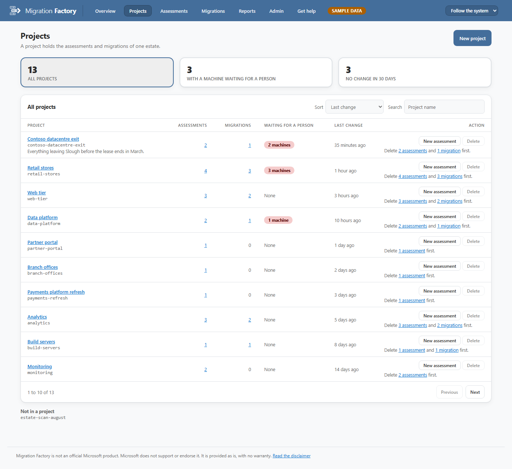

# Projects

A project is a folder for one estate: a datacentre you are leaving, a platform you are refreshing, a business unit's machines. It holds the assessments of that estate and the migrations planned from them. Everything else lives inside a project, so it is the first thing to create.

## Create a project

1. Select **New project**.
2. Type a name. The page shows the address it will use, made from the name.
3. Add a description if you want one.
4. Select **Create project**.

While the product creates the project, the button says **Creating the project...**. Then the page says **Project created. Start an assessment in it.** The new project is in the list at once.

## The counts

Three counts are at the top of the page. Each count is a button. Select a count to show its projects in the list below it.

| Count | The projects it shows |
|---|---|
| **All projects** | Every project. The list shows these projects when the page opens. |
| **With a machine waiting for a person** | The projects that have a migration with a machine that waits for a person. |
| **No change in 30 days** | The projects that had no change in the last 30 days. |

The list does not hide a project until you select a count.

While the page reads your projects, each count says **Reading** in place of a number, and the list says **Reading your projects.** If the page cannot read them, each count says **Not known**, and the list says **The list could not be read. The message at the top of the page gives the reason.**

## The list

Each row is one estate.

| Column | What it shows |
|---|---|
| **Project** | The name of the project, with its address under it. The name opens the assessments of the project. |
| **Assessments** | The number of assessments in the project. The number opens the Assessments page for the project. |
| **Migrations** | The number of migrations in the project. The number opens the Migrations page for the project. |
| **Waiting for a person** | The number of machines that wait for a person, in red, or **None**. **Not known** shows when a migration's status does not give the number. |
| **Last change** | The time of the last change to the project, its assessments or its migrations. |
| **Action** | **New assessment** starts the wizard inside the project. **Delete** deletes the project. |

- **Sort** puts the list in order of **Last change** (the most recent first), **Name**, or **Waiting for a person** (the most machines first).
- **Search** finds a project by its name or its address.
- The list shows 10 projects at a time. Select **Next** and **Previous** to see the other projects. The line below the list says which projects show, for example **11 to 13 of 13**.

The page adds each project to the list when it reads it. The list does not change while you type a new project. It also waits while you move the pointer on a button, a link or a field in it. It changes when you go out of the field, move the pointer away, or stop for 10 seconds.

Assessing the same estate again is normal. That is how you see what changed after somebody fixed the things holding machines back.

## Delete a project

A project that still holds assessments or migrations cannot be deleted. Its **Delete** button is not available, and the row says what to delete first, for example **Delete 2 assessments and 1 migration first.** Each part of that sentence opens the page where you delete them. When the project is empty, **Delete** on its row removes the project and its name. Your machines are not touched.

## Projects and people

Every person with a role sees every project. Projects organise the work; they do not restrict who sees it.

<!-- next:begin -->

---

**Next:** [Assess an estate](assess.md)

<!-- next:end -->
