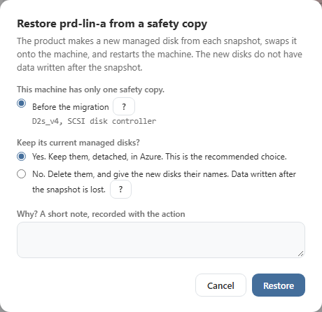
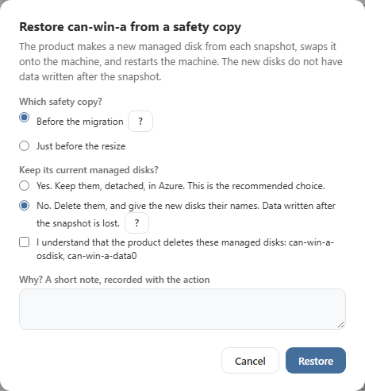
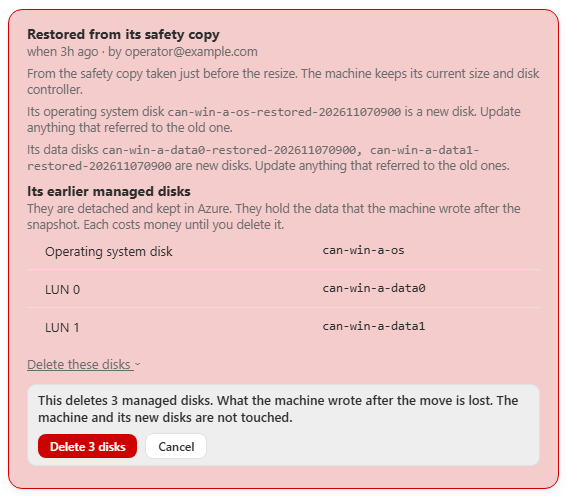
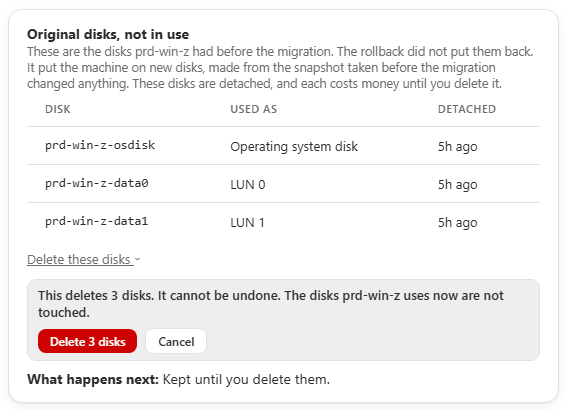
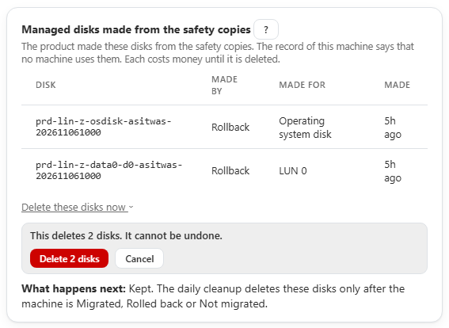

# Restore a machine

Restoring a machine makes a new managed disk from each snapshot of a safety copy, for the operating system disk and each data disk. The product swaps the new disks onto the machine. The current disks stay in Azure, detached, unless you choose to delete them. When a step fails after a change, the product rolls the machine back on its own. You can also restore a machine yourself, for a machine that migrated and then turned out to have a problem the checks did not catch.

## When to do it

- The machine migrated, and the people who use it report a problem that started with the move.
- The panel says the machine is not as it was, and the machine still exists. A rollback before the move that did not finish leaves the machine like this. **Restore this machine** shows for it, also when only the first copy exists.

**Restore this machine** shows only after the move of the machine ended. While the move goes on, the wave owns the machine, and the panel says why the button is not there. This also applies when the wave stopped part way. If the move fails, the wave rolls the machine back. To get the machine back now, select **Stop this migration**, then restore the machine.

The new disks do not have the data written after the snapshot. If you keep the current disks, that data stays on them. Restore the machine soon after the move, so that less data is written after the snapshot.

## Do it

1. Open the migration and select the machine's row.
2. Select **Restore this machine**. The dialog **Restore** *machine* **from a safety copy** opens.
3. Under **Which safety copy?**, choose the copy. Each copy shows the size and disk controller that the record of the machine gives for it. When the record does not give a size, the copy shows none:
   - **Before the migration.** The first copy. The machine returns to the size and disk controller it had before the migration. Accelerated networking also returns to how it was. Select **?** beside the copy to read this in the dialog. The restore changes the machine in place. It does not delete the machine in Azure, so the machine keeps its extensions and its system-assigned identity.

   A machine with the Site Recovery extension: the dialog says that a restore that swaps disks stops the replication. After the restore, disable replication and enable it again.
   - **Just before the resize.** The second copy, taken after the operating system was prepared. The machine keeps its current size and disk controller.

   A machine with only one copy shows only that copy. A machine has only the first copy when a step failed before the second copy and the rollback could not finish. For such a machine, the dialog says **This machine has only one safety copy.** and shows only **Before the migration**.

   
4. Under **Keep its current managed disks?**, choose one answer. It applies to every disk.
   - **Yes. Keep them, detached, in Azure.** This is the recommended choice, and the dialog selects it first. The new disks get new names. The machine's panel lists each current disk after the restore. Each one costs money until you delete it in Azure.
   - **No. Delete them, and give the new disks their names.** Data written after the snapshot is lost. Each new disk gets the name and resource ID of the current disk. The product does not copy the tags, role assignments or backup of the current disk. The safety copies are then the only copies, and the daily cleanup deletes them when the retention of the wave ends. The checkbox names each disk that the product deletes. Select it to say you understand.

   For a machine with a Premium SSD v2 or Ultra Disk that has a safety copy, the dialog says more under **No**. The product does not delete such a disk while an instant access snapshot of it is not complete. That disk stays as it is, and the checkbox can still name it. The record names each disk that stays and the reason.
5. Write a short note.
6. Select **Restore**. **Cancel** or Escape closes the dialog and changes nothing. If a **?** text is open, Escape closes that text first.

The dialog says two more things only for a machine that has these disks. A shared disk stays as it is. If Azure cannot use the snapshot of a Premium SSD v2 or Ultra Disk now, the restore stops before it changes the machine.

### What the restore does

1. The product reads the power state of the machine.
2. It reads the permissions of its managed identity on each resource that the restore uses:
   - The machine, for each operation that the restore uses. See [What Restore this machine reads first](../reference/permissions.md#what-restore-this-machine-reads-first).
   - Each network interface of the machine.
   - Each user-assigned managed identity of the machine.
   - The capacity reservation group of the machine.
   - From the first copy: each resource that a network interface links to, for example its subnet.
   - For each disk that the restore makes from a snapshot: the snapshot and the disk encryption set.

   Before a move changes the machine, the product reads the permissions that the move needs on the machine and on the linked resources.
3. It gets a new disk for each disk of the copy. From the first copy, it uses the rollback disks that it made before the move. From the second copy, or when the rollback disks are not there, it makes each new disk from its snapshot.
4. It stops the machine and swaps the new disks onto it.
5. It starts the machine on the size and disk controller of the copy you chose. It waits for the agent of the machine.
6. It checks the volumes inside the machine. It compares the mounted volumes with the volumes that were mounted before the move.
7. It returns the machine to the power state from step 1. A machine that was running stays running.

The row shows **Restoring** while this happens, then **Restored** with when and by whom. If the restore stops, the top of the page and the migration's **Activity** give the reason. You need the operator role.

Each new disk gets the encryption type and disk encryption set of the current disk. A customer-managed key must be enabled. A shared disk, and a disk with no copy, stay as they are.

### If you delete the current disks

The new disks get the names of the current disks. Azure cannot have two disks with one name, so the product uses one more disk for each:

1. Before it stops the machine, it makes a disk with a temporary name. When a rollback disk is there, it uses that disk.
2. It swaps the disks with a temporary name onto the machine, and deletes the current disks.
3. It makes the disks with the old names and swaps them onto the machine. Then it deletes the disks with a temporary name.

A resource lock stops this. Before it changes anything, the product reads the locks on each disk that it deletes, on its resource group and on its subscription. A CanNotDelete or ReadOnly lock stops the restore, and the reason names the lock and the disk. Remove the lock, or keep the current disks.

### When the restore stops

| What happens | What the product does | What you do |
|---|---|---|
| The product's managed identity does not have a permission that the restore needs, or the product cannot read that permission | Stops before it changes the machine. The reason names the resource and the permission. | Grant the VMF Migration role on the scope that the reason names. Then restore the machine again. |
| Azure does not make a new disk, or makes a different disk | Stops before it changes the machine. The reason names each disk that the restore made, and the next restore names them again. | Delete those disks, or let the daily cleanup delete them. Each one costs money until then. |
| Azure refuses to swap a data disk two times, or the product cannot read which disk is on a LUN after a failed swap | Keeps the machine stopped. The panel shows **Finish the restore**. | Select **Finish the restore**. See [When Azure does not swap a data disk back](../understand/safety-copies.md#when-azure-does-not-swap-a-data-disk-back). |
| Azure refuses to delete the current operating system disk | Puts that disk back, starts the machine, and returns it to its power state. The restore does not happen. **Activity** gives the reason from Azure. | Correct the cause, then restore again. If **Activity** names a disk to attach, attach it before you start the machine. |
| Azure does not delete a disk with a temporary name | Continues. **Activity** names the disk. | Delete the disk. It costs money until then. |
| The product cannot read whether a data disk is shared, or Azure cannot use the snapshot of a disk now | Stops before it changes the machine. The reason names the disk. | Correct the cause, then restore again. |
| Azure does not set accelerated networking back | Continues. **Activity** says so. | Check accelerated networking on the primary network interface. |
| Azure refuses the power state three times | The panel says the power state. | Select **Return to the power state**. |
| A volume that was mounted before the move is not mounted after the restore | Records the machine as changed. **What happened** names each volume. The panel shows **Check the volumes**. | Mount each volume inside the machine. Then select **Check the volumes**. See [Check the volumes](#check-the-volumes). |
| The product cannot check the volumes after the restore | **What happened** says why. The panel shows **Check the volumes**. | Make sure that every volume is mounted. Then select **Check the volumes**. |

If you delete the current disks, a Premium SSD v2 or Ultra Disk stays while an instant access copy depends on it. The record names each one and the reason.

### Check the volumes

**Check the volumes** checks the volumes of a machine again, and does not move the machine. The panel of the machine shows it when a restore or a rollback found a volume that is not mounted. The panel also shows it when the product could not check the volumes. It shows in each state that no job works on, also on a migrated machine. You need the operator role.

1. Mount each volume inside the machine.
2. On the panel of the machine, select **Check the volumes**.
3. In the dialog, select **Check the volumes**. To close the dialog with no check, select **Cancel**.

The product runs the check that **Try this machine again** runs first:

- If the machine is Stopped or Stopped (deallocated), the product starts it for the check. Then the product returns the machine to that power state.
- On Linux, the product first updates the LVM devices file and mounts the volumes that the fstab file names. On Windows, it changes the status of a data disk to Online if it was online before the move.
- When every volume is mounted again, the product records the machine as restored. The panel no longer shows **Check the volumes**.
- When a volume is not mounted, the machine stays changed. **What happened** names each volume.
- When the check cannot run, the machine stays changed. **What happened** says why.

If the job of the check stops after it started the machine, the service starts the check again within about 5 minutes. The check then returns the machine to its power state. Until then, the panel says that the machine is Running because a check did not finish. After three more tries, the service stops. Then select **Check the volumes** again.

## Afterwards

The **Restored from its safety copy** part of the machine's panel says which copy the product restored the machine from, when, and by whom. It names the new disks, and says whether they got new names. **What happened** on the machine's panel lists each step of the restore beside the steps of the migration. These are the lines that **Activity** shows for the machine. If a restore does not finish, the top of the panel says **The restore did not finish**, and gives the reason.

A restore of a machine that stopped with **Needs a decision** or **Needs attention** ends that stop. The machine then does not stop a signed-off plan, and the next wave can start on the next check of the service. A restore that leaves **Finish the restore** ends the stop only when the finish is done. See [What stops a plan that runs on its own](start.md#what-stops-a-plan-that-runs-on-its-own).

- **If you kept the current disks**, the new disks got new names. Anything that referred to the old disks by name or resource ID needs updating. The panel lists the current disks under **Its earlier managed disks**: the operating system disk and the LUN of each data disk, with its name. They are detached and kept in Azure. They hold the data that the machine wrote after the snapshot. Each one costs money until you delete it. See [Delete the earlier managed disks](#delete-the-earlier-managed-disks).
- **If you deleted the current disks**, each new disk has the name and resource ID of the earlier disk. Its tags, role assignments and backup are not copied. Set them again if you need them.

### Delete the earlier managed disks

Under **Its earlier managed disks**, **Delete these disks** deletes the disks in that list. You need the operator role. Select **Delete these disks**, and a warning opens under it, in the panel. The warning says how many managed disks it deletes. When you delete them, what the machine wrote after the move is lost. The machine and its new disks do not change. Select the red button, for example **Delete 3 disks**, to delete the disks. Select **Cancel** to close the warning with no change. Escape and **Delete these disks** also close it.

The product deletes only the disks that the record of the restore names, by their resource IDs. It does not delete a disk that is attached to a machine at that time, or a disk that it cannot read. The migration's **Activity** names each of these disks and the reason, and the panel continues to list them. A disk that is not in Azure any more counts as deleted. After the delete, the list shows only the disks that are left. **Activity** names each disk that the product deleted, and who asked for it. The product never deletes these disks by itself.

The panel does not show **Delete these disks** while a job works on the machine, or while the machine waits for **Finish the restore**. The product also refuses the delete while a wave migrates the machine. It refuses it while a restore or a finish of the machine runs or has not ended. Then the warning gives the reason, and no disk changes. While the delete runs, the product refuses a restore and a finish of the machine. It also refuses **Delete this migration** until the delete ends.

### Delete the original disks

A rollback does not attach the disks that the machine had before the migration again. It puts the machine on new disks, made from the snapshot taken before the migration changed anything. The original disks stay in Azure, detached, and each one costs money until you delete it. A restore from the first copy also makes new disks from a snapshot. No action of the product puts the original disks back on the machine.

The machine's panel lists these disks under **Original disks, not in use**, below the restore part. It shows them on each machine that rolled back, while one of its original disks is not deleted. The panel says that these are the disks the machine had before the migration, and that the rollback did not attach them again. For each disk, the table gives its name, **Used as** and when the rollback detached it. **Used as** is **Operating system disk** or the LUN of a data disk. **What happens next** says **Kept until you delete them.** The list stays after **Try this machine again**, also when the next attempt migrates the machine. A later rollback adds the disks that it detaches.

Under the table, **Delete these disks** deletes the disks in the list. You need the operator role. Select **Delete these disks**, and a warning opens under it, in the panel. The warning gives the number of disks, and "It cannot be undone." It also says that the disks the machine uses now do not change. Select the red button, for example **Delete 3 disks**, to delete them. Select **Cancel** to close the warning with no change. Escape and **Delete these disks** also close it.

The product deletes only the disks in the list, by their resource IDs. It reads each disk first. It does not delete a disk that is attached to a machine at that time, or a disk that it cannot read. The migration's **Activity** names each of these disks and the reason, and the panel continues to list them. A disk that is not in Azure any more counts as deleted. It also deletes nothing when Azure does not show the machine, because these disks can then be all that is left of the machine. **Activity** names each disk that the product deleted, and who asked for it. The product never deletes these disks by itself, and the daily cleanup does not delete them.

The panel does not show **Delete these disks** while a job works on the machine, or while the machine waits for a finish. The product also refuses the delete while a wave migrates the machine, or while the move of the machine has not ended. It refuses it while a restore or a finish has not ended. Then the warning gives the reason, and no disk changes. While the delete runs, the product refuses a restore and a finish of the machine.

The product refuses a restore while it deletes the migration and its safety copies.

One restore of a machine runs at a time. While one runs, the machine's panel does not show **Restore this machine**, and it says why. The product also refuses a restore while a wave migrates the machine, and while the move of the machine has not ended. A restore never takes the machine from a wave, also when the wave stopped. If the worker of the wave stopped after the move of the machine ended, the product removes its hold by itself. This occurs on the next check after 15 minutes, when no execution of the wave runs. Then you can restore the machine. If you start one from a page that you opened earlier, the product refuses it and the dialog gives the reason. Nothing on the machine changes. If a restore stopped before it ended, the button shows again 15 minutes after its last line in **Activity**.

### Managed disks made from the safety copies

A rollback and **Restore this machine** can make managed disks from the safety copies. The machine's record keeps each of these disks when Azure makes it. A disk that the record says no machine uses costs money until it is deleted. The machine's panel lists each of these disks under **Managed disks made from the safety copies**. For each disk, the table gives its name, the action that made it, the disk it was made for and when. The operating system disk shows as **Operating system disk**, and a data disk shows its LUN.

**What happens next**, under the table, gives one of these:

| What happens next | When |
|---|---|
| The next daily cleanup deletes these disks. | The machine is **Migrated**, **Rolled back** or **Not migrated**. |
| Kept. The daily cleanup deletes these disks only after the machine is Migrated, Rolled back or Not migrated. | The machine waits for a decision, needs attention, or is in a move. |
| Kept. A restore of this machine runs, or starts again after its job stopped. | A restore of the machine has not ended. |
| Kept. Finish the rollback or Finish the restore of this machine runs, or starts again after its job stopped. | A finish of the machine has not ended. |
| Kept. A restore of this machine stopped and did not finish, and the machine needs a person. | A restore stopped. See [When the job of a restore stops](#when-the-job-of-a-restore-stops). |

The panel shows what the record says. It does not read Azure. The **?** beside the title gives the rules of the daily cleanup. Select **?** to show them, and **Close** or Escape to close them again. Before the daily cleanup deletes a disk, it reads the disk in Azure. It keeps a disk that is attached to a machine. It keeps every disk while a wave or a restore works on the machine, or when Azure does not show the machine. **Delete this migration** with **Delete the copies as well** also deletes these disks. The panel does not list a disk that a finish needs. See [Safety copies and rollback](../understand/safety-copies.md#rollback-disks).

#### Delete these disks now

You do not have to wait for the daily cleanup. Under the table, **Delete these disks now** deletes the disks in the list. You need the operator role. Select **Delete these disks now**, and a warning opens under it, in the panel. The warning says how many disks it deletes, then "It cannot be undone." Select the red button, for example **Delete 2 disks**, to delete them. Select **Cancel** to close the warning with no change. Escape and **Delete these disks now** also close it.

The product deletes only the disks in the list, by their resource IDs, by the rules of the daily cleanup. Before it deletes a disk, it reads the disk in Azure. It does not delete a disk that is attached to a machine. The record then says that a machine uses that disk, and the list leaves it out. It does not delete a disk that it cannot read, and the list continues to show that disk. A disk that is not in Azure any more counts as deleted. The product deletes no disk when Azure does not show the machine, or when it cannot read the machine. The migration's **Activity** names each disk that the product deleted, each disk that it kept and the reason, and who asked for it. The product never deletes these disks by itself before the move of the machine ends.

The panel does not show **Delete these disks now** while a job works on the machine, or while the machine waits for a finish. It also does not show it while a restore or a finish holds the disks. The product also refuses the delete while a wave migrates the machine, and while the move of the machine has not ended. Then the warning gives the reason, and no disk changes. While the delete runs, the product refuses a restore, a finish and **Delete these disks** of the machine. It also refuses **Delete this migration** until the delete ends.

### When the job of a restore stops

Azure can stop the job of a restore before it ends. For example, the job can use all its memory or reach its time limit. Then the product starts the restore again by itself, in 15 to 20 minutes. The restore continues from the last step that it saved, with the disks that it made. It makes no second set of disks. The row keeps **Restoring**, and the migration's **Activity** says that the restore started again after its job stopped.

The product starts a restore again three times at most. If the restore does not end after that, the row stops showing **Restoring**, and **Activity** gives the reason and the step that it reached. The machine can be stopped, or part way, and it needs a person. Look at the machine and its disks, then start **Restore this machine**.

The daily cleanup then keeps the safety copies of the machine and the disks made for it, also after their retention ends. A restore needs them. The **Safety copies** card says that a restore stopped and that the machine needs a person. The cleanup goes on as usual after a restore of the machine finishes. A restore that fails again keeps the copies too. If the restore left the machine stopped because Azure did not swap a data disk back, the machine's panel shows **Finish the restore**. The finish writes the record of the restore, and then the cleanup goes on as usual.

Until the restore ends, the product refuses a new restore or finish of the machine, and **Try this machine again**. The dialog says that the product starts the restore again by itself. The daily cleanup keeps the safety copies of the machine and the disks made for it, because the restore needs them.

**Finish the rollback** and **Finish the restore** also start again by themselves when their job stops. See [When Azure does not swap a data disk back](../understand/safety-copies.md#when-azure-does-not-swap-a-data-disk-back).

Azure swaps a data disk in two changes. First it detaches the disk from its LUN, then it attaches the new disk. If the job stopped between the two changes, that LUN has no disk. When the restore starts again, it attaches the disk made from the copy to that LUN. It uses the caching that the LUN had. Then the restore continues, and the machine starts only when each LUN has its disk. The product attaches the disk only when the machine's record shows that this disk belongs on the LUN. The disk must exist, it must not be attached to a machine, and Azure must show that it was made from the copy.

If Azure refuses to attach that disk, the product attaches the disk that the LUN had before. The machine stays stopped, and the machine's panel shows **Finish the restore**. If Azure refuses that disk too, the LUN stays empty, and **Finish the restore** attaches the disk later. The attach can also stop with an error that is not a refusal from Azure. Then the product attaches no other disk, and the machine stays stopped. The record says that the product did not read the LUN, and **Finish the restore** reads it first. If the record does not show which disk belongs on the LUN, the product attaches no disk. The machine stays stopped, and the reason names the LUN, the disk made from the copy and the disk that the LUN had.

The same applies when Azure stops between the two changes during a restore, and when **Finish the restore** finds a LUN with no disk.

A machine can be in one migration at a time. While a newer migration holds the machine, the older migration refuses three actions. They are **Restore this machine**, **Finish the rollback** and **Finish the restore**. The dialog names the newer migration, and nothing on the machine changes. Try again after the newer migration migrates it, or skips or stops it with no change on it, or after you delete that migration.

The machine stays in the migration as **Restored**. To try it again later, correct the cause and use **Try this machine again**.

## A size that Microsoft retires

Microsoft retires some size series on a date:

| Size series | Retirement date |
|---|---|
| D, Ds, Dv2, Dsv2 | 1 May 2028 |
| Av2, Amv2, B v1, F, Fs, Fsv2 | 15 November 2028 |
| Dv3, Dsv3, Ev3, Esv3 | 15 November 2029 |

Microsoft says that after that date, you cannot create, resize into or run a machine on such a size. A machine runs again only after you resize it to a size that Microsoft supports.

- **More than 12 months before the date**, nothing changes.
- **Within 12 months before the date**, the move goes on. The rollback and the restore return the machine to the original size, as always. The plan notes, the log and the confirmation give the date.
- **From one day before the date**, a machine on that size is outside the scope of this tool. A restore started late that day could reach the old size after the date. The assessment says **Retired size (not in scope)**. The machine gets no target, the plan does not move it, and the check before the move stops it. Nothing on the machine changes.
- **From one day before the date**, the product also refuses a restore from the first copy. The refusal says why, and nothing changes.
- **After the date**, if a move that started before the margin fails, the product does not start the rollback. The machine stays as the failed step left it, and needs attention.

To move such a machine, resize it to a size that Microsoft supports yourself. Then assess it again.

A restore from the second copy keeps the size the machine has now. The retirement does not change them.

<!-- next:begin -->

---

**Next:** [Finish a migration](finish.md)

<!-- next:end -->
