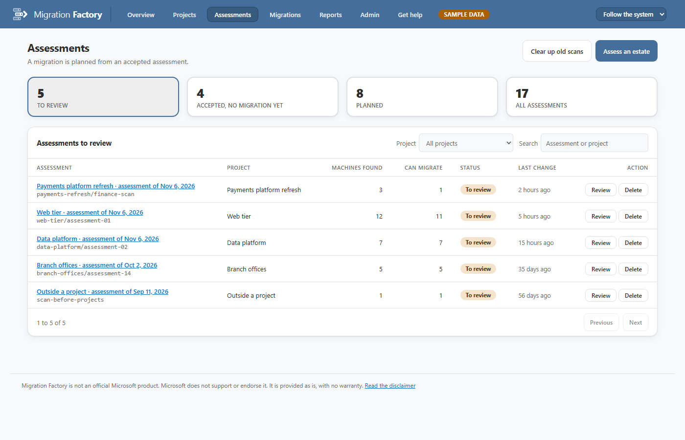
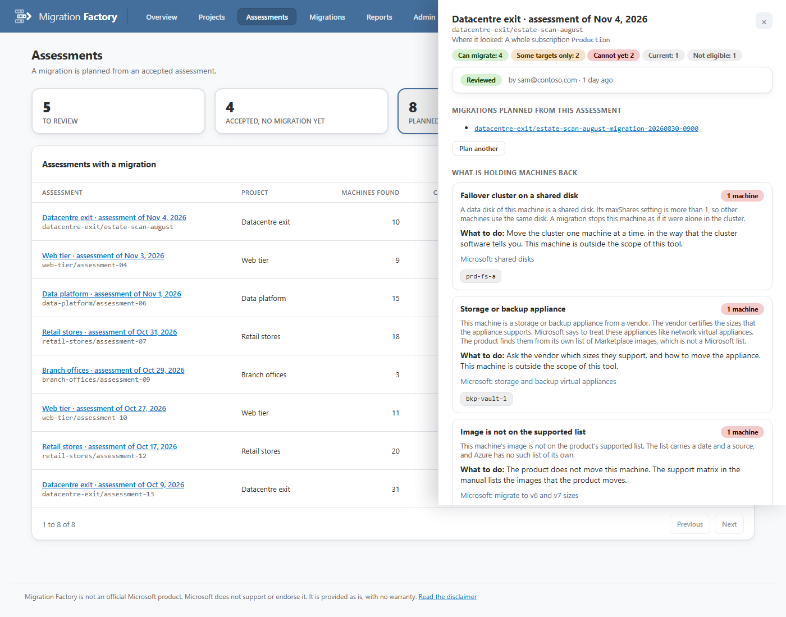
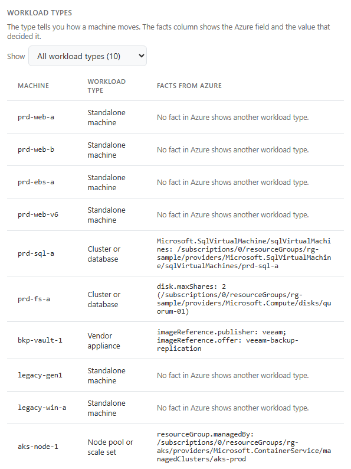
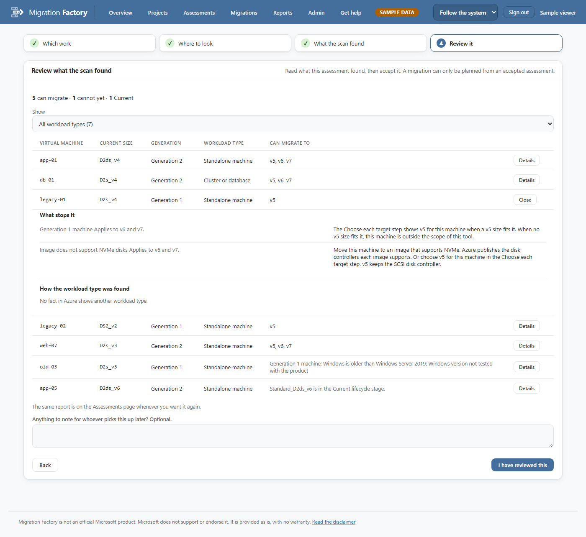
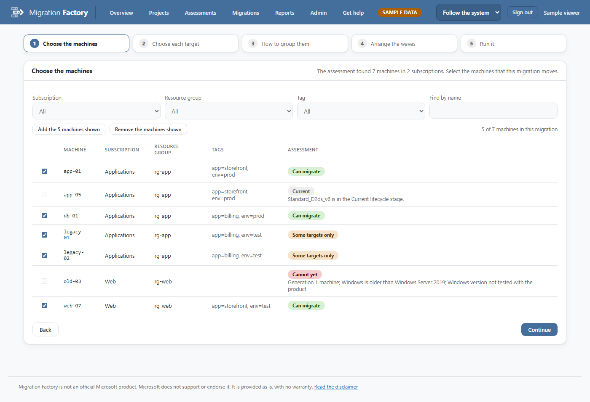

# Read an assessment

An assessment tells you which machines can move, which cannot, and why. Read it, then accept it. A migration can only be planned from an accepted assessment.

## The Assessments page

Four counts are at the top of the page. Each count is a button. Select a count to show its assessments in the list below it.

| Count | The assessments it shows |
|---|---|
| **To review** | The assessments that nobody accepted yet. The list shows these assessments when the page opens. |
| **Accepted, no migration yet** | The accepted assessments that no migration was planned from. |
| **Planned** | The assessments that a migration was planned from. |
| **All assessments** | Every assessment. |

When no assessment waits for a review, the list shows the first count that has assessments. When you open the page from a project, the list shows **All assessments** of that project. The list does not hide an assessment until you select a count. While the page reads your assessments, each count says **Reading** in place of a number, and the list says **Reading your assessments.** If the page cannot read them, each count says **Not known**, and the list says **The list could not be read. The message at the top of the page gives the reason.**

Each row is one assessment.

| Column | What it shows |
|---|---|
| **Assessment** | The project and the date of the scan, with the name of the assessment under it. The name opens the report. |
| **Project** | The project of the assessment. |
| **Machines found** | The number of machines the scan found. |
| **Can migrate** | The number of machines that can migrate, the same number as in the report. |
| **Status** | **To review**, **Accepted** or **Planned**. |
| **Last change** | The time of the last change: the scan, the acceptance, or the newest migration planned from it. |
| **Action** | **Review** opens the assessment in the wizard. **Plan a migration** opens the first planning step. **Open** opens the newest migration planned from the assessment. **Delete** deletes the assessment. |

- **Project** shows the assessments of one project only.
- **Search** finds an assessment by its project, its date or its name.
- The list shows 10 assessments at a time. Select **Next** and **Previous** to see the other assessments. The line below the list says which assessments show, for example **11 to 17 of 17**.

**Assess an estate** at the top of the page starts the wizard. See [Assess an estate](assess.md).

## Open the report

Select the name of an assessment in the list. The report opens in a panel on the right. Select **Close** or press Escape to close it.

## What the report shows

**The counts.** One count for each group: **Can migrate**, **Some targets only**, **Cannot yet**, **Current** and **Not eligible**. A group with no machines is not shown.

**Current.** The machines whose size Microsoft puts in the Current lifecycle stage, as a grey card. Each machine has one line, for example **Standard_D2ds_v6 is in the Current lifecycle stage.** These machines are not in any other card, and they do not count under **Cannot yet**.

**What is holding machines back.** Every reason that stops a machine on every size series, as a red card. The card says what the reason is, what to do about it, and links to the Microsoft Learn page that explains it. That page opens in a new tab. The machines with that reason are listed at the bottom. Machines are grouped by reason, not listed one by one.

**What limits the target.** Every reason that closes some size series only, as an amber card. The machine can still move to the other series. The section **Findings and size series** below explains this.

**What to check before the move.** Findings that let a machine move, as amber cards, after a person checks the thing each one names:

| Finding | What to do |
|---|---|
| **SQL Server runs on this machine** | Agree the downtime with the database owner first. |
| **The OS disk is Standard HDD** | Microsoft retires Standard HDD as the type of an operating system disk on 8 September 2028. Choose **Standard SSD: OS disk** for the machine on the targets step. The scan does not show this finding for a disk that Azure Site Recovery made, with the tag `ASR-ReplicaDisk` or `ASR-FODisk`. |
| **Workload type not checked** | The scan could not read a fact that finds the type. Check how the machine is used. |
| **This machine may be a cluster node** | A fact in Azure shows that a cluster can use the machine. Ask its owner. The product does not move a cluster node, and Checking stops one before anything changes. |
| **The move can download the MANA driver** | Shows on each Windows machine that can move to at least one size series. When the driver store of the machine has no MANA driver, the move downloads one from download.microsoft.com. Make sure that the machine can connect to download.microsoft.com over HTTPS. |

**Not eligible.** The machines another Azure service manages, and the machines outside the scope of this tool. Nothing to solve.

**What the product will prepare.** The things the product does itself during the migration, such as enabling the Windows NVMe driver or moving the page file. Nothing here needs doing first. See [What an assessment can find](../reference/assessment-findings.md).

**What this scan could not read.** The facts that the scan did not get, as cards. For most of them, the scan finished without that fact and everything else in the report is correct. See [What the scan could not read](#what-the-scan-could-not-read) below.

**Workload types.** One row for each machine, with its workload type and the facts from Azure that decided it. Each fact is the Azure field and its value, for example `disk.maxShares: 2`. Use **Show** to see one type only. The type tells you how a machine moves. See [Workload types](#workload-types) below.

## Workload types

Microsoft sorts workloads into patterns for the move to v6 and v7. The assessment gives each machine one of these types, in this order:

| Workload type | What the assessment does |
|---|---|
| Vendor appliance | Stops it. A network virtual appliance, a storage or backup appliance, or a machine in an Azure managed application. The vendor certifies its sizes. |
| Managed by a service | Leaves it alone. A service owns its resource group, or the machine is in an Azure CycleCloud cluster. |
| Node pool or scale set | Leaves it alone. AKS, Azure Red Hat OpenShift or a scale set owns it. |
| Pooled AVD host | Leaves it alone, as it does every session host. |
| Cluster or database | Stops a failover cluster on a shared disk, an Always On availability group member and SAP. Warns for a single SQL Server machine, which can still move. |
| Standalone machine | Nothing about the type stops it. Its findings decide whether it can migrate. |
| Type not checked | Warns. The scan could not read a fact, so the machine is not called standalone. |

The assessment finds a network virtual appliance from the Marketplace image or the Marketplace purchase plan. Azure keeps the purchase plan on a machine made from a gallery copy of a Marketplace image. The list of appliances comes from the Microsoft Azure Policy definition "Configure Marketplace Network Virtual Appliances (NVAs) to add a MANA support tag".

The assessment finds a storage or backup appliance in four ways. It reads the Marketplace image, the Marketplace purchase plan and the gallery image. It also finds an Azure managed application that owns the resource group. The list of storage and backup appliance images is this product's own list, with a date. It is not a Microsoft list. WEKA machines, servers and clients, are stopped too.

Any other machine with a Marketplace purchase plan is outside the scope of this tool. Azure records the plan on the machine. The finding **Machine with a Marketplace purchase plan** names the plan publisher, the plan product and the plan name. This includes Ubuntu Pro, RHEL BYOS and the SUSE offers with a name that ends in -llc. The standard Ubuntu, Red Hat Enterprise Linux, SUSE, Debian, Oracle Linux and Windows Server images have no plan. An appliance or a machine in an Azure managed application gets its own finding instead.

The assessment finds a machine in an Azure CycleCloud cluster from the tags that CycleCloud adds to each machine. These are CycleCloudCluster or CycleCloudNodeArray, or ClusterId with ClusterName on CycleCloud 8.2 and earlier. Each tag counts only with a value in the form that CycleCloud gives. A tag name alone does not count. A machine in an Azure Batch pool is a scale set member, so the assessment leaves it alone as a scale set member.

The assessment also leaves alone a machine on an Azure Dedicated Host and a machine with hibernation enabled. Both are outside the scope of this tool. Azure records the dedicated host or the host group on the machine, and the note on the machine names them. Azure also records the setting hibernationEnabled on the machine.

Some workloads have no fact in Azure that shows them, for example a domain controller or a self-hosted build agent. The assessment calls such a machine standalone, so look for them yourself. [What an assessment can find](../reference/assessment-findings.md) lists them.

## What the scan could not read

The scan reads the list of sizes that Azure offers once for each subscription and region of its machines. When Azure does not answer for a short time, for example HTTP 429 or HTTP 503, the product tries the read again. When the read still fails, the scan does not stop. It finishes for every other subscription.

The report then shows one card for each subscription and region that it could not read:

- **Which.** The subscription, the region, and the number of its machines. These machines show the finding **Sizes not read for this subscription** under **What is holding machines back**, and count under **Cannot yet**. The scan does not judge them from their size names.
- **Why.** What Azure said: its error code and its words.
- **How to correct it.**
  - Azure refused the read (HTTP 403 or AuthorizationFailed). On the Admin page, give the product access to this subscription with the role that the card names. The card names the role and the operation from the product's own list. See [What the product may do in Azure](../reference/permissions.md). The size list is read at the subscription.
  - When Azure cannot find the subscription (SubscriptionNotFound), make sure that it exists and that the product has access to it.
  - For any other error, read what Azure said and correct the cause.

Then start a new assessment of the same place. See [Assess again](#assess-again).

The scan can also fail to read the facts of one machine. Then the scan does not stop. It finishes for every other machine, and the report shows one card for that machine:

- **Which.** The name of the machine. The machine shows the finding **Facts of this machine not read** under **What is holding machines back**, and counts under **Cannot yet**. The product does not move it.
- **Why.** What the product said.

Start a new assessment of the same place. On the **Choose each target** step, no size series is supported for this machine until a new assessment reads it.

A number that the product cannot read is not known. For example, the Azure Linux Agent of a machine can report a version number with too many digits. The product then reads the Linux release from the image of the machine. The product never reads such a number as a pass or a fail.

## Findings and size series

A finding can apply to every size series, or to some of them. Generation 1 is the usual example. It closes v6 and v7, and v5 takes the machine with a resize.

- A finding that applies to every series stops the machine. The report shows it under **What is holding machines back**, and counts the machine under **Cannot yet**.
- A finding that names some series closes only those. The report shows it under **What limits the target**. It counts the machine under **Some targets only** while at least one series stays open to it. When the findings together close every series, the machine counts under **Cannot yet**.
- Under such a finding, the card says which series it applies to. For example: **This applies to v6 and v7 only. A move to v5 does not need this.**

A machine can migrate when at least one size series is still open to it. You select the machines that move in the **Choose the machines** step. Then you choose the series for each machine, in the **Choose each target** step. See [Plan a migration](plan.md).

## The Review it step

The wizard shows the assessment at its **Review it** step, so you do not have to leave the wizard to read it. The step shows how many machines can migrate, how many cannot yet, and how many are **Current**, and one row for each machine. The row of a **Current** machine shows its line in the column of the size series.

| Column | Meaning |
|---|---|
| Virtual machine | The name of the machine |
| Current size | The size the machine has now |
| Generation | Generation 1 or Generation 2 |
| Workload type | The workload type of the machine. **Show** above the table shows one type only. |
| Can migrate to | The size series still open to the machine, or **None** |

**Details** on a row shows **What stops it**: each finding and what to do about it. A finding that names some series only says so, for example **Applies to v6 and v7.** It shows **What to check before the move**, when a finding asks a person to check something. It also shows **What happens first**: what the product prepares during the migration. Last, **How the workload type was found** shows the facts from Azure. Select **Close** or press Escape to close the details. The full report, grouped by reason, stays on the Assessments page.

## Accept the assessment

1. Read the report.
2. Add a note if you want, for whoever picks this up later.
3. Select **I have reviewed this**.

The report shows **Reviewed** with your name and the time. The row on the Assessments page shows **Accepted**. Now a migration can be planned from it. The acceptance also starts the target options. The **Choose the machines** step and the **Choose each target** step use them.

You need the approver role to accept an assessment.

The acceptance names the scan that the report shows. A migration is planned only from that scan. If the assessment changes after the report opens, the product records no acceptance. Open the report again and read it.

## Next: choose the machines that move

After the acceptance, the wizard says **This assessment is ready** and shows **Plan a migration from this**. The row on the Assessments page shows **Plan a migration**. Either one opens the first planning step, **Choose the machines**. There you select the machines that this migration moves, with filters for subscription, resource group, tag and name.

See [Plan a migration](plan.md).

## Assess again

Nothing about an assessment expires. When somebody fixes a reason, run a new assessment of the same place. The new one stands on its own. Compare the two on the Assessments page.

## Delete an assessment

**Delete** on a row removes the record of the assessment: what it found and its log. Your machines are not touched. An assessment that a migration was planned from cannot be deleted until that migration is deleted. Its row then says **Delete the migration first.**, and the migration is a link. If the product cannot read every migration in the run store, it does not delete the assessment. It shows an error, and you can try again later.

The report of a planned assessment lists each migration planned from it, as a link. **Plan another** in the report opens the wizard to plan one more.

**Clear up old scans** removes assessments that were started and never planned, and are older than 30 days. It shows the list first and asks.

<!-- next:begin -->

---

**Next:** [Plan a migration](plan.md)

<!-- next:end -->
