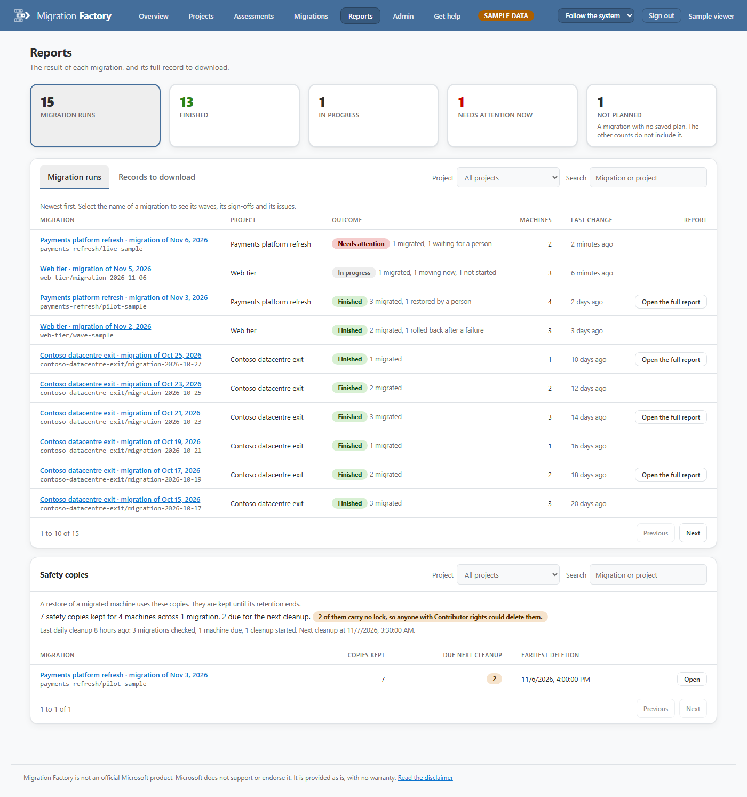
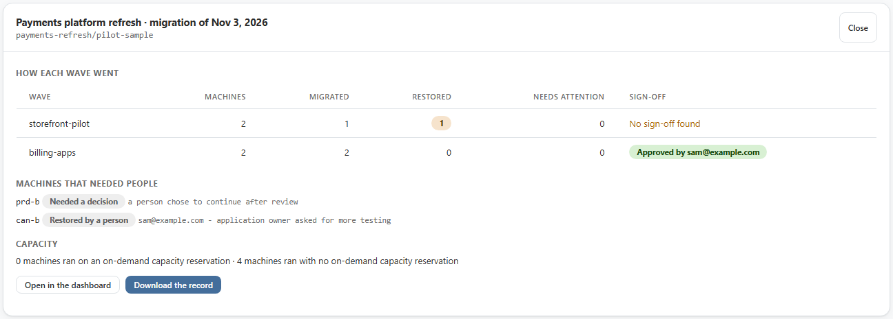
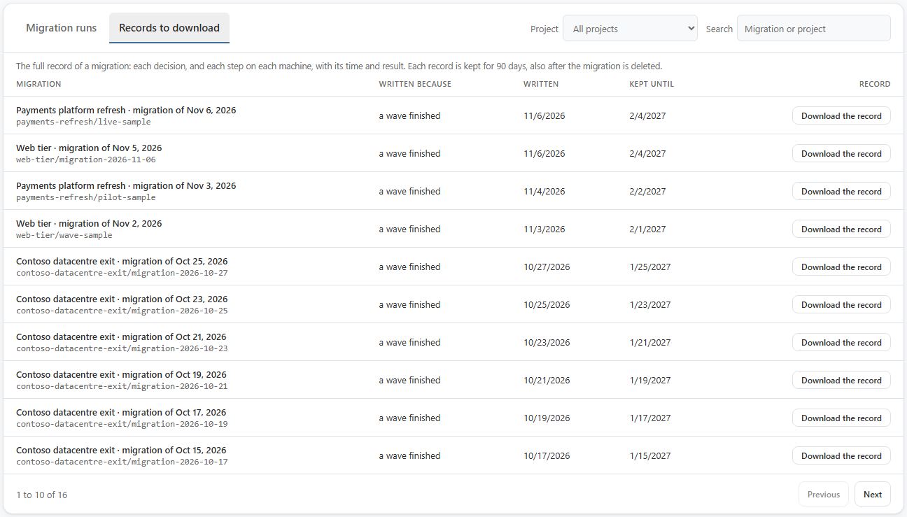
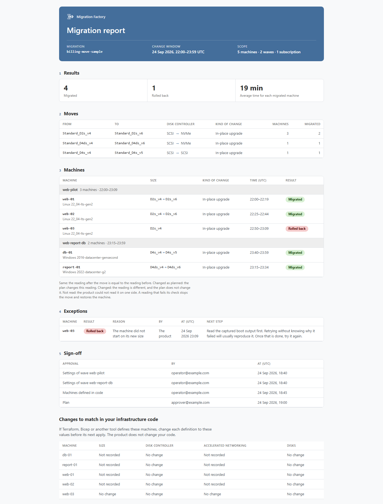
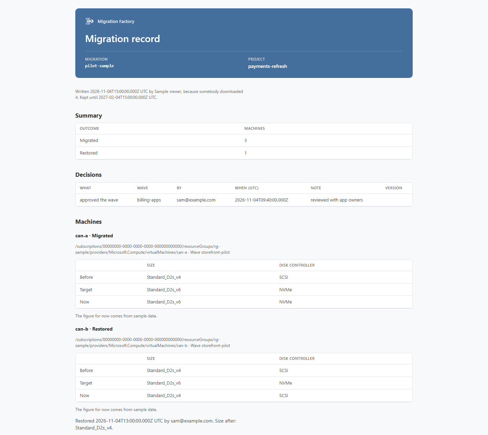

# Reports

The Reports page is the record of every migration: what finished, what needed people, and the full report for each one. It also shows the safety copies that the product keeps. Nothing on this page changes a machine.

## The count tiles

Five tiles at the top count the migrations. Each tile is a button. Select a tile to show its migrations in the list below it. The selected tile has a heavier border.

**Migration runs.** Every migration that was planned.

**Finished.** The migrations whose machines have all ended their move, and no machine waits for a person.

**In progress.** The migrations with a machine that moves now or has not started yet.

**Needs attention now.** The migrations with a machine that waits for a person. A migration that is still in progress can also be in this tile. A machine that a restore left stopped, because Azure did not swap a data disk back, waits for a person. It is not counted as restored until somebody uses **Finish the restore**.

**Never got past setup.** The migrations that were scanned but never planned. Nothing was migrated, so the other tiles do not count them.

While the page reads your migrations, each tile says **Reading** in place of its count, and the list says **Reading your migrations.** If the page cannot read them, each tile says **Not known**, and the list says **The list could not be read. The message at the top of the page gives the reason.**

An assessment is not a migration, so this page does not show it. The Assessments page shows each assessment: see [Read an assessment](read-an-assessment.md).

## The list

When the page opens, the list shows **Migration runs**: every migration, newest first, 10 on each page.

- **Migration**. The project name and the date that the migration was made. The run ID shows in small text below the name. Select the name to see the detail of the migration below the list.
- **Project**. The project that holds the migration.
- **Outcome**. **Finished**, **In progress** or **Needs attention**, then the counts of the machines. The counts show how many migrated, how many a person restored, and how many the product rolled back. They also show how many wait for a person, were left out, move now, or have not started.
- **Machines**. The machines in the migration.
- **Last change**. How long ago the migration changed.
- **Report**. When the report of the migration exists, **Open the full report** shows on its line. See **The report** below.

Use **Project** to show the migrations of one project only. Use **Search** to find a migration by its name, its run ID or its project. Below the list, a line such as "1 to 10 of 16" tells you which rows you see. When **Project** or **Search** is set, the line ends with "that match the filter". Use **Previous** and **Next** to go to the other pages.

**Open the full report** shows the report on this page, in the same tab. **Close the report** or Escape takes you back to the list. **Download the report** saves the report as a web page file.

## The detail of a migration

Select the name of a migration to see its detail below the list:

- **How each wave went.** Per wave: the machines, how many migrated, how many a person restored, how many needed attention, and the sign-off.
- **Machines that needed people.** Every machine that stopped, with what it needed: a decision, attention, or a restore. A machine that a restore left stopped shows **Stopped: finish the restore**.
- **Capacity.** How many machines ran on an on-demand capacity reservation, and how many did not.

**Open in the dashboard** goes to the migration's page. **Download the record** shows for administrators only. See **The migration record** below. **Close** or Escape closes the detail, and takes you back to the name in the list.

The address of the name opens the same detail. Open it in a new tab, or send it to somebody who has a role in the product.

## Records to download

Administrators see two tabs above the list: **Migration runs** and **Records to download**. Other roles see the migrations only. Use the arrow keys to move between the tabs.

**Records to download** lists the records of each migration, newest first, 10 on each page. It includes the records of deleted migrations. Each line shows the migration, why the product wrote the record, when it wrote it, and how long it keeps it. **Download the record** on the line saves it. The name of a deleted migration is not a link, because the migration has no page now. **Project** and **Search** work on this list too. See **The migration record** below.

## Safety copies

The **Safety copies** card is below the list. It shows the safety copies of each migrated machine. The line at the top counts the copies kept, the machines they belong to, and how many are due for the next cleanup. A yellow note says how many copies carry no lock. Below that, when the daily cleanup last ran and what it found, and when it runs next. The daily cleanup examines the migrations in hourly passes. Until it has examined each migration, the card says that the cleanup is not complete. It gives the number of migrations examined, the number of migrations in the store, and the time of the next hourly pass.

Below these lines, a list shows each migration that keeps copies, 10 on each page:

- **Migration**. The project name and the date that the migration was made, with the run ID in small text below the name. Select the name to go to the migration's page.
- **Copies kept**, **Due next cleanup** and **Earliest deletion**.
- **Open** goes to the migration's page too.

The card has its own **Project** and **Search**. Use them to find the copies of one migration. **Previous** and **Next** go to the other pages. A migration that the page could not read is still in the list, with no date in its name. Each migration page has its own **Safety copies** card. See [Safety copies and rollback](../understand/safety-copies.md).

## The report

The product writes the report of each migration. You do not produce it. The product writes it again when a wave finishes, when a machine is restored, and when somebody stops the migration. It also writes it when a restore changes the disks and then stops with an error, for example when the restore leaves the machine stopped. **Finish the restore** writes it again. Each day, a check writes it again if it is missing or out of date.

The report has five sections:

- **Results.** How many machines migrated, were restored, or stopped.
- **Moves.** One row for each size, target and kind of change, with how many machines took it. A machine moved with the preview feature VMTempDiskResizePreview shows **In-place upgrade (Preview)**.
- **Machines.** Each machine by wave, with its result. Open **Evidence** under a machine to see each reading before and after the move. A machine that the plan does not move shows **Not moved**, as on the Migrations page. A machine that you removed from its wave before it started is not in the report.
- **Exceptions.** Each machine that did not migrate: the reason, who or what stopped it, when, and the next step.
- **Sign-off.** Each approval: the plan sign-off, each wave approval, each accepted set of wave settings, and the note about machines defined in code. A row names the SQL Server machines of **Before you sign off: SQL Server and the temporary disk**, with who signed off and when.

Then the follow-up. A table shows the changes to each machine that a definition in code must match. It covers the size, the disk controller, accelerated networking and new disks. Then come the on-demand capacity reservations. It also says what the scan could not read.

The report has no engineering codes. The engineering detail is in the migration record.

The report shows the time of the last change in its records, not the time it was written. When nothing in the migration changes, the report does not change.

If the product cannot write the report, the activity of the migration says why. The wave or the restore continues. The daily check writes the report again.

The report is a single web page. To keep it or send it on, use **Download the report**.

On the screen and in the file that **Download the report** saves, the report uses the theme that the dashboard shows: light or dark. To print the report, download it, then open the file and print it. The print uses the same theme.

## The migration record

The migration record is the full record of one migration, for your engineering and change management teams to keep. It is for the administrator role. Other roles do not see it.

It holds:

- **Each decision.** Who accepted each wave's settings, who signed off the plan or approved a wave, and who accepted the note about machines defined in code. It also names who checked where tempdb is on the SQL Server machines. Each has its time, its note, and the version it was given for.
- **Each machine.** Its size and disk controller before, the target, and now, and where the figure for now comes from. Its assessment for the size series it moves to, the other sizes in the plan, the plan notes, and the last step it reached. Every step with its time and result. Every script the product ran inside the machine, with its version and SHA-256. Its safety copies, and a restore with who did it and why. A machine that the plan does not move shows **Not moved**, and the summary counts it apart from **Not started**.
- **The assessment and the quota.** How many machines the assessment scanned, and how many it put in each class. Each quota record: the wave, region, zone, size, quota family, cores needed, quota used of its limit, and state.
- **All the activity.** Every line of the migration's activity, including each call to Azure, in time order.

The product writes the record when a wave finishes, when a machine is restored, and when somebody stops the migration. It also writes it when an administrator downloads it, and just before somebody deletes the migration. It keeps each record for 90 days after it was last written. A deleted migration's record is still there for those 90 days.

Each time the product writes the record, the activity of the migration shows a line for it. If the product cannot write the record, the activity says why. Then the daily check writes the record and the report again. While the migration is on the page, the daily check also writes the record again when the record is not there.

To download one:

- Select the name of a migration in the list, then **Download the record** in its detail.
- Or, on the tab **Records to download**, which includes the records of deleted migrations, select **Download the record** on its line.

While somebody deletes a migration, the product does not make a new record of it, and the page tells you why. When the delete is complete, the record of the migration is on the tab **Records to download**.

The report and the record each end with the short line of the [disclaimer](../understand/disclaimer.md), because people who never saw the dashboard read them.

**Download the record** saves a web page to read or to print. It has the same look as the report, in the theme that the dashboard shows when you download it. To make a PDF, open it and print it to PDF.

<!-- next:begin -->

---

**Next:** [The Admin page](admin.md)

<!-- next:end -->
