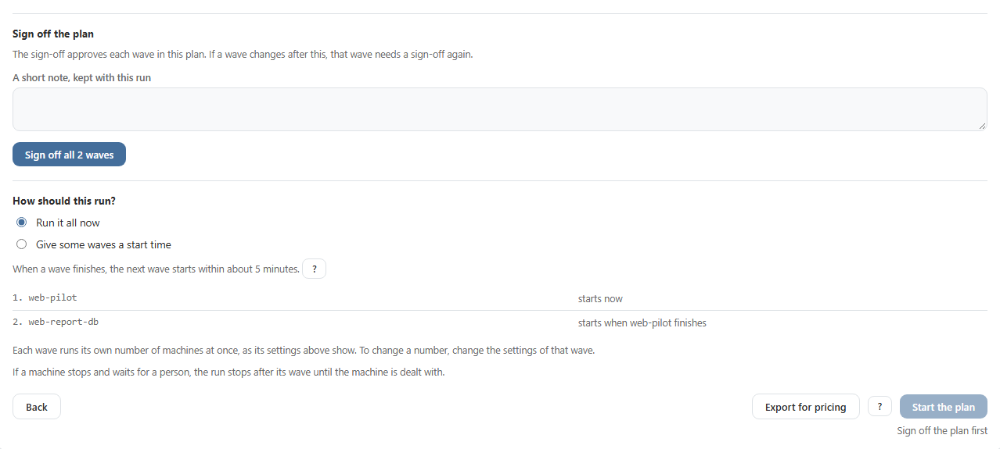
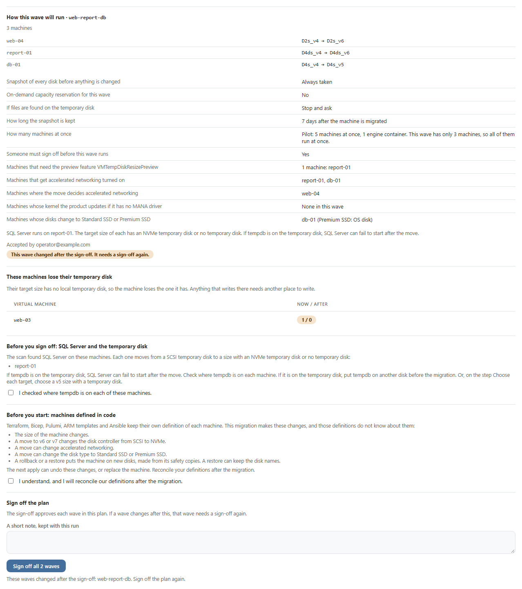
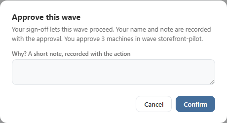
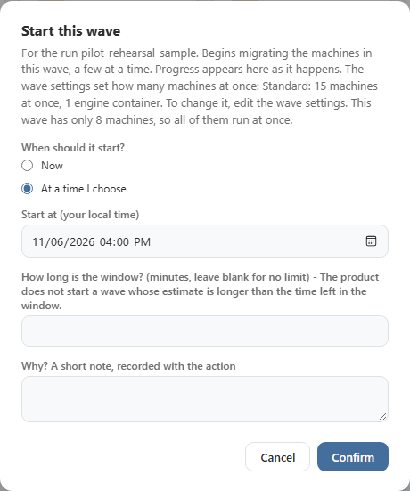

# Start a migration

A migration runs only after three things, each by a named person:

1. **The settings of each wave are accepted.** An operator read how each wave will run and agreed. See [Choose how a wave runs](wave-settings.md).
2. **The plan is signed off.** An approver signs off the plan once. This gives each wave in it its own approval.
3. **It is started.** An operator starts the first wave, now or at a time they chose.

After that, each wave starts when the one before it finishes. The wizard's last step does all three. The migration's page shows what each wave still needs, on the wave's header.

## Sign off the plan

At the wizard's last step, **Run it**, the section **Sign off the plan** is below the waves. Its button is on when every wave's settings are accepted. Until then, it says **Accept the settings above first**.

1. Write a short note. The product records your name, the time and the note with the sign-off.
2. Select **Sign off all 2 waves**. The button gives the number of waves in the plan. With one wave, it says **Sign off the plan**.

If the note is empty, the product does not sign off the plan. The page shows a message under the note field.

The section shows **Signed off by** with your name. You need the approver role. A user without it sees that an approver signs off the plan.

The sign-off gives each wave its own approval, for the wave as you saw it: its machines and its settings. If somebody changes a wave after this, that wave needs an approval again, and the other waves keep theirs. Each wave section then shows **Approved by** with a name, or **This wave changed after the sign-off. It needs a sign-off again.** The section **Sign off the plan** names the waves that changed. Select **Sign off all 2 waves** again, or select **Approve** on that wave on the migration's page.

A plan that runs on its own stops at a wave that changed after the sign-off. It continues when that wave is approved again. A wave set not to need a sign-off also stops after a change. To start it, select **Start this wave** on it. The Migrations page then lists the migration under **Waiting for approval**, with the tag **start**. A start time does not start such a wave either. It stays scheduled, and the activity tells you why. To start it, select **Cancel the scheduled start**, then **Start this wave**. A change to the order of the waves changes no approval.

A decision on a stopped machine is different. An approver can accept the decision the machine waits for. The product records it on the wave's approval, the sign-off and the accepted settings, so they stay valid. The approval keeps the name of the approver who gave it, and adds the name of the approver who accepted the decision. Any other change for a stopped machine asks again for the approval of its wave, also after **Sign off all**. This includes every change that an operator makes.

## Choose how it runs

- **Run it all now.** The first wave starts now. When a wave finishes, the next wave starts within about 5 minutes.
- **Give some waves a start time.** Each wave shows a time field. A wave with a time starts at that time. A wave without a time follows the one before it.

The list under the two choices shows the waves in the order they run, and what starts each one. The migration's page shows the waves in the same order. Each wave runs its own number of machines at once, which its settings show above the choices. To change a number, change the settings of that wave. See [Choose how a wave runs](wave-settings.md).

Then select **Start the plan**. It stays off until the settings are accepted and the plan is signed off, and the line under it says which is missing. **Start the plan** also needs a note. If the step shows **Before you start: machines defined in code**, the start also needs the tick in that section. After an operator accepts the statement, the step does not show that section. If the note or the tick is missing, the product does not start the plan. The page shows a message under the note field or under the tick. If the product refuses an action on this step, the page scrolls to the message at the top of the page. You need the operator role. A user without it sees that an operator starts the plan, and cannot tick the statement in **Before you start: machines defined in code**. The page checks that the work really started, and then opens the migration's page. If the product refuses the start, the page says **The start of a wave did not work**, with the reason. The migration's page says the same words. The step also shows them above **Start the plan** when you open it again. If the start reports nothing for 3 minutes, the page says that it has not reported back yet, and continues to check.

## Export the plan for pricing

At the wizard's last step, **Export for pricing** downloads a CSV file of the plan. It is the file of the step **Choose each target**, with the wave of each machine. It counts each target size by wave, region and operating system. Then it lists each machine with its wave. The plan holds only the machines that you selected in the **Choose the machines** step. The sizes come from the plan, so a change in the wave editor is in the file. A machine that does not move has no target size. The button works before the plan is signed off.

## What stops a plan that runs on its own

- **A machine that waits for a person.** The wave it is in finishes, and then the plan stops. It continues when somebody deals with that machine: corrects the cause, accepts the loss, restores the machine, or leaves the machine out.
- **Repeated failures.** The wave safety brake pauses the run. An operator selects **Resume** on the **Wave safety brake** card.
- **A person.** Pause the run on the migration's page.

For each wave that has not started, the migration's page says what starts it. It says **Starts when** the wave before it **finishes**, **Starts within about 5 minutes**, or why it waits. The reason says what is missing and which button to select, for example **Review & accept options** on the wave. Only the first wave of a signed-off plan has **Start this wave**. After somebody starts a wave, the wave says **Starts within about 5 minutes** until its machines start. If its machines do not start in 10 minutes, the wave shows **Start this wave** again.

The service starts the wave at its next check. Every 5 minutes, the service checks only the migrations that have something to do. That is a wave or a restore that runs, a scheduled wave, or a signed-off plan. When you start or schedule a wave, the service adds the migration to the next check. It does the same when you sign off a plan, make a decision, or select **Resume**. One time each hour, the service checks every migration, and adds each migration that has something to do. When many migrations wait, a start can take more than one check. The next check continues the migrations that the last check did not complete. On the migration's page and at the wizard's last step, the **?** beside the line says this.

## Start a wave by hand

A migration whose plan nobody signed off runs one wave at a time, started by hand.

1. On the wave's header, select **Approve** if the wave waits for sign-off. The dialog says how many machines you approve. Write a short note, and select **Confirm**. You need the approver role.

   

2. Select **Start this wave** on the wave's header.
3. Choose **Now**, or **At a time I choose** and pick the time in your local time.
4. If you chose a time, you can give the window a length in minutes. The length must be more than 0. To start with no window, leave it empty. The product does not start a wave whose estimate is longer than the time left in the window.
5. The dialog shows the number of machines at once from the wave settings, and an estimate of the time. To change the number, cancel and edit the wave settings.
6. Write a short note, and select **Confirm**. You need the operator role. **Cancel** or Escape closes the dialog and starts nothing.

A scheduled wave shows **Scheduled for** with the time and who set it. If the first wave is signed off and its schedule has no window, **What happens next** shows the wave and its start time. To cancel the schedule, select **Cancel the scheduled start**. At the time, the product checks the wave and starts it one time. When the wave starts, the product removes the start time. If the wave changes after the check and before the start, the wave does not start. It stays scheduled, the activity tells you why, and the product checks it again. If the product cannot keep the schedule, the activity tells you that the wave is not scheduled. To start it, select **Start this wave**. While the product starts the wave, the wave shows **The wave is starting.** before the time, and it does not show **Cancel the scheduled start**. You cannot cancel the start or set a new time then. If the start fails, the product does the start checks again after 10 minutes. If a check then stops the wave, the wave shows **Scheduled for** and **Cancel the scheduled start** again. The activity tells you why. For example, the wave is not approved, or it does not fit its window.

The product refuses to start a wave while it deletes the migration and its safety copies.

The product also refuses a second start of a wave while that wave runs. The message names the wave and says that it runs now. Wait until the wave ends.

Above 15 machines at once, the wave runs in more than one container. If Azure refuses one of them, the wave runs in the containers that started, with fewer machines at once. The page tells you how many containers and machines at once run, and what Azure said. Do not start the wave again. See [Scale](../technical/scale.md).

## The first migration on a machine that was defined in code

Before the first wave of a migration starts, the product asks for one confirmation. You confirm that you understand what a migration does to machines defined by Terraform, Bicep and similar tools. The wizard asks this at its last step, and records the tick when you sign off the plan or start it. On the migration's page, select **Accept and let this run start**, tick the statement, write a short note, and select **Confirm**. Until then, the waves on that page say that somebody must accept the note first. The product refuses to start without the confirmation. See [Plan a migration](plan.md).

## What happens next

Go to [Watch a migration](watch.md).

<!-- next:begin -->

---

**Next:** [The Migrations page](migrations.md)

<!-- next:end -->
