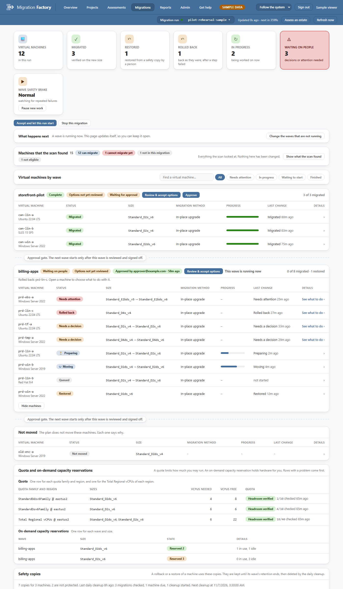
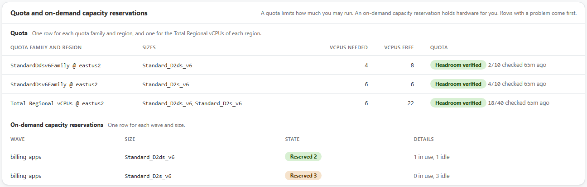
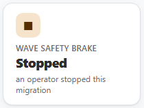
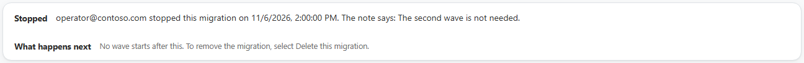

# Watch a migration

The migration's page is where you watch a wave move and control it. Open it from the Migrations page, or from the **Running now** tile on the Overview page. The page updates itself. Leave it open.

## The cards at the top

| Card | Meaning |
|---|---|
| Virtual machines | How many machines are in this migration |
| Migrated | Verified on the new size. A machine that a restore works on is not counted here. |
| Restored | Machines that a person restored from a safety copy. A machine that a restore left stopped is counted here after **Finish the restore**. A machine that stopped and then was restored is counted here, not under **Waiting on people**. |
| Rolled back | Shows only when a machine rolled back. A step failed, and the product rolled the machine back to how it was. |
| In progress | Being worked on now: a step of the move, a rollback, a restore, or **Finish the restore** or **Finish the rollback**. |
| Waiting on people | Machines that stopped with a decision or an issue for a person. This includes a machine that a restore or a rollback left stopped, because Azure did not swap a data disk back. The card turns red when it is more than zero. |
| Wave safety brake | **Normal** while the product watches for repeated failures. **Paused** after repeated failures stopped new work. **Stopped** after somebody selected **Stop this migration**. The card carries **Pause new work** and **Resume**, but not after a stop. |

Under the cards, **Accept and let this run start** shows until somebody accepts the note about machines defined in code. See [Start a migration](start.md). Beside it is **Stop this migration** while the migration works on machines, or while a wave did not start and an earlier wave started. When neither is true, **Delete this migration** is there instead.

## What happens next

A line under the cards says what the migration needs now: a plan, a review, an approval, a start, or nothing because it is working. It offers the button for that step. While a wave runs, it says so. A wave runs from the time a worker takes one of its machines. It runs until each machine has migrated, failed, rolled back, stopped for a decision, or was left out. It also runs while a worker holds one of its machines. Sometimes a worker stops after its machine finished, and its hold stays on the machine. Then the line says so, and the service removes the hold within about 5 minutes. Until then, the wave does not change. When a wave runs, the button is **Change the waves that are not running**, and it opens the wave editor. It shows only when a machine can still move. Such a machine has no wave, or it has not started and its wave does not run. The editor does not change a wave that runs, or a machine that has started. After a wave has run, it tells you to start the next wave.

If the last thing somebody asked for did not work, this line says so instead. It names the action and gives the first sentence of the reason. The action is the start of a wave, the restore of a machine, the plan or the scan. **Show the whole reason** opens the rest. The line clears when the next action succeeds.

## Machines that the scan found

A summary of the assessment the migration came from. **Show what the scan found** opens the full list. A machine that nobody selected in the **Choose the machines** step shows **Not in this migration**. It is counted apart from the machines that move. A machine whose size Microsoft puts in the Current lifecycle stage shows **Current**, with a line such as **Standard_D2ds_v6 is in the Current lifecycle stage.** It is not counted with the machines that cannot migrate yet.

## Virtual machines by wave

Each wave is a table with one row per machine. The row shows its name and operating system, its status, its size now and after, and the way it moves. It also shows a progress bar, its last change, and a details arrow.

The header of a wave says what the wave still needs. **Options not yet reviewed** means its settings are not accepted, and **Review & accept options** accepts them. **Waiting for approval** means it waits for sign-off, and **Approve** gives it. **Approved by** names the approver. The header also says when the wave is running now, and how many of its machines migrated. The waves are in the order they run. See [Start a migration](start.md).

When a machine of a wave rolled back, a line under the header names it. Open a machine to choose what to do with it. When every machine of the wave has ended, the wave shows **Finished: 1 rolled back**, with the number. The next wave does not wait for it. **Waiting on people** shows only when a machine needs a decision or attention.

A machine that a decision sent back shows **Waits for the service's next check** until the service starts it again at its next check. See [When a machine stops](when-a-machine-stops.md). The service does not start the machine while another wave runs, while a restore runs, or while its wave cannot start. Then the machine shows why. For example, it shows **Waits for wave W2 to finish**, or **Wave W1 cannot start yet** with the step that is missing. **What happens next** says the same. The service writes the cause one time in the activity, and again when the cause changes. While the wave safety brake pauses the migration, the service starts nothing. The machine then shows **Waits for Resume**, and **What happens next** names the brake. A wave that the plan starts by itself also shows **Waits for Resume**.

The status words, in the order a machine passes through them: Queued, Checking, Backing up, Preparing, Shutting down, Backing up, Moving, Starting up, Verifying, Migrated. See [How a machine moves](../understand/how-a-machine-moves.md).

A machine has one status, and it says what the machine is now. The status comes from the record of the machine and from its newest step in the activity. These statuses show during a rollback or a restore, and after it:

| Status | Meaning |
|---|---|
| Rolling back | A step failed, and the product rolls the machine back now. Point to the status to see the step that runs. You do not need to do anything. |
| Restoring | **Restore this machine** runs. Point to the status to see the step that runs. |
| Finishing the restore, Finishing the rollback | **Finish the restore** or **Finish the rollback** runs. |
| Stopped: finish the restore, Stopped: finish the rollback | Azure did not swap every data disk back, so the machine is stopped. Open it and use the action that the status names. |
| Restored | A person restored the machine from a safety copy. This also applies to a machine that stopped before the restore. |

Three statuses need a person, and each shows **See what to do**. **Needs a decision** and **Needs attention** mean the machine stopped. **Rolled back** means a step failed and the product rolled the machine back to how it was, from the first safety copy. See [When a machine stops](when-a-machine-stops.md).

The progress bar shows how far the move got, only while the machine moves. It is green and full only for **Migrated**. A machine that ended another way shows a dash. **Last change** gives the status and the time of its newest change. While the machine moves, that is the time of its newest line in the activity.

A machine that has been in one step for more than 15 minutes shows an hourglass in its status. That is a hint, not an error. Point to the status to see when the step started.

Filters above the tables show all machines, only those needing attention, only those in progress, waiting to start, or finished. A search field finds a machine by name. A wave with more than five machines has **Hide machines**. Its machines hide only when you select **Hide machines**. **Show machines** shows them again.

## Not moved

Machines that the plan does not move are in a table of their own, under the waves. Each row shows **Not moved**. Open the row to see why the plan does not move the machine, for example a finding that closes every size series.

A machine that you removed from its wave before it started is not on this page. No wave moves it. The wave editor lists it with the machines that are not in a wave yet. To move it, add it to a wave there. See [Arrange the waves](waves.md).

## The details of one machine

Select a machine's row. A panel opens on the right. It shows the status of the machine, the way it moves, its wave, and its on-demand capacity reservation. When the machine stopped, it says why, and shows the controls that apply to it now. Then it lists everything that happened to the machine, newest first, and the work done inside the machine. The list has the lines of [Activity](#activity) for this machine: the steps of the move, a rollback, a retry, a restore and **Finish the restore**. It also has each stop, and **Stop this migration**. A line of a step gives the time of that step. An example is **Checking and preparing the machine took 765 s** on the line of **Preparing**. While a restore runs, the status says **Restoring**, and the panel does not show the stop from before the restore. If a restore does not finish, the panel says **The restore did not finish** in the place of the stop, and gives the reason. While a restore waits for **Finish the restore**, the panel and the list say **The restore did not finish**. The × at the top closes the panel. See [When a machine stops](when-a-machine-stops.md).

The capacity line of the panel says one of these:

| The line | When |
|---|---|
| **On-demand capacity reservation: this machine used one of the reserved slots of its wave.** | **On-demand capacity reservation for this wave** is **Yes**, and the machine joined the capacity reservation group of the wave. |
| **Capacity reservation group:** and the name of the group | The machine is in a capacity reservation group that this migration did not make. The move keeps the machine in this group. See [Capacity and quota](capacity.md). |
| **No on-demand capacity reservation. Its wave does not reserve capacity.** | **On-demand capacity reservation for this wave** is **No**. |
| **No on-demand capacity reservation. Azure does not allow one for a machine in an availability set.** | The machine is in an availability set. |
| **No on-demand capacity reservation.** | **On-demand capacity reservation for this wave** is **Yes**, and the machine did not use the on-demand capacity reservation of its wave. The activity says why. The panel shows this line when the machine is **Migrated**, **Not migrated** or **Rolled back**. In each other state, the machine can still join the on-demand capacity reservation, or can still be in it, so the panel shows no capacity line. |

## Quota and on-demand capacity reservations

A quota limits how much you may run. An on-demand capacity reservation holds hardware for you. The card has two lists. When no wave in view uses an on-demand capacity reservation, the card is called **Quota**, and it shows only the quota list. See [Capacity and quota](capacity.md).

### Quota

One row for each quota family and region. Azure gives one quota to a family in a region, and every size in the family uses it. A **Total Regional vCPUs** row for each region shows the quota for all the families together.

| Column | Meaning |
|---|---|
| Quota family and region | The quota family that Azure gives for the sizes, and the region. **Quota family not known** means that Azure gave no family. The product does not guess a family from the size name. **Total Regional vCPUs** is the quota for all the sizes in the region. |
| Sizes | The target sizes in the family. A size that is restricted, or not offered in the region, shows that beside its name. |
| vCPUs needed | The vCPUs that the plan needs from the quota in the region, at the newest quota check. On the Total Regional vCPUs row, it is the vCPUs that the machines add to their old sizes. A dash means that no check recorded it. |
| vCPUs free | The quota limit minus the vCPUs in use, at the same quota check. |
| Quota | Headroom verified, not enough quota, increase requested, or quota not known, at the same quota check, with its time. The start of a wave checks the quota again. The newer check replaces the older check, also when the older check said that the quota was not enough. |

Rows with a problem come first. These are the problems:

- Not enough quota, or an increase that Azure has not granted yet.
- A size that is restricted, or not offered in the region.
- A quota or a family that the product cannot verify.

### On-demand capacity reservations

This list shows when at least one wave in view uses an on-demand capacity reservation. It has one row for each wave and size of those waves only. A wave with **On-demand capacity reservation for this wave** set to **No** has no row.

| Column | Meaning |
|---|---|
| Wave | The wave. |
| Size | The target size, with its availability zone, and its region when the card shows more than one region. |
| State | **Reserving...**, **Not confirmed**, **Reserved** and the number of machines it holds, **Released**, or **On-demand capacity reservation failed**. **Not reserved** means that **On-demand capacity reservation for this wave** is **Yes**, and Azure holds no on-demand capacity reservation for it. |
| Details | One short fact. For an on-demand capacity reservation that Azure holds, how much of the reserved quantity is in use and idle, for example **1 in use, 1 idle**. Azure bills the idle quantity too. For **Not confirmed**: **Azure did not confirm it. It can still bill.** |
| (Release) | One **Release** for each wave, on the first row of the wave. It shows when an on-demand capacity reservation of the wave can bill, for an operator, while no machine of the wave is migrating. It releases each capacity reservation of the wave. |

An on-demand capacity reservation that Azure did not confirm, or that Azure refused, comes first.

## Safety copies

Every copy this migration holds. A line at the top counts the copies and the machines, and says how many copies are not protected. It also says when the daily cleanup last ran and when it runs next. Until the daily cleanup has examined each migration in its hourly passes, the line says that the cleanup is not complete. It gives the number of migrations examined, the number of migrations in the store, and the time of the next hourly pass. The table has one row for each wave: its machines, its copies, how many are locked, how long they are kept, and what happens next. **Show** on a row lists the machines of the wave, one by one, and **Hide** closes the list. See [Safety copies and rollback](../understand/safety-copies.md).

When you delete the migration with its copies, the copies stay in this list until the product deletes them. If the delete stops part way, a machine whose copies are all deleted shows them as deleted. The page then does not offer **Restore this machine** for it. The activity shows each copy that the product did not delete, with the reason.

## Activity

Every event, newest first. When an attempt of a step fails and the product tries the step again, the line gives the cause and **Attempt 1 of 2 failed. The product tries the step again.** This line is not red, because the step goes on. Only the attempt that ends the step is red, with **Open the machine to see why this step failed.** When the product then rolls the machine back, the red line also says **The product now rolls the machine back. You do not need to do anything.** An attempt shows as one line: the Azure request that failed with the same cause in that attempt does not get a second line. An older line for a step that failed once and then succeeded is marked **failed once, then succeeded on retry**. Hover a line to see the technical record behind it. **Show the whole log** shows every line, also the line of each Azure request; the default is the latest lines.

When an operator selects **Try this machine again** or **Accept this and continue** on a machine, a line names that button. For example, it says **An operator selected Try this machine again.** When the decision removed the approval of a wave, the line says that in place of the button.

When **Verifying** finds no accelerated networking adapter, a line says **The accelerated networking adapter is not ready yet. The product checks again every 30 seconds for up to 15 minutes.** With no traffic on its counters, a line says **The accelerated networking adapter is present, but its packet counters show no traffic.** The product checks again in the same way. When the adapter is ready, a line says how long it took. A line says that accelerated networking is in use only when the counters show traffic. When the product cannot read the counters, a warning says so, and the step goes on.

## Pause and resume

**Pause new work** stops new machines from starting. Machines already moving finish their current step safely. **Resume** lets new machines start again.

The product pauses a wave on its own after repeated failures in a row. That is the wave safety brake. When it does, the card says **Paused** and an operator must resume after reading what failed.

While the brake pauses the migration, **Try this machine again** returns the machine to the queue, but nothing starts it. The machine shows **Waits for Resume** until an operator selects **Resume** on the **Wave safety brake** card. The service does not start it on its next check. The same is true after somebody selects **Pause new work**.

## Stop a migration

**Stop this migration** ends the migration of every machine that has not finished, so that you can delete the migration. It changes nothing in Azure, with one exception. The product returns a machine to its power state from before the move when the product changed only that. For example, the product started a machine for the cluster check. Machines that already finished keep their result. A wave that did not start does not start after this. The product leaves out its machines and does not change them. It makes no safety copy of them. Every other machine is free for another migration, but not a machine that is not as it was. This includes a machine that was part way through its move. It stays in this migration until you restore it and leave it out again. [When a machine stops](when-a-machine-stops.md) gives the steps. Use it when a migration cannot finish and you want to plan again. Also use it between two waves when you do not need the next waves, then delete the migration.

After the stop, the top of the page shows **Stopped**, with the user who stopped the migration, the time, and the note. **What happens next** says that no wave starts, and that **Delete this migration** removes the migration. A wave that did not start shows **Stopped before it started**, and a wave that the stop ended part way shows **Stopped**. The product removes the scheduled start of each wave, so no wave starts at its time. The **Wave safety brake** card shows **Stopped**, and it does not show **Resume** or **Pause new work**. The machines that the stop left out stay left out, so **Resume** cannot start them.

## The report

The product writes the report of what happened when a wave finishes, and again when a machine is restored. You do not produce it. **Open the full report** shows on the line of the migration on the Reports page. If the product cannot write the report, the activity says why. The daily check writes it again, and so does the next wave or restore. See [Reports](reports.md).

<!-- next:begin -->

---

**Next:** [When a machine stops](when-a-machine-stops.md)

<!-- next:end -->
