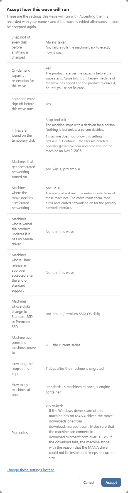
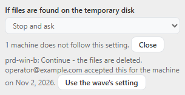

# Choose how a wave runs

Every wave has its own settings. They decide how many machines move at once, and how long the safety copies stay. They also decide what happens when the product finds something a person should know about. A person must accept them before the wave can run, and again after any change.

## The settings, one by one

**Someone must sign off before this wave runs.** Yes or no. The default is yes. With yes, an approver must approve the wave before an operator can start it. Only an approver can change this setting to no.

The size series (v5, v6 or v7) is not a wave setting. Each machine has its own, chosen before the waves; see [Plan a migration](plan.md). To change it for one machine, use **Change target** in the wave editor; see [Arrange the waves](waves.md). To change many machines, choose again on the targets step and plan again.

**On-demand capacity reservation for this wave.** **No**, or **Yes**. An on-demand capacity reservation asks Azure to hold capacity for the wave before it starts, so the machines are certain to fit. It bills from the moment it is held. It bills until every machine of the wave has ended and the product releases it, or until you select **Release**. Machines in an availability set cannot use one. A machine in its own capacity reservation group stays in that group, and the on-demand capacity reservation does not count it. See [Capacity and quota](capacity.md).

**If files are found on the temporary disk.** The product looks at the temporary disk before it stops a machine. Files there do not survive the move.
- **Stop and ask.** The machine stops with a decision for a person. Nothing is lost unless a person decides.
- **Continue - the files are deleted.** Choose this only when you know nothing there matters. Only an approver can choose it. It accepts the loss of the files for every machine in the wave.

The kernel choice for MANA is not a wave setting. Each Linux machine has its own kernel choice. You make it in the **Details** of the machine on the **Choose each target** step. See [Plan a migration](plan.md). If the choice is **Stop and ask** and the kernel has no MANA driver, the machine stops. The product changes nothing.

You change the choice on the **Choose each target** step. The new choice applies only to a new migration from the assessment. A migration that has a plan keeps the kernel choice of its plan. To use the new choice, select **Delete this migration** on the Migrations page. Then plan a new migration from the assessment.

These pages show the row **Machines whose kernel the product updates if it has no MANA driver**:

- The wave editor.
- The **Run it** step.
- The acceptance.

The row shows the name of each machine with the choice **Update the kernel**. If no machine has this choice, the row shows **None in this wave**.

**How long the snapshot is kept.** Days after the machine is migrated, after which the daily cleanup deletes its safety copies. The default is 7. Say a bigger number when your change process needs the copies for longer. Copies cost storage while they exist.

**How many machines at once.** How many machines the product works on at the same time. Select one of four choices. Each choice shows its number of machines and its number of containers:

| Choice | Machines at once | Containers | What it means |
|---|---|---|---|
| Pilot | 5 | 1 | A small number of machines, for a first wave or a test. |
| Standard | 15 | 1 | The default. The wave needs no more cores than one container. |
| Large | 30 | 2 | Each container works on 15 machines and uses its own cores. |
| Maximum | 60 | 4 | Each container works on 15 machines. The editor checks that the Container Apps environment has the cores. |

Under the choice, the editor says what it means and shows an estimate of the whole wave's time. It also says how many cores the containers need, and whether the Container Apps environment has them. Every start of the wave uses this number: the **Run it** step and the dialog **Start this wave** show it, and do not change it.

**Snapshot of every disk before anything is changed.** Always taken. Shown so you know, not a choice.

## Accept the settings

You accept the settings in one of two places:

- **In the wizard**, at the step **Run it**. Each wave has a section **How this wave will run**. Select **Accept these settings**. See [Plan a migration](plan.md).
- **On the migration's page.** On the wave, select **Review & accept options**. The dialog **Accept how this wave will run** opens. Select **Accept**, or **Cancel** to close it.

You need the operator role in both places. Without it, the wizard says who accepts the settings.

The settings are read back to you as a list. Each setting shows the value of the wave, as the wave editor shows it. Under a setting, the list says how many machines do not follow it. Then it names each machine with its value, and the cause when the plan records one. These lines have the same words as the wave editor; see [Machines that do not follow a setting](#machines-that-do-not-follow-a-setting). The list has no button. To make a machine use the setting of its wave, use the wave editor.

Under **Machines that get accelerated networking turned on**, it names each machine whose move turns accelerated networking on for the primary network interface. A move to v5, v6, v7 or Bsv2 turns it on when it is off. Some sizes require it: every v6 size, and the Intel D-family and E-family v5 sizes. Other sizes do not require it, and the move turns it on for them too. A move never turns accelerated networking off.

Under **Machines where the move decides accelerated networking**, the list names each machine whose network interfaces the scan did not read. The move reads them before the machine changes, then turns accelerated networking on for the primary network interface.

On Linux, guest preparation reads the kernel before anything is changed. When the target can give MANA and the kernel has no MANA driver, the machine stops. Nothing is changed.

A machine whose move does not turn accelerated networking on is on neither list. For example, it has accelerated networking on already. The list also names each machine set to **Update the kernel**, under **Machines whose kernel the product updates if it has no MANA driver**.

On the migration's page, the list also shows **Machines whose Linux release an approver accepted after the end of standard support**. Checking stops a Linux machine if the vendor ended standard support for its release. An approver can accept the release for that machine. The list names each machine with this acceptance. A wave with no such machine shows **None in this wave**.

The list also shows **Machines whose disks change to Standard SSD or Premium SSD**. It names each machine whose move changes the type of its disks. Each name has the change after it: **Standard SSD: OS disk**, **Premium SSD: OS disk** or **Premium SSD: every disk**. You choose this for each machine on the **Choose each target** step; see [Plan a migration](plan.md). A wave with no such machine shows **None in this wave**.

On the migration's page, the last line of the list is **Plan notes**. It names each machine that has notes from the plan, and shows each note under the name. For example, a note can say that the move downloads the MANA driver from download.microsoft.com, or that the size a rollback returns to retires soon. A wave with no notes shows **None in this wave**. In the wizard, the notes show under each machine at the step **Run it**.

On the migration's page, the list also says which size series the machines of the wave move to. A wave with machines on more than one series shows a count for each. In that dialog, some values have a sentence under them that tells more about the value.

Your name is recorded with the acceptance. If the wave is edited afterwards, the settings must be accepted again.

## Where to change them

In the wave editor, under **How this wave runs** on each wave. Or from the migration's page: **Review & accept options**, then **Change these settings instead**.

## Machines that do not follow a setting

A machine can have a value for a setting that is different from its wave. A decision for one machine sets it; see [When a machine stops](when-a-machine-stops.md). A plan can also hold a different value for one machine.

The wave editor shows the value of the machines that have no decision for that setting. Under a setting, it says how many machines do not follow this setting. Select **?** beside that line to see each machine, and select **Close** to close the list.

Each line of the list gives the machine and its value, with the words that the setting shows. It also gives the cause when the plan records one:

| The line | Why the machine has this value |
|---|---|
| prd-win-b: Continue - the files are deleted. operator@example.com accepted this for the machine on Nov 2, 2026. | A decision for this machine. The line gives the user who accepted it, and the date. |
| prd-win-b: 14 days. | The plan holds this value for the machine. The plan does not record why. |

When you change a setting, the product changes it on every machine of the wave that had the value you saw. A machine that does not follow the setting keeps its value. The activity of the migration names each of these machines. A machine that you move into a wave gets the settings of that wave, but it keeps a value that a decision gave it. When you rename a wave, its machines get the settings of the wave in the same way.

Three settings apply to the whole wave: the on-demand capacity reservation, the sign-off, and how many machines at once. Every machine follows these. A change to one of them changes every machine of the wave.

### Make a machine use the setting of its wave

1. Select **?** beside the line that says how many machines do not follow this setting. The list shows each machine.
2. Select **Use the wave's setting** beside the machine. The line changes to "prd-win-b uses the wave's setting when you save.", and the button changes to **Cancel**. Select **Cancel** to keep the value of the machine. While a change is not saved, **Close** above the list also changes to **Cancel**.
3. Select **Save**.

The save gives the machine the value that the wave shows, and removes the record of a decision for that setting. After that, a change of the setting on the wave also changes this machine. The activity of the migration names the machine, its new value and its old value.

This change is a change to the wave. The wave must have its settings accepted again, its quota checked again, and an approval again. You cannot make this change while the wave runs.

While the change is not saved, the button says **Cancel**. If you select it, or press Escape, the product cancels each change that you did not save. To give a machine the value Continue, you must have the Approver role.

A setting that you did not change is not written. So it does not clear the accepted settings, the approval or the quota check of the wave.

<!-- next:begin -->

---

**Next:** [Capacity and quota](capacity.md)

<!-- next:end -->
