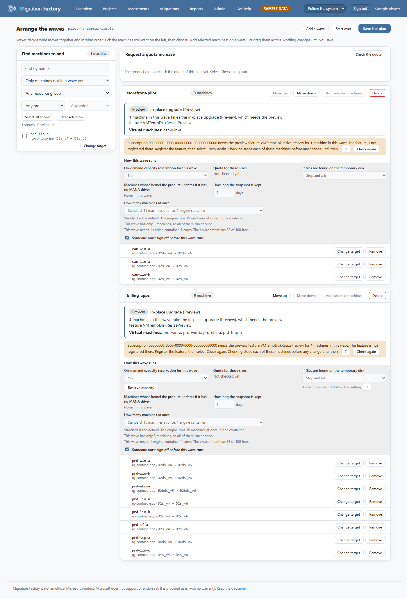
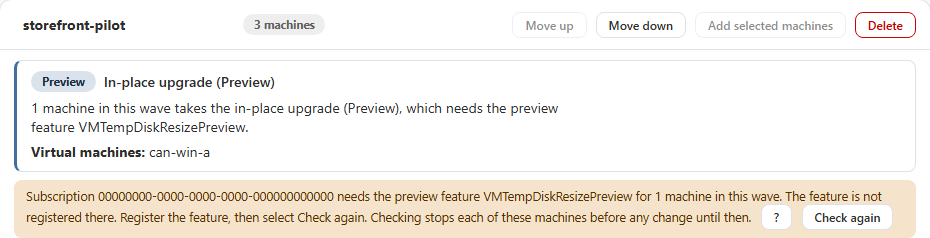
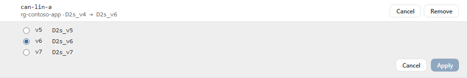

# Arrange the waves

Waves decide what moves together and in what order. The wave editor lets you build them by hand, rename them, move machines between them, and set how each wave runs. Nothing changes until you save, and nothing moves until a wave is accepted, approved and started.

In the wizard, the wave editor is the step **Arrange the waves**, after **Build the waves**. Later, open it from a migration's page with **Arrange the waves**. While a wave runs, that button is **Change the waves that are not running**.

## The two sides

The left side lists the machines that are not in a wave yet. The right side lists the waves, each with its machines and its settings.

## Find machines

Above the left list: **Everything** or **Only machines not in a wave yet**, a resource group filter, a tag filter, and a search field. **Select all shown** ticks every machine the filters show.

## Move machines into a wave

1. Tick the machines on the left.
2. On the wave you want, select **Add selected machines**. Or drag the ticked machines onto the wave.

A machine already in a wave can be dragged to another wave. Or select its row in the wave, then select **Add selected machines** on the other wave. A line above the waves then names each machine that moves from one wave to another. The count above the list shows the selected machines that the list shows, and names each selected machine that it does not show. Adding machines to a wave clears the selection.

**Remove** on a machine moves it out of its wave, back to the machines with no wave. Its availability set moves with it. A machine with no wave does not move. The Migrations page and the report do not show it until you add it to a wave again.

A machine marked **under way** has already started migrating and cannot be moved. A wave marked **Running** does not change until it finishes: its settings are locked, and no machine moves into it or out of it. To change it sooner, select **Pause new work** on the Migrations page and wait for its machines to finish. A wave marked **Held** is locked the same way: a worker stopped after its machine finished, and its hold stays on the machine. The service removes the hold within about 5 minutes, and then the wave can change.

A machine marked **moves with its pair** shares an availability set. Machines in one availability set always travel in the same wave, and the editor moves them together.

## Add, rename and delete waves

**Add a wave** creates an empty wave named `new-wave`. Select the name to rename it. A wave name can hold only letters, numbers, dots, dashes and underscores, and the page says when it changes what you typed. The names unscheduled and unplanned are not available: the product uses them for the machines that are not in a wave. **Delete** on a wave removes it and returns its machines to the left side. **Move up** and **Move down** change the order in which the waves run.

## Smaller first waves

Put 3 to 5 machines in the first wave. Put the machines that matter least first, and the machines that matter most last.

## Save

**Save the plan** writes your arrangement. While the plan saves, the button says **Saving the plan...** and you cannot select it. A line under the buttons says what the page waits for. This can take up to a minute. In the wizard, it then goes to the step **Run it**. From a migration's page, the page says **Saved. The plan now matches what you arranged here.** It then shows **Continue - review how this wave runs**.

Saving a change to a wave has consequences the page tells you about:

- The wave's settings must be accepted again, because the acceptance described the wave as it was.
- The wave's approval is cleared, for the same reason. An approval is for one wave, so the waves you did not change keep their approvals.
- The wave's quota check is cleared. The quota is checked again before a wave starts.

**Start over** undoes your unsaved changes and returns to the saved plan. In the wizard, **Back** takes its place and goes to the step **How to group them**.

## The size series

Each machine has its own size series, chosen before the waves, and a wave can hold machines on different series. Each machine in the editor shows its current size and its target size. See [Plan a migration](plan.md).

When machines of a wave take the in-place upgrade (Preview), a note under the name of the wave names them. Its first line shows **Preview** and **In-place upgrade (Preview)**. Then a sentence counts the machines, for example **1 machine in this wave takes the in-place upgrade (Preview), which needs the preview feature VMTempDiskResizePreview.** The last line shows **Virtual machines:** and the name of each machine, for example web-b01. When their subscription does not have the feature registered, an amber notice under that note names the subscription and says what to do. Its **?** gives the steps in the Azure portal, and **Check again** reads the feature again. In **Change target**, the series of such a machine shows **In-place upgrade (Preview)**. When the new series changes the kind of temporary disk, a change of target there plans the in-place upgrade (Preview). See [The in-place upgrade (Preview)](plan.md#the-in-place-upgrade-preview).

To change the series of one machine, select **Change target** on its row. The panel opens under the row, and the button changes to **Cancel**. The panel shows v5, v6 and v7, each with its target size.

A series the machine cannot take shows **Not available**. A series whose move is the in-place upgrade (Preview) shows **In-place upgrade (Preview)**. Select a series, then **Apply**. **Cancel** or Escape closes the panel.

- Save your wave changes first. **Apply** stays off while the editor has unsaved changes.
- Accept the settings of the machine's wave again. Its quota check is cleared.
- Approve the machine's wave again. An approval is for one wave, so the other waves keep their approvals.
- The product offers only the series the targets step offered for that machine.
- The machine gets the notes that a plan on the new target gives. The step **Run it** shows them.
- A series whose size has another processor maker shows **Not available**. Choose that on the targets step, then plan again. A series back to the maker of the machine itself is available.
- After any machine in the wave has started, the product refuses a change and the editor does not show **Change target**.
- The product refuses a change while the wave holds an on-demand capacity reservation. Release the on-demand capacity reservation first.

While nothing in its wave runs, a machine that rolled back can take another series. Select **Change to <series>** on the machine, on the Migrations page. That change clears every wave approval and the plan sign-off.

To change many machines, choose again on the targets step and plan again.

A plan holds only the machines that you selected in the **Choose the machines** step. To add a machine, select it in that step, save the targets again, and plan again.

## The settings of a wave

Each wave has a **How this wave runs** section. See [Choose how a wave runs](wave-settings.md).

<!-- next:begin -->

---

**Next:** [Choose how a wave runs](wave-settings.md)

<!-- next:end -->
