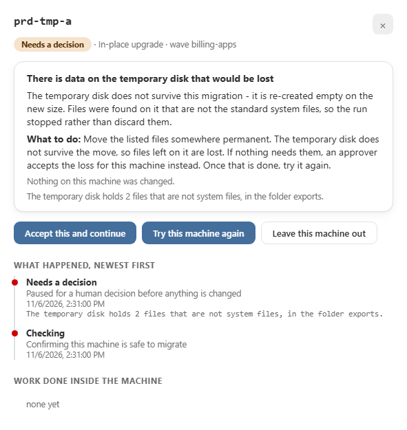
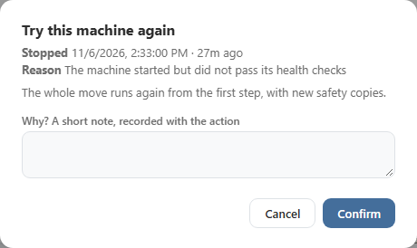
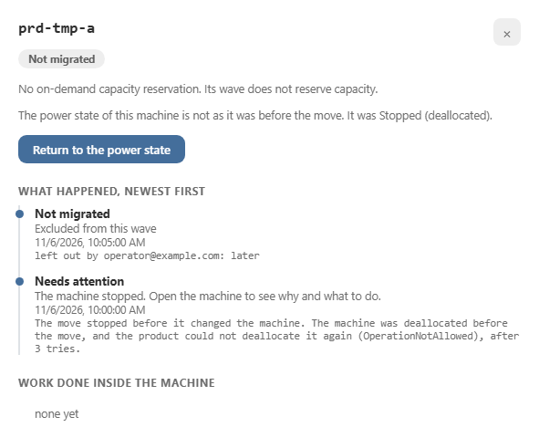
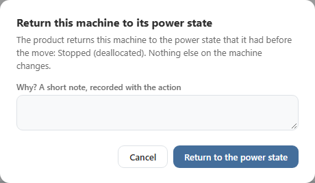
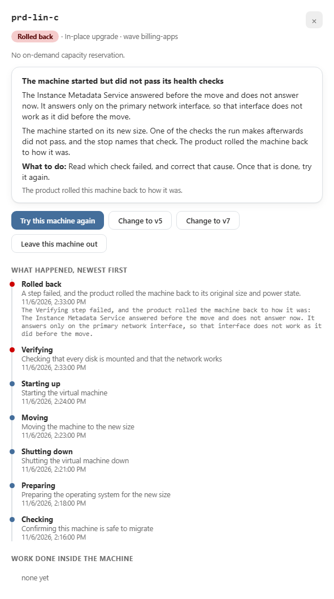
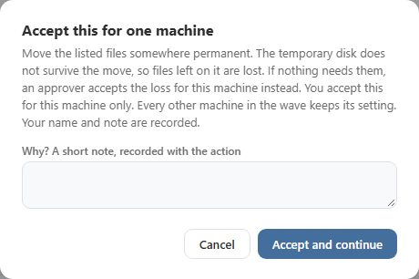
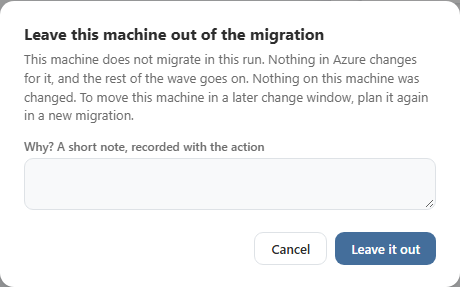

# When a machine stops

A machine stops when something needs a person. The product stops the machine, names the reason, and says what to do. On the Overview page, the **Waiting for a person** tile counts the migrations with a machine that waits.

## Find it

1. On the Overview page, select the **Waiting for a person** tile, then select the migration in the list. Or open it from the Migrations page.
2. Filter the machines with **Needs attention**.
3. Select **See what to do** on the machine's row.

The panel shows three things:

**Why it stopped.** The reason, in a sentence, and what the product checked. The reason has a short code for support. To see it, put the pointer on the title of the reason. If a check failed after the machine started on its new size, the panel names that check directly under the title.

**What state the machine is in.** One of three lines:
- **Nothing on this machine was changed.** The machine runs as it did. It stopped before any change.
- **The product rolled this machine back to how it was.** A step failed after a change, and the product rolled the machine back from its safety copy. It runs on its original size.
- **This machine is not as it was. Read this before you try again.** The rollback also failed, or could not shut the machine down. Its disks and its safety copies still exist. If a data disk can be missing from its LUN, the machine stays stopped, and the error names each disk to attach. Read both error messages. Then use **Restore this machine** and choose the safety copy **Before the migration**. If Azure did not swap a data disk back, the machine is stopped and the panel shows **Finish the rollback** in its place. See [When Azure does not swap a data disk back](../understand/safety-copies.md#when-azure-does-not-swap-a-data-disk-back).

**What to do.** What to correct, and whether trying again makes sense: after a fix, or when capacity is available.

The panel shows a stop only while that stop keeps the machine stopped. After **Try this machine again** or a restore, the stop goes from the top of the panel. While a restore runs, the panel does not show the stop. If the restore does not finish, the top of the panel says **The restore did not finish**, and gives the reason. The list of steps keeps the stop. Under these are the controls that apply to the machine now. Examples are **Accept this and continue**, **Try this machine again** and **Leave this machine out**. Below the controls, the panel lists each step of the machine, newest first.

A dialog that you open from the panel shows in the middle of the window, in front of the panel. If the dialog is taller than the window, scroll in the dialog to see all of it.

The panel stays current while it is open. When the page refreshes, the panel shows the new state, stop, controls and steps of the machine. A dialog that you opened from the panel stays open, and it keeps your note. If the machine changed after you opened the dialog, the dialog tells you and shows the new state of the machine. If the product has no state record for the machine now, the dialog tells you that. Read the panel again before you continue, because the service refuses an action that is not correct for the new state. **Cancel** and Escape close the dialog.

Every reason is listed with its meaning and its fix in [Why a machine stopped](../reference/stop-reasons.md).

**Work done inside the machine** lists each script the product ran in it. **Running** is a script that runs now. **No answer** is a script that started and did not answer, so it can have changed the machine. The product counts it as a change.

## The three kinds of stop

**Needs a decision.** The machine stopped before anything was changed, and it waits for a person. Most of these stops need the cause corrected, for example a missing right or a lock. Two of them also let an approver accept the stop for that machine:

- Files were found on the temporary disk, and the wave setting says stop and ask.
- The target size requires accelerated networking, the machine has it off, and the plan does not turn it on. Microsoft requires it on every v6 size and on the Intel D-family and E-family v5 sizes. The product also keeps it on for every v7, Intel v5 and Bsv2 size.

When the operating system is older than the network driver needs, the machine stops too, and nobody can accept that stop. Without the MANA driver, accelerated networking does not work after the move. Choose **Update the kernel** for the machine on the **Choose each target** step and plan again, or patch the kernel, or leave the machine out. A Linux machine for which a person chose **Update the kernel** stops here too when Microsoft does not list its release for MANA. A kernel update does not change the release. It also stops here when its repositories have no newer kernel, or when the product has no rule for its kernel. It also stops on a UEK kernel that Microsoft does not list, such as UEK R7, when the UEK R8 repository is not enabled. The panel says which. Upgrade the release, install a kernel with a MANA driver or UEK R8, choose AMD v5 for an AMD machine, or leave the machine out.

For files on the temporary disk, correct the cause and try the machine again, or let an approver accept the loss. Correcting the cause loses nothing, so try that first. For accelerated networking, an approver accepts it, and the move turns it on before the resize.

**Needs attention.** The machine stopped. Open the machine to see why and what to do. A step could not finish before the product changed the machine, for example a check inside the machine. Or a rollback also failed, or could not shut the machine down. Or a rollback put the disks back, and a volume that was mounted before the move is not mounted now. Or the steps of a machine never reached an end, and the product rolled it back. A MANA driver that could not be installed stops here when the install added nothing. Correct the cause, then try the machine again. When a volume is not mounted after a rollback, mount the volume inside the machine, then select **Try this machine again**. The product first checks that every volume mounted before the move is mounted again.

**Rolled back.** A step failed after the machine was changed, and the product rolled the machine back. While it does, the machine shows **Rolling back**, and you do not need to do anything. This includes a script inside the machine that stopped after it changed the operating system. It also includes a MANA driver install that added files and then failed. Read what failed, correct it, then try the machine again. To move it in a later change window instead, select **Leave this machine out**. The panel lists the disks that the machine had before the migration under **Original disks, not in use**. They are detached and cost money until you delete them. See [Delete the original disks](put-back.md#delete-the-original-disks). Then plan it again in a new migration.

A machine whose accelerated networking adapter did not arrive also ends here. The stop says **The accelerated networking adapter did not become ready in 15 minutes**, and how many times the product checked. The machine ran on the synthetic network interface for all of that time. The rollback returned the machine to its original size, where it ran before. Try the machine again. A machine whose adapter was present, but whose packet counters showed no traffic for 15 minutes, ends here too. The stop says **The accelerated networking adapter is present, but its packet counters showed no traffic in 15 minutes**. Inside the machine, look at the state of the adapter and at its packet counters. Then try the machine again.

A failed kernel update on a Linux machine ends here too, with the reason **The kernel update did not give the machine a MANA driver**. The machine runs on its old kernel, from the first safety copy. The panel says what failed, for example the error of the package manager, or the kernel the machine started on. Update the kernel inside the machine yourself, make sure that it starts on the new kernel, then try the machine again.

## Try the machine again

1. Correct the cause the panel names.
2. Select **Try this machine again** in the panel. The dialog says when the machine stopped, and the reason.
3. Write a short note.
4. Select **Confirm**. **Cancel** or Escape closes the dialog and changes nothing.

The machine returns to the queue. Your name and note are recorded. You need the operator role. While the wave safety brake pauses the migration, nothing starts the machine. It shows **Waits for Resume** until an operator selects **Resume** on the **Wave safety brake** card.

- Most machines start again from the first step. This is a complete new attempt. The product takes new safety copies before it changes the machine again. The copies of the earlier attempt stay on record, and the daily cleanup deletes them with the new ones.
- A machine that is on its new size and failed only its final checks starts again at Verifying. It keeps its safety copies, because the move they belong to is not repeated.

A machine that a stop left changed is not tried again, for example a machine whose rollback also failed. Restore it first. One changed stop is different: **A volume is not mounted after the rollback or the restore**. Mount the volume inside the machine, then select **Try this machine again**. Before the retry changes the machine, the product checks that every volume mounted before the move is mounted again. When each volume is mounted, the retry starts the move again, with new safety copies. When a volume is not mounted, the machine stops again with the same reason, and the stop names each volume. When the product cannot run the check, the reason is **The product could not check the volumes inside the machine**, and the stop says why. In both cases, no disk, size or setting of the machine changes. If the machine is Stopped or Stopped (deallocated), the product starts it for the check. Then the product returns the machine to that power state. To check the volumes with no retry, select **Check the volumes**. See [Check the volumes](put-back.md#check-the-volumes). **Restore this machine** stays on the panel. Until then, the panel says this in place of **Try this machine again**. After a restore that worked, the machine shows **Restored**, and it waits for nobody: the stop no longer describes the machine. A machine that a refused data disk swap left stopped is not tried again either. Use **Finish the rollback** or **Finish the restore** first.

A machine whose power state is the only change can be tried again. The panel then says that the power state of the machine is not as it was before the move. The retry first returns the machine to its power state, Stopped (deallocated) or Stopped. Then it moves the machine. The panel shows **Try this machine again** for it, also for a stop outside the scope of this tool, such as a cluster node.

While the power state of a machine is not as it was, its panel says the power state that it had. **Return to the power state** returns the machine to it and changes nothing else. The panel shows it in each state that no job works on, also on a machine that you left out. Write a short note, then select **Return to the power state**. The product starts the return at once. If Azure refuses again, the panel keeps the button. You need the operator role.

A rollback or a restore after a retry sets the size, disk controller, accelerated networking, disk types and capacity reservation group back. They are as before the first change. The disk content comes from the copies of the latest attempt.

Before a retry changes the machine, the product checks that the original size holds the network interfaces and data disks the machine has now. If the machine got more than that size holds, the retry stops and nothing changes. The reason says what to remove.

The product refuses to try a machine again while it deletes the migration and its safety copies. A new attempt takes new copies, and the delete does not know about them.

The product also refuses to try a machine again while its wave cannot start. The message in the dialog names the missing step, for example the wave settings or the wave approval. Do that step, then try the machine again. Until then, nothing changes for the machine.

## Try a rolled-back machine on another size series

A machine that rolled back can move to another size series, for example v5 after a failed move to v6. The panel shows **Change to v5** beside **Try this machine again** for each series the targets step allows for that machine.

1. Select **Change to** and the series.
2. Select **Confirm**. The machine gets the new target size and stays rolled back.
3. Accept the wave settings, and approve the wave again. The change removes the accepted settings, the approval and the quota check of this wave only. The other waves keep their approvals.
4. Select **Try this machine again**.

You cannot change the target while another machine of the wave is migrating, or while the wave holds an on-demand capacity reservation. The panel says so in place of the button. You need the operator role.

When the rollback found no capacity for the original size, a move to v5 does not start the machine on its original size. The product changes the size first, and then starts the machine. The checks inside the machine run after that start. When Azure refused the original size in the rollback, **Change to v5** is there too. Then use **Restore this machine** with the copy **Before the migration**. The restore changes the machine to the v5 size. See [Capacity for the original size, on a rollback](capacity.md#capacity-for-the-original-size-on-a-rollback).

## Accept a decision for one machine

Two stops offer a choice. They are files on the temporary disk, and accelerated networking a target requires. The first is a loss the product cannot undo, so a person accepts it. The second turns accelerated networking on for the machine before the resize.

1. Read the panel. It says what the machine loses, and what the product cannot check.
2. Select **Accept this and continue** in the panel. The dialog **Accept this for one machine** opens.
3. Write a short note.
4. Select **Accept and continue**. **Cancel** or Escape closes the dialog and changes nothing.

After **Accept and continue**, the machine returns to Checking. If its wave still runs, the product checks the machine again with your decision. If no part of its wave runs, the machine shows **Waits for the service's next check**, and **What happens next** says that a machine waits. The service starts the machine again at its next check. Then the machine shows **Checking**. If another wave or a restore runs, or the wave cannot start, the machine shows what it waits for. The service starts the machine after that. While the wave safety brake pauses the migration, the machine shows **Waits for Resume** instead, and nothing starts it until an operator selects **Resume**. The same is true after **Try this machine again**. See [Watch a migration](watch.md).

The decision applies to this machine only. Every other machine in the wave keeps its setting. The accepted wave settings, the approval of the wave and the plan sign-off stay. The approval keeps the name of the approver who gave it. Your name, your note and the decision are added to it. The machine keeps this value when somebody changes the setting of its wave later. The wave editor names this machine with your name and the date, under the setting; see [Choose how a wave runs](wave-settings.md). To make the machine use the setting of its wave again, see [Make a machine use the setting of its wave](wave-settings.md#make-a-machine-use-the-setting-of-its-wave).

The product refuses the decision while the wave cannot start, and names the missing step. Only an approver who accepts the decision keeps the approval. Any other change for the machine asks again for the approval of its wave, also after the plan sign-off. The product keeps the change and does not try the machine again. If the approval of the wave did not match the wave before the decision, it does not stay. The product keeps the decision, removes the approval, and says so. An approver selects **Approve** on the wave. Then accept the decision again.

A decision changes only its own wave, so every other wave keeps its approval. The activity names each wave that lost its approval, and so does the message after **Accept and continue**. A wave that the plan sign-off covers can still start without its approval. For any other wave, the message says to approve the wave again.

Somebody can approve the wave, accept its settings or sign off the plan while the product saves your decision. Then the product keeps that new record as it is, and does not add your decision to it. The activity of the migration shows a warning when this happens. The wave starts only if the record covers the wave with your decision in it. If it does not, the product removes it or refuses the wave, and says what to do.

The product can stop while it saves your decision. It can stop after it writes the decision into the plan, and before it adds the decision to the records. Then the wave cannot start, and the machine still waits for the decision. Accept the decision again. The product adds the first decision to the records, with the name and time of that decision, and tries the machine again. The history of the machine says that the product completed the save. If somebody changed the plan after the stop, the product does not add the decision to the records. Then it names the missing step.

You need the approver role. You do not need the operator role. If you do not have the approver role, the panel tells you.

For files on the temporary disk, **Try this machine again** stays on the panel beside the choice. Correcting the cause loses nothing, so it is the better answer. For accelerated networking it does not show it, because trying again stops the machine in the same place.

On every target except AMD v5, the move keeps accelerated networking on. So an Intel machine cannot move with accelerated networking off.

To accept a loss for a whole wave instead, change the setting in the wave editor. That accepts it for every machine in the wave that has no value of its own, so it also needs the approver role.

## Leave the machine out

If a machine cannot move with this version, leave it where it is. The migration continues without it. The report lists it as not migrated with its reason.

- **A machine that stopped.** Select **Leave this machine out** in the panel. The dialog says that nothing in Azure changes for the machine, except a power state that the product returns. It also says where the stop left the machine. If nothing on the machine was changed, or the product rolled it back, the machine runs as it was before the move. To move it in a later change window, plan it again in a new migration. See [Plan a migration](plan.md). If the rollback did not finish, the machine is not as it was. It stays this way when you leave it out. Do the steps in **Why it stopped** before you plan it again in a new migration. Sometimes only the power state of the machine is not as it was. Then the product returns the machine to that power state when you leave it out. Then the machine is free for another migration. Write a short note, then select **Leave it out**. You need the operator role.

  

- **A machine that is not as it was.** The migration keeps this machine when you leave it out, so no other migration can take it. The dialog says so. The first safety copy of another migration would copy the changed machine, and a rollback of that migration would restore the changed machine. The panel still shows **Restore this machine**.
  - After **Restore this machine** or **Finish the restore**, a machine that you left out is free for another migration.
  - After **Finish the rollback**, the machine stops again in this migration. Select **Leave this machine out** again to make it free.
  - **Stop this migration** keeps a machine whose rollback did not finish. The machine stays failed in this migration. Restore it, then select **Leave this machine out** to make it free.
  - **Stop this migration** leaves out a machine that was part way through its move, and records that it is not as it was. After **Restore this machine**, it is free for another migration.

- **A machine that has not started.** Open the wave editor, select **Remove** on the machine, and save.

## When a worker stops

One worker holds a machine while it works on it, so nothing else touches it. A restore of the machine holds it the same way. Each hold has a heartbeat. If the worker stops, its heartbeat stops too. After 15 minutes the wave removes the hold, and another worker continues the machine from its last completed step. If every worker stopped and nobody paused the wave, the product starts the wave again on its next check, which runs every 5 minutes. The service checks the migration on each check while one of its machines is between **Queued** and **Verifying**, or has a hold. This is also true when a worker took a machine and stopped before the checks of that machine started. If the service has many migrations, the start can take more than one check. See [Start a migration](start.md). A wave that nobody started does not start on this check. A wave whose workers all failed shows the failure and waits for you. It also starts again a restore that stopped. If a worker stopped after the move of its machine ended, its hold stays on the machine. When no execution of the wave runs, the product removes that hold on its next check after the 15 minutes. Then you can restore the machine. You do not have to do anything.

A machine that failed, or that waits for a decision, stays part of its migration, so no other migration can take it. To let another migration take it, select **Leave this machine out**, or **Stop this migration**. A machine that is not as it was stays part of its migration after both. **Leave the machine out**, above, gives the steps that make it free. When you delete a migration, the next migration can take its machines. A machine that migrated, or that you left out as it was, is free for another migration when it finishes. This is also true if the wave stops before it ends.

<!-- next:begin -->

---

**Next:** [Restore a machine](put-back.md)

<!-- next:end -->
